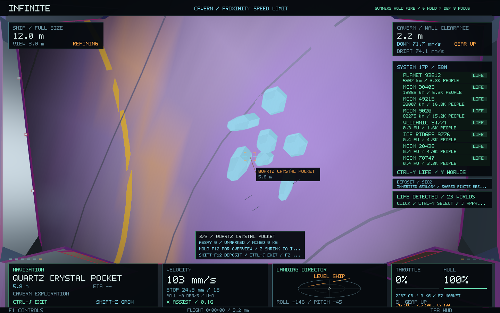
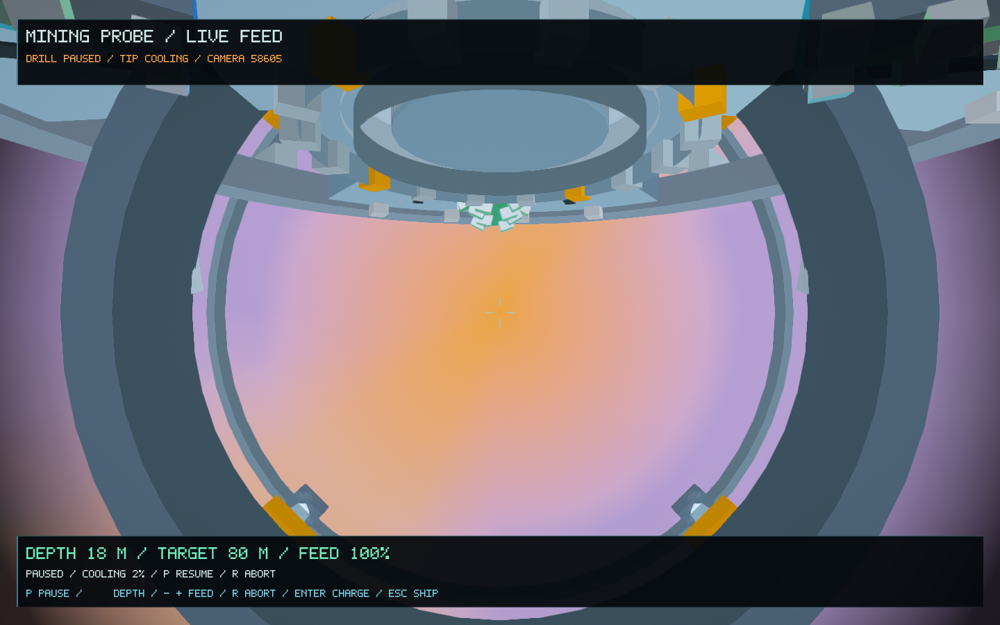
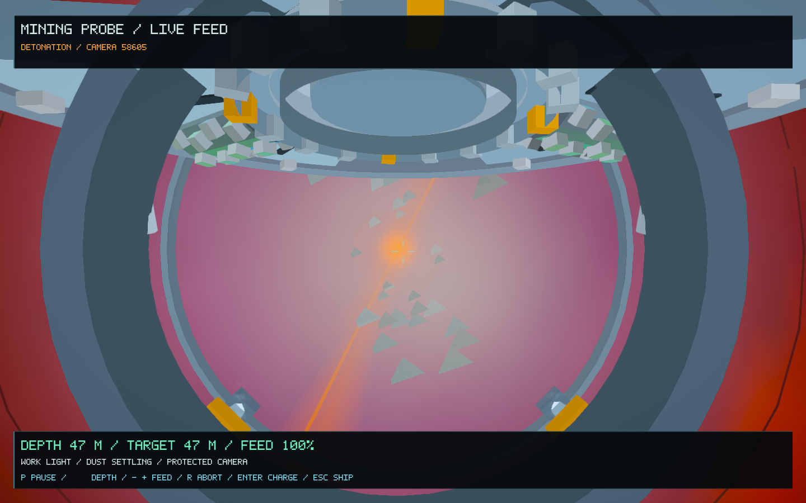

# Cavern geology, drilling and expeditions — 0.59.0

New probe excavations reveal three readable targets: exposed strata, a mineral seam and a crystal pocket. Their composition follows the existing planet's chemistry, temperature, sedimentation, plate-boundary fractures and cooling conditions. Bedding and vein patterns stay anchored in planet metres through navigation and magnification changes.

Crystal clusters have physical collision surfaces. Their visible facets use the same mineral habits as Infinity's existing crystal field: quartz, truncated cubic iron, orthorhombic olivine, hexagonal ice and layered graphite. The meshes and collision planes are checked against one another. Cold and chemical availability constrain which materials appear; launching another probe does not create a fresh resource pool.

## Drill a cavern

Fit a probe launcher through **F2 → Survey**, using an empty gun bay or trading its turret. A second empty bay can hold the mining head needed for later extraction. Auxiliary equipment needs an assigned, ready crew operator through **F9**.

| Control | Action |
| --- | --- |
| **Alt+[ / Alt+]**, aboard the ship | Choose the next probe's target depth, 40–120 m in 10 m steps. |
| **Ctrl-P** or the launcher's **Space** action | Launch at exposed solid land on a planet or moon. |
| **Alt-P** | Open or close the independent probe camera. |
| **P**, in the probe camera | Pause or resume drilling. A hot tip must cool below 65% before resuming. |
| **[ / ]**, in the probe camera | Adjust target depth; the target cannot move above material already cut. |
| **- / +**, in the probe camera | Adjust feed from 35% to 150%. Higher feed adds heat; a thermal cutout pauses an overheated drill. |
| **Enter**, in the probe camera | Arm an early detonation after at least 20 m of cover. The charge uses a 1.5-second fuse at the actual reached depth. |
| **R**, in the probe camera | Disarm and retract a cutting, paused or arming probe. The spent round remains consumed; an aborted drill leaves its narrow bore without blasting a chamber. |
| **Esc**, in the probe camera | Return to the parked player ship. |
| **Ctrl-J**, after the blast | Approach the entrance. From inside, show exit guidance for manual flight through the shaft. |

The camera, cutter, heat, particles, excavation shape and blast damage all follow the saved drilling timeline. Pausing does not advance the tip or silently run down a fuse. Depth changes retain a compatible ready shaft while updated geometry builds on a worker; a chamber from another depth is never substituted. Shaft material colours stay at their physical depth as cutting progresses.

The command history is bounded and reserves a final safe-abort slot. Probe rounds, completed excavations and histories persist through restarting.

## Inspect, mark and extract

1. Enter a completed new cavern. **Shift-F12** cycles its three deposits and points the HUD at the selected physical location.
2. Face the deposit and hold **F12** for an overview. A navigator's condition and skill affect work time.
3. Shrink below **12 mm hull length**, stop near the exposed face and hold **F12** for a close assay. Close inspection is checked using physical ship size, position, speed and facing. Camera magnification alone does not qualify. Tiny ships retain the existing fragility rules.
4. Press **Ctrl-F12** to mark the assayed material. Move into the chamber's open centre before **Shift-Z** restores full size.
5. With a mining head fitted and operated, hold **Ctrl-Space** while stopped at full size. The cutter needs a clear line to the selected mark; rock, crystals and intervening ships can obstruct it.
6. Sell the actual cargo through the existing goods market, or deliver an assay sample to its issuer.

Extraction takes from the same canonical surface reserve used by existing prospecting. Depletion is shared between surface work, multiple deposits and multiple excavations in that region. Established depleted reserves do not refill. Deposit assay grades, marks and extracted quantities stay with the saved excavation.

The cavern readout shows the selected material, assay grade, mark and mined kilograms. Its deposit formula replaces the surface weather readout underground, and distant world labels yield to the local inspection target. Existing universe navigation remains available.

## Funded cavern-assay jobs

**F2 → Survey** includes a **CAVERN ASSAY** offer for an existing solid world. Accept it, use **F4** to target that world, then obtain a fresh close assay, mark the material and extract at least 10 kg after acceptance. Return to the issuing port with the material and claim the contract through its Survey row.

Acceptance reserves the issuer's reward in escrow. Completion transfers **10 kg** from player cargo into the port's stock and pays the reserved **1,200 CR** once. The existing contract cancellation path returns unused escrow to the issuer. Port access, warehouse space and player balance limits remain checked.

The original three survey offers retain their identities. The added assay offer uses a separate deterministic ID, and existing saves receive it without replacing their earlier jobs.

## Preservation and verification

Universe generators, addresses, planet geometry, seeds, histories, orbits and atomic structures are unchanged. Excavation geometry and discovery records remain a saved gameplay overlay. The existing controls for ship flight, shrinking, crew and exploration remain available.

Exploration saves now write version 5 and read versions 1–5. Probe saves write version 2 and read versions 1–2. Old excavations retain their geometry version; new colliding crystal pockets are not inserted into an occupied legacy cavern on load. Existing wallets and economic-network saves keep their formats.

- **60 core regression tests passed**, including cross-scale and restart checks, ship handling, mining, crew, economic conservation and shared depletion.
- **429 focused cavern checks** cover all five mineral habits, facet/collision agreement, deterministic generation, continuous control timelines, oblique impact cameras, cooling, early blast position/damage, safe aborts, bounded control history, asynchronous mesh fallback, shared finite extraction, paid sample handover and save migration. The original **117 probe** and **561 presentation** checks also pass.
- **16 native Metal views** cover refitting, approach, cutting, fuse, blast, beacon, entrance, full-size chamber flight, portrait feed, portal visibility, crystal inspection, pause, changed depth/feed, early detonation and safe retraction. Runtime text checks found zero overlaps.
- **12 native UI layouts** check the expanded controls guide, small/portrait/Retina screens, crowded notifications, crew and market panels, probe telemetry, contact selection and unchanged navigation.
- The packaged **0.59.0 / build 71** app passes signature verification and an isolated normal-startup check.

Evidence: [focused checks](cavern-expeditions-0.59/focused-tests.log), [regressions](cavern-expeditions-0.59/regressions.log), [native drill views](cavern-expeditions-0.59/native.log), [image checks](cavern-expeditions-0.59/image-checks.txt), [UI checks](cavern-expeditions-0.59/ui-checks.txt), [signed startup](cavern-expeditions-0.59/startup.log).
