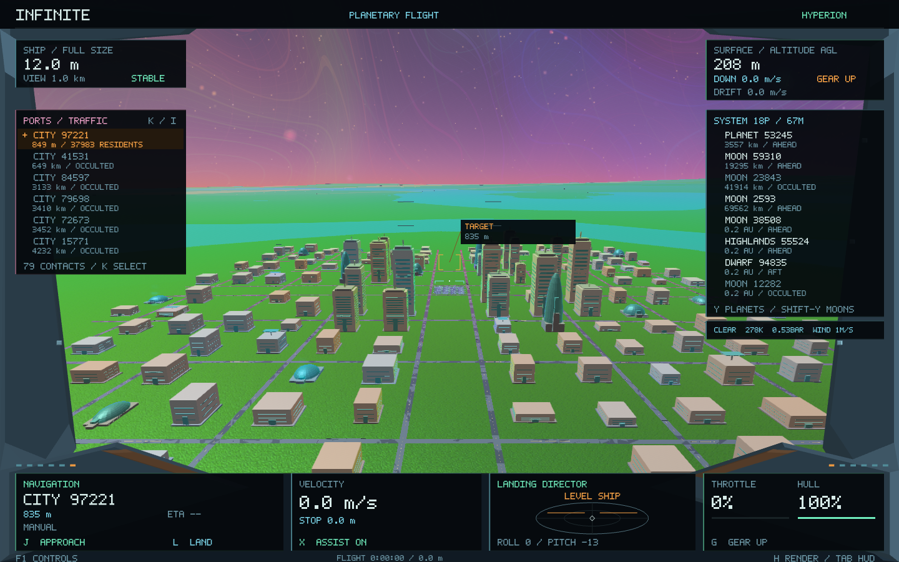
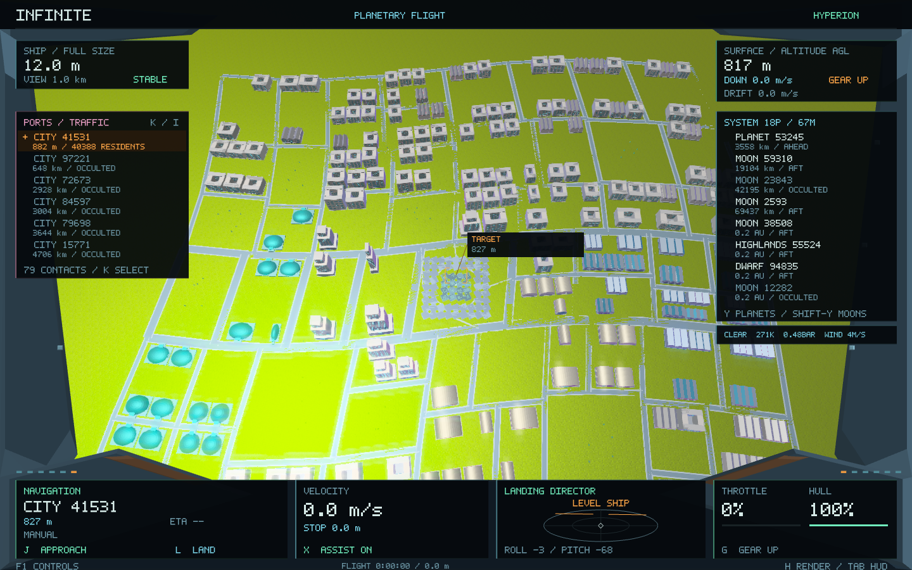
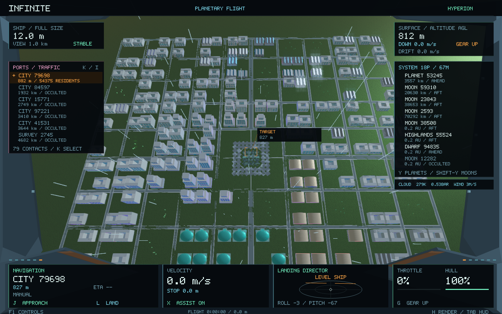
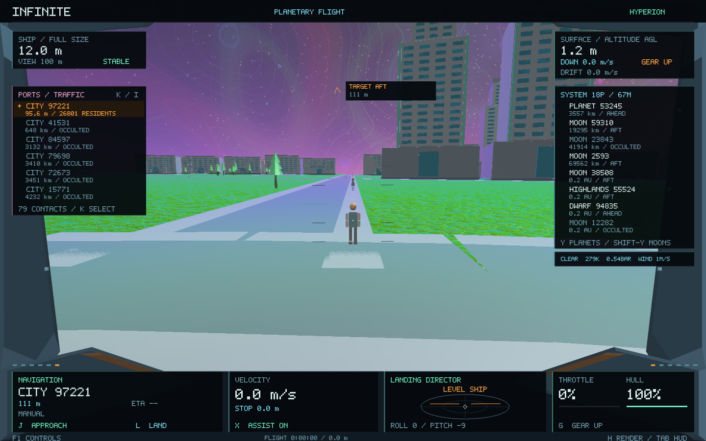
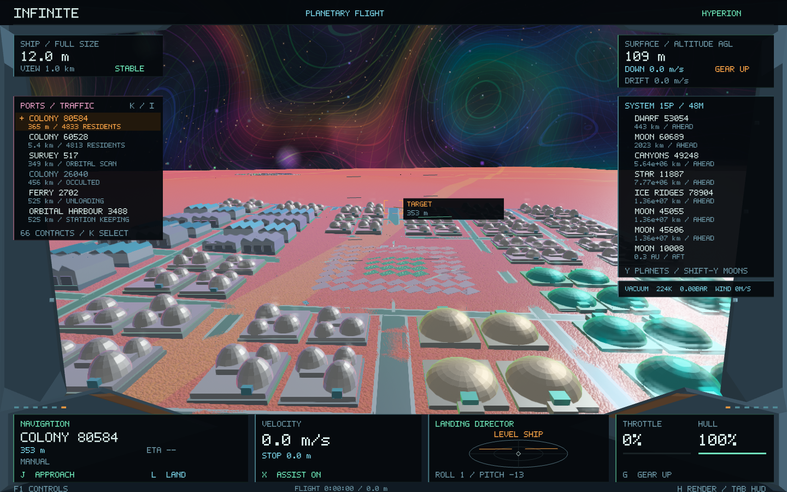

# Research-led city generation — Infinite 0.20

This release replaces the common square-lot appearance of 0.19 settlements with a connected urban model: street graph → accessible parcels → functional districts → architecture → pedestrian routes. It preserves the existing planets and the original surface-site selection. **Shift-K**, **J**, **L** and **Enter** still select a surface port, approach, land and launch.

## Audit and research

The 0.19 generator placed buildings on a repeated 15×15, 9×9 or 5×5 grid. Roads were drawn separately, without an explicit connectivity or frontage model. Building types often came from parcel-number tests, towers occupied a central distance band, and every resident used the same small loop around the landing area. Terrain sampling, foundations, deterministic seeds, surface eligibility and asynchronous caching were useful foundations and are retained.

Three primary research sources informed the new implementation:

| Research | Applied here |
| --- | --- |
| Chen, Song & Ortner, [Hierarchical Co-generation of Parcels and Streets in Urban Modeling](https://repository.sutd.edu.sg/esploro/outputs/journalArticle/Hierarchical-Co-generation-of-Parcels-and-Streets/9912329509846), 2024 | Treat streets and parcels as coupled data. Organic layouts use hierarchical block subdivision; every accepted building has frontage on a street reachable from the port. This is a bounded implementation, without the paper's global optimization stage. |
| Chen et al., [Interactive Procedural Street Modeling](https://www2.cs.uh.edu/~chengu/Publications/streetModeling/street_sig08.pdf), 2008 | Distinguish street hierarchy and combine regular, radial and terrain-related directions. Infinite uses explicit patterns, smooth deformation, slope alignment and terrain-cost alternatives; it does not implement the paper's interactive tensor-field editor. |
| Müller et al., [Procedural Modeling of Buildings](https://doi.org/10.1145/1141911.1141931), 2006 | Separate architectural massing from façade detail and apply context-sensitive rules. Here, typed massing rules produce housing courts, setbacks, vaulted halls, row-house roofs, sheds and linked pressure habitats. There is no general CGA parser. |

The existing Hyperion game's `src/flight/settlements.cpp::facility`, `domeFrame`, `roofUnit` and port-access treatment were also inspected for the visual vocabulary of glazed modules, equipment, contrasting trim and grounded facilities. Its world simulation is not imported. New structures use Infinite's existing Original, Hyperion and Hybrid rendering paths.

## City structure

Four morphologies share a stable landing anchor:

- **Planned:** clear avenues, local streets and regular blocks, suited to newer colonies and organized construction.
- **Radial:** polygonal rings and spokes with a middle ring boulevard, producing wedge-shaped blocks and a recognizable civic approach.
- **Organic:** recursive block splits create unequal blocks and T-junctions. The older district receives finer grain, while subsequent development has larger blocks. A smooth deformation softens alignment while keeping shared street intersections.
- **Contour:** the street frame follows the local terrain's cross-slope direction, with narrower transverse spacing. Mining outposts favor this form. Actual road candidates still pass slope and water checks.

Street links carry a class, width, stable identity and physical geometry. Avenues are 16 m wide, local streets 8 m and pedestrian links 2.5 m. Candidate paths test the real geological height field at roughly 10 m spacing, try bounded lateral alternatives and reject wet or overly steep construction. The maximum tested grade is 18%. Unreachable components are removed, and shortest paths from the port provide a measure of access.

Parcels come from connected block boundaries. Streets split at T-junctions share junctions and logical edges. A parcel must fit its block, respect the actual road corridor, avoid another parcel, remain dry and meet the existing foundation constraints. Frontage determines building orientation; building positions are no longer independent of the road layout. The reserved landing footprint stays clear.

## Districts, growth and architecture

Each city has a seeded municipal founding age and districts for civic functions, commerce, housing, industry and agriculture. District ages describe stages of local development rather than changing the planet's geological history. Access and distance from the commercial centre influence floor count and the skyline. Where an atmosphere has prevailing wind, industrial districts favor its downwind side. Protected settlements use pressure habitats and enclosed agriculture; open-city vegetation uses the existing temperate-world eligibility rule.

Architectural forms follow function:

- Housing uses perimeter courts, row houses or linked protected habitats.
- Commercial concentration supports stepped towers with podiums and upper setbacks.
- Civic facilities use large vaulted halls or protected domes.
- Industry uses loading sheds and sawtooth roof forms.
- Agriculture uses greenhouses; streets and parks receive appropriate trees, lamps, benches or solar equipment.

Massing remains identifiable at every detail level. Windows, entrances, coping, roof sections and equipment add close detail through shared GPU templates. Repeated elements form façades and modules rather than unrelated random ornaments. Foundation heights still use the original terrain; no city flattens or replaces a landscape.

Population now derives from residential floor space, with mixed housing/commercial occupancy where appropriate. Jobs are recorded separately for non-residential uses. Building counts, functions, populations and layouts intentionally develop from 0.19; settlement identity and location remain stable. Nearby previous building IDs are retained where possible, while additional parcel identities include their block, street and ordinal.

## Streets and inhabitants on real terrain

Asphalt and pavement strip vertices are sampled from the authoritative terrain field. They are stored as metre offsets from a double-precision road origin, then transformed after double-precision camera subtraction. This avoids the raised edges caused by scaling a flat box across sloping ground. Paving is batched into a small transient mesh using existing shaders, without a separate render-target family.

Road paths are simplified only after dense grade/water testing, with a 4.5 cm geometric tolerance. Pedestrian routes retain their bends and crossings, with a 2.5 cm simplification tolerance and at most 40 stored points per building. These points use local metre coordinates so their precision does not depend on planetary distance.

Residents retain deterministic IDs and homes. Their bounded local walks now start at their home's frontage and follow the connected street network, using curb routes and junction crossings. Paths respect parcel clearance. Weather sheltering and the saved activity clock remain in use. This is ambient city life, without a new traffic economy, interiors or a full daily-schedule simulation.

## Compatibility and budgets

The universe/population/terrain recipes remain **3 / 1 / 1**, and climate/society remain **1 / 1**. A separate **city layout recipe 1** refines the original site results only after site selection has finished. This prevents a changed city radius or building count from moving later settlements.

`tests/data/surface-sites-0.19.txt` preserves 62 actual settlement anchors across four systems: addresses, world descriptors, names, seeds, kinds, protection, landing positions, orientations and radii. Existing activity-slot identities remain valid. The 120-record universe descriptor/geometry snapshot, original navigation and galaxy-to-lattice checks remain part of validation. Natural geometry and procedural histories are not rewritten.

City generation runs in the existing cancellable asynchronous surface cache. The **4 MiB cache**, two-job limit and shared oneTBB runtime are unchanged. Each city is bounded to 240 buildings; the frame still limits ordinary surface instances to 6,000 and samples at most 96 residents per nearby settlement. Source templates remain shared across all cities. No new dependency or shader compiler requirement is added.

Branch `checkpoint/infinite-0.19-before-city-research` retains the baseline. A terrain that cannot support a valid connected refinement retains its previous settlement layout and landing anchor.

## Verification and reproduction

```sh
cmake -S . -B build -DINFINITE_GPU_TESTS=ON
cmake --build build -j 4
ctest --test-dir build --output-on-failure
build/infinite_city_tests --svg build/city-plans
build/infinite --surface-test --capture-dir build/city-demo/captures --profile build/city-demo/frames.csv --data build/city-demo/data
```

Native GPU tests require an active desktop. CPU-only builds can leave `INFINITE_GPU_TESTS` disabled.

The structural tests cover all four morphologies, graph connectivity, hierarchy, unique IDs, street frontage, mixed uses, architectural variety, ground-fitted pavement, pedestrian clearance, deterministic regeneration and the clear landing approach. Site and universe preservation have separate snapshots. Native captures compare all three display modes with matching cameras, terrain and full city-data fingerprints.

Research notes, generated plans, screenshots and measured release results are retained in [city-generation](city-generation/).

## Release results

All **37 tests passed** in **300.85 seconds**. The city test performed 24,041 topology, frontage, clearance, determinism and preservation checks across all four layouts. Surface/weather tests passed 59,831 checks. All **62 surface-site anchors** and **120 pre-expansion universe records** remained exact. The native suite also passed its galaxy-to-atomic round trip, seamless flight, landing and nine-scale render-mode checks.

A final five-test city/surface/native run passed after extending the read-only preservation fingerprint to cover every scene field, including districts and parcels. The signed 0.20 application contains the same 31 code/data sections as the tested executable and was reopened successfully at the saved, shrunken-ship flight without repositioning it.

The seven-view city/weather tour generated **21 native images** at **1440 × 900**. Every mode retained its scene geometry, camera and full city-data fingerprint. Actual settlements on the comparison planet include planned, radial and organic forms; [the four SVG plans](city-generation/plans/) separately illustrate all four forced morphology variants at one unchanged test site, including contour planning.

Measurements use the same Metal backend and VSync setting on this Mac. The city-approach scene has the same planet, landing anchor, camera and weather. The complete tours differ: 0.19 visits five views, while 0.20 visits seven, including two additional cities. These are individual validation runs, not repeated throughput benchmarks.

| Measurement | 0.19 baseline | 0.20 |
| --- | ---: | ---: |
| Whole-tour median frame | 16.664 ms | 16.666 ms |
| Whole-tour p95 frame | 17.804 ms | 17.376 ms |
| Recorded frames | 1,534 | 2,220 |
| Peak process RSS | 134.72 MiB | 144.39 MiB |
| City-approach visible buildings | 158 | 166 |
| City-approach visible residents | 72 | 74 |
| City-approach surface triangles | 68,604 | 135,925 |
| Eight-site world surface data | 0.843 MiB | 1.547 MiB |
| Surface templates uploaded at city approach | 123.3 KiB | 400.9 KiB |

The median remains near 60 fps with almost twice the surface triangles in the comparison approach. The additional street graph, parcels, districts and walk routes consume roughly 721 KiB for this eight-site world, within the unchanged 4 MiB surface-cache budget. Across the longer final tour, uploaded surface templates peak at 529.2 KiB; all CPU mesh templates total 710.7 KiB.

The short Hyperion city-approach intervals contain 15 frames each: median **16.668 → 16.587 ms**, with maximum/p95 **70.262 → 58.656 ms**. These intervals include screenshot readback synchronization and mode changes, so their tails are not representative of ordinary flight. The different tour lengths also prevent attributing the RSS change solely to cities. Raw frame CSVs and [validation.json](city-generation/validation.json) retain the sample boundaries and caveats; no causal speedup is claimed.

The baseline checkpoint remains available. Source hashes confirm `Core`, `Universe`, `Processes`, `Terrain`, `Crystallography`, `Geometry`, `Navigation`, `Streaming` and `Weather` are unchanged from that checkpoint. City layouts, architecture and population intentionally change; existing site IDs, landing anchors, terrain and natural universe structures remain intact.

### Same approach, before and after




### Other city forms and street life









These are bounded settlements, with procedural founding ages and functional districts rather than a simulated economy or ongoing city growth. Building collision retains the existing conservative bounds. Courtyards and façade openings are architectural detail; interiors and courtyard landing are not introduced by this release.
