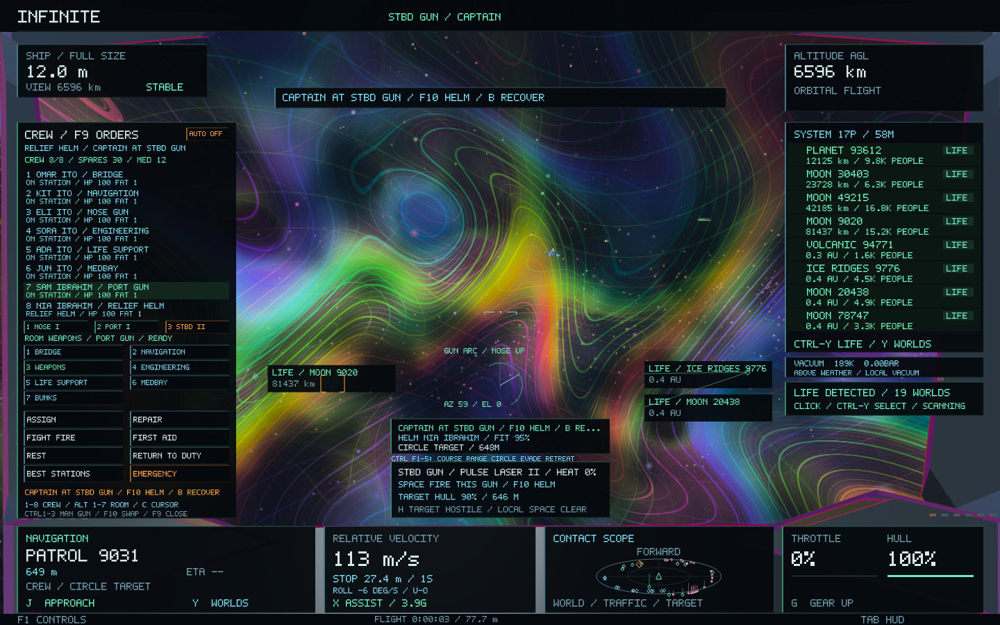
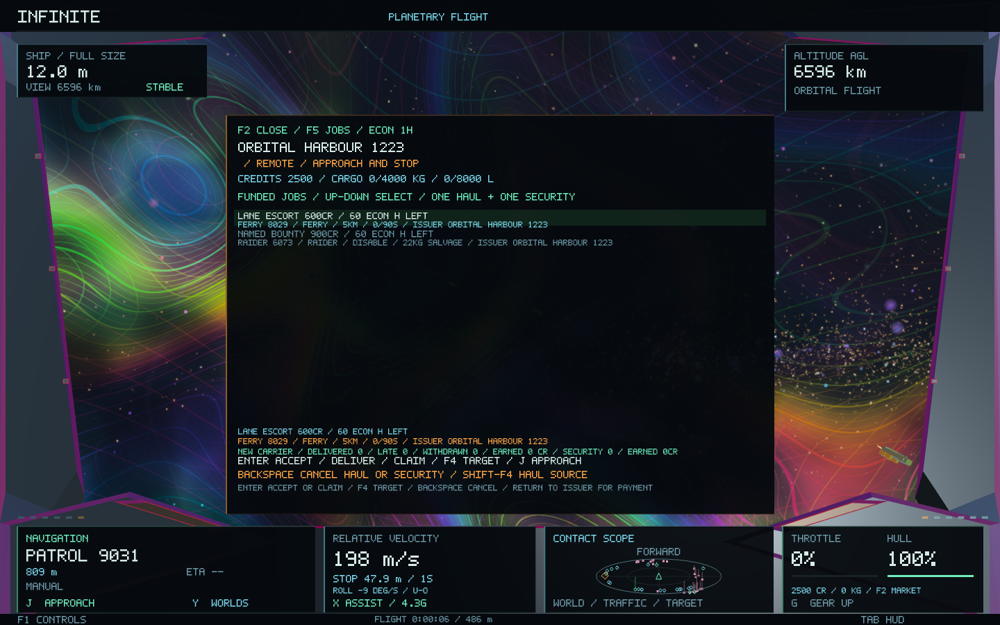
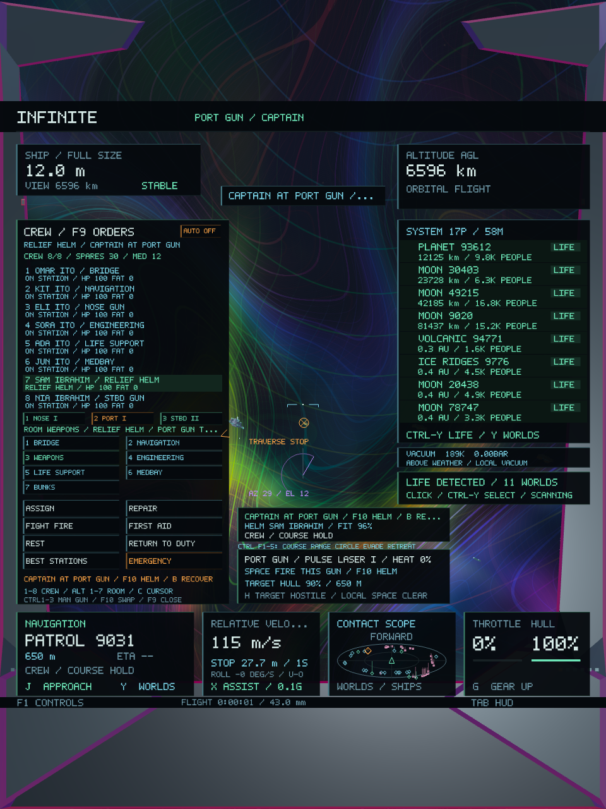

# Crew combat operations — 0.51

This release adds the three requested layers in order: crew combat piloting, distinct gunner views, then funded security contracts. Infinite's universe generators, seeds, scientific geometry, hierarchical addressing and object identities remain unchanged. Ordinary captain flight still uses the restored manual controller.

## 1. Give the relief pilot combat orders

Fit at least two weapons, staff a gun in **F9**, and use **F10** to exchange places with that gunner. The person walks to the bridge before receiving the helm. Select a contact normally, then issue an order from the gun station:

| Control | Order |
| --- | --- |
| 1 / Ctrl+F1 | Hold the captured course or continue the existing approach |
| 2 / Ctrl+F2 | Hold distance and match the selected contact's velocity |
| 3 / Ctrl+F3 | Circle the contact with the occupied side gun facing inward |
| 4 / Ctrl+F4 | Make an evasive break around the contact |
| 5 / Ctrl+F5 | Retreat from the contact |
| F10 | Return to the helm |
| B | Return to the helm and brake |

Close F9 to use the number keys for pilot orders; with F9 open they retain crew selection. Ctrl+F1–F5 also work while the console is open.

Bridge experience, health, fatigue, morale and compartment condition determine the relief pilot's readiness. Readiness affects acquisition delay, heading response and manoeuvring speed. A capable relief pilot adds an evasive break when the hull takes damage. Hull below 30% triggers retreat. A missing or disabled target falls back to course hold, with a visible explanation. Target selection and gun aim never change a universe identity or teleport the physical ship.

Combat orders supply a velocity and attitude in the contact's physical SI reference frame. The existing flight controller still provides thrust, inertia, gravity, terrain collision and frame changes. A low-altitude guard removes commanded downward velocity inside the stopping envelope. Combat orders pause an existing approach; 1 / Ctrl+F1 can resume it. Manual controls, ship dimensions and the save representation of physical flight remain intact.

## 2. Use the individual stations

The port gun opens looking 60 degrees to port; starboard opens 60 degrees to starboard. Both retain the physical four-metre, hull-size-scaled muzzle offset. The nose gun looks forward.

| Station | Azimuth limits relative to the hull |
| --- | --- |
| Nose | −60° to +60° |
| Port | −150° to +30° |
| Starboard | −30° to +150° |

Elevation remains ±70°. Mouse/arrows aim the occupied gun and **Space** fires only that mount. The new compass shows the hull nose, permitted arc and current gun bearing. A traverse-stop warning appears at the limits. The station card keeps the named relief pilot, readiness and current order visible. Port instrumentation uses a violet accent; starboard uses mint.

The existing colourful renderer, independent gun camera, weapon obstruction tests, thermal state and cockpit motion are retained. There is no projectile lead indicator because these lasers trace an instantaneous ray.

## 3. Fly security contracts

Open **F2**, cycle **F5** to **Jobs**, select a security offer, and press **Enter**. Offers are funded from an existing orbital port's cash before acceptance. Only one security job can be active, alongside the existing hauling job. Accepting or cancelling works remotely within the system; claiming requires the existing physical port access rules.

- **Lane escort:** target an existing civilian merchant ferry with **F4**. Protect it within 5 km for 90 seconds of nearby flight. The ship must be full size, airborne and outside cruise/the travel field. Nearby raiders can attack the protected civilian and retaliate when the player damages them. Civilian damage enters the same persistent hull/wreck ledger used by the player's weapons. Leaving for more than 30 seconds after protection starts, losing the civilian, losing the player ship, cancelling or missing the deadline fails the job and refunds its issuer.
- **Named bounty:** **F4** selects the existing named raider. Disable it with the player's weapons after acceptance. An old wreck, another contact or an unattributed report does not fulfil the job.
- **Return and claim:** completion marks the objective ready; the reward is retained in escrow. Use **F2 → Jobs → F4** to target the issuing port, berth there at full size and below 3 m/s, then press **Enter** on the claim. Bounties also recover **20 kg alloy and 2 kg electronics** into the player's hold. A full hold delays the claim without losing reward or salvage. The finite receipt cannot be claimed twice.

The HUD displays escort progress or bounty/claim status. The saved Outcomes page records payments and the completed task. Damage and crew injuries continue through the existing repair, medical, staffing and supply systems; there is no separate replacement economy.

Wallet and ledger version 8 append security ownership, progress, receipts and statistics. Older versions remain readable. NPC and weapon save formats remain unchanged. Security state stays on the existing cancellable economy worker; only bounded telemetry and immutable snapshots cross to the flight/render thread.

## Validation

Baseline checkpoint: `842b5db`. Eight focused existing crew/combat/economy suites passed before edits. New tests exercise funded escrow, physical escort timing, abandonment and death, named bounty attribution, old wreck rejection, deferred payment, salvage capacity, duplicate claims, conservation, malformed saves, version-seven migration and SQLite restart. Station tests cover physical movement, order feedback, critical-hull retreat, gun traverse, authority loss and portrait/wide HUD fit. NPC tests exercise attacks on a protected civilian and persistent damage.

All **51 Infinite core tests passed**, including galaxy-to-atomic round trips, deterministic processes, restored handling, crew, equipment, contracts and persistence. The two affected HUD suites passed again after the visual correction. Four native station/NPC gameplay and image checks passed; the station fixture was rerun after reserving the arc display against contact labels and correcting capture timing. The extended station fixture contains twelve captures, including both side stations, portrait layout, three crew manoeuvres and the funded security board.

**201 existing source and shader files match checkpoint `842b5db` byte for byte.** The preservation manifest includes all universe generators, scientific geometry, hierarchy, addressing, seed implementations and existing GPU shaders. Unrelated concurrent Dune/Ellipsoid work is excluded from this checkpoint.

The signed macOS package matches all 28 tested code/data sections. The app was reopened with the existing saved flight, and its live Jobs page displayed the new funded escort and named bounty offers.

[Core results](combat-operations-0.51/core-tests.log), [HUD regression results](combat-operations-0.51/visual-regression-tests.log), [native results](combat-operations-0.51/native-tests.log), [final station images](combat-operations-0.51/native-visual-final.log), [preservation hashes](combat-operations-0.51/preservation.json).

