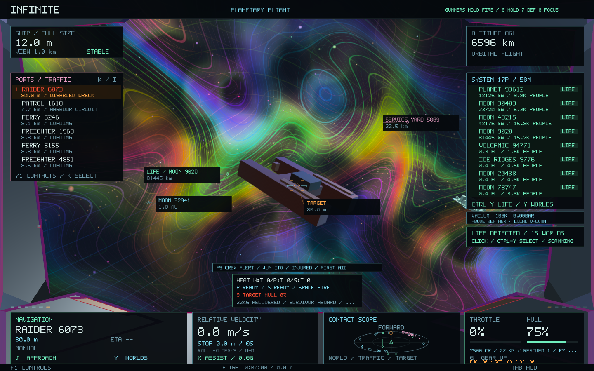

# Combat and recovery audit — 0.52.1

This update reduces frame-thread work in the 0.52 gunner and recovery systems. Universe generators, seeds, geometry, shaders, ship handling and save formats are unchanged.

## Corrections

Gunner acquisition remains bounded to 128 candidates, but the final shot now checks **every supplied nearby hull**. Previously a friendly ship beyond candidate 128 could be omitted from the obstruction test. Recovery also checks nearby ships in addition to the existing terrain and mesh obstruction tests. A ship passing between the player and the wreck interrupts recovery progress.

Autonomous firing checks its intended target against the final muzzle trace before consuming heat, cooldown or a shot. Friendly ships, other hulls and geometry still block fire. Manual weapon behavior remains the same.

## Optimisations

- Hold, inhibited, unmanned and reloading mounts return before copying or scanning contacts.
- Acquisition uses bounded stack arrays containing contact references and SI deltas, excluding presentation/economic strings. Eye/frame conversions are shared across mounts and contacts from the same planet. Already shared reference frames use their existing SI coordinates directly.
- The authoritative shot trace also performs the intended-target safety check, eliminating a second terrain/mesh trace.
- Weapon tracing reads contacts by reference and copies only the winning hit. Home-frame conversion is lazy and uses the identity when the ray and contact already share a frame.
- Idle recovery keeps range and speed instruments live. Access tracing runs while the recovery key is held, and is repeated throughout every actual recovery attempt.

There are no persistent contact caches, new worker threads or allocations proportional to the universe. The temporary gunner arrays are bounded to 128 entries; no contact identities are changed.

## Measurements

CPU microbenchmark on this Mac, Release `-O3`, baseline `ebe984a`. Three alternating runs per executable, each containing eleven batches of sixty updates; figures below are the median of the three run medians. Setup, damage-history construction and CSV output are outside the measurement. These are synthetic bounded-contact workloads, **not whole-game FPS measurements**. The existing game and other desktop work could affect timing.

| Workload | Before µs/update | After µs/update | Reduction |
|---|---:|---:|---:|
| Hold: 128 contacts / 2048 damage records | 1851.420 | 0.167 | 99.99% |
| Defend: 128 contacts / 128 damage records | 852.012 | 103.723 | 87.8% |
| Focus: 128 contacts / 128 damage records | 183.057 | 8.907 | 95.1% |
| Weapon trace: 128 contacts | 48.482 | 5.159 | 89.4% |
| Idle recovery beside a wreck | 12.051 | 0.169 | 98.6% |

Measured `operator new` calls per update fell from **9197.8 to 27.5** for Defend, **1679.4 to 27.5** for Focus, and **856 to 25** for a trace. Counts include temporary argument construction in the benchmark harness and occasional shot/status creation. Firing masks and nearest-hit checksums match across all before/after runs.

Raw measurements and reproducibility metadata: [comparison.json](combat-performance-0.52.1/comparison.json), with three before/after CSV pairs in the same folder. Reproduce the current implementation with:

```sh
cmake --build build --target infinite_combat_benchmark
./build/infinite_combat_benchmark
```

The benchmark source is `tools/CombatBenchmark.cpp`. Rebuild that same source against the baseline core to compare revisions; the retained baseline executable used for these results was linked before the runtime changes.

## Validation

All twelve relevant regression suites pass, including component damage and persistence, real crew stations and exchanges, NPC combat, finite salvage/rescue and economic conservation, portrait HUD layout, restored handling/roll, galaxy-to-atomic round trips and restart continuity.

New cases verify that rejected autonomous shots consume no heat, cooldown or damage; a friendly contact beyond candidate 128 still blocks fire; equivalent planet/system frames preserve firing cadence and obstruction decisions; intervening ships stop recovery; and release resets progress. [Test results](combat-performance-0.52.1/final-tests.log).

AddressSanitizer and UndefinedBehaviorSanitizer also pass for the modified FireControl, Weapons and Recovery translation units and combat-operations test driver (the remaining core library is the normal Release build). [Sanitizer results](combat-performance-0.52.1/sanitizer-tests.log).

Both native checks pass across ten captured stages: gunners, targeted engines, crew damage/repair, wreck approach, six-second recovery, cargo/survivor transfer and port handover. The native test executable matches the packaged build. [Native checks](combat-performance-0.52.1/native-tests.log), [capture hashes](combat-performance-0.52.1/captures.json).

**220 runtime source/header/shader files are byte-identical to the baseline.** [Preservation manifest](combat-performance-0.52.1/preservation.json). The signed 0.52.1 / build 59 app matches all 28 tested Mach-O code/data sections. [Package verification](combat-performance-0.52.1/package.json). The existing normal saved flight is left untouched; the updated package takes effect on the next launch.


