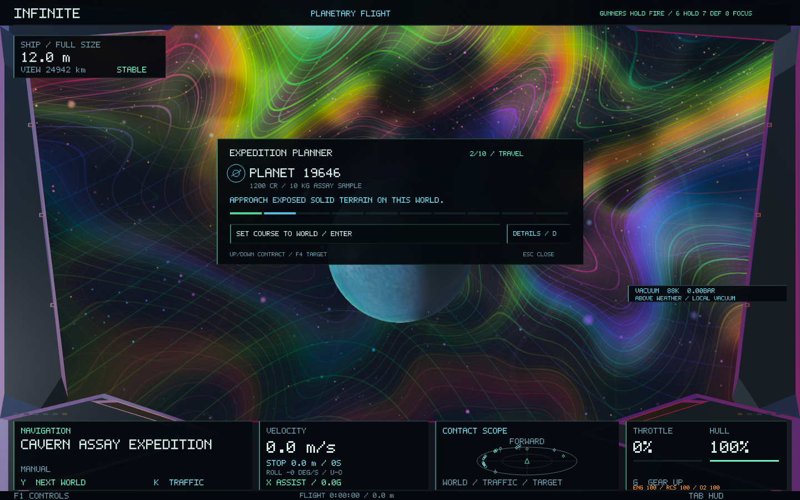
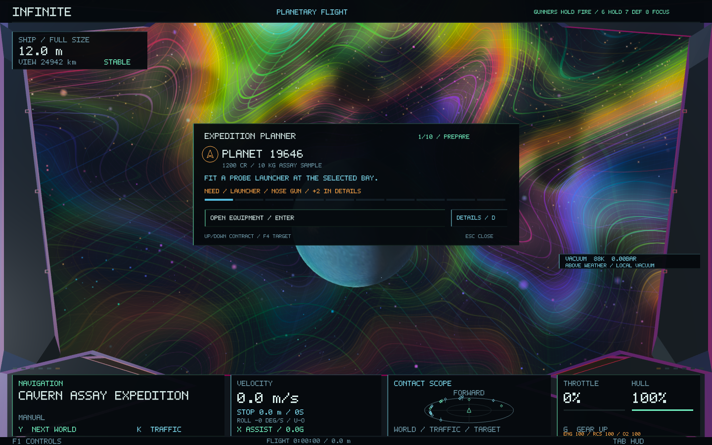

# Compact mission card — 0.60.2

**F3** now opens a mission card showing the destination, current instruction, a thin progress strip and one primary action. The quiet travel card measures **660 × 226 logical pixels**, compared with the previous **1040 × 576** panel on desktop. It grows to fit longer instructions, warnings and command receipts.

Healthy equipment and crew checks are omitted from the summary. Preparation shows the first missing requirement and a count of further issues; drilling shows its actual phase, depth and tip heat; tiny-ship work shows physical size and fragility; return and delivery show the real sample cargo. On the return leg, the heading changes to the issuing port. Acknowledgements and failed orders have their own measured space above the action.

**Enter** follows the primary action, **D** opens the full diagrams and setup controls, **Up / Down** or the wheel changes contracts, **F4** targets the current objective, and **Esc / F3** returns to flight. Manual work is labelled **Return to flight**; its instruction retains the relevant work control. All existing planner and expedition features remain in Details, with the existing saved view preference.

The view is a read-only summary of existing mission data. World generation, seeds, identities, geometry, flight controls and economic rules are unchanged. The full visual planner remains available under Details.

Tests cover the entire contract-to-delivery lifecycle, missing requirements, paused drilling, sample cargo, preference compatibility, long receipts, five aspect ratios, normal/probe HUD layers, vector bounds, text overlap and a compact-view text budget. **18 native captures** cover both views, both portrait layouts, real sample handover and unchanged navigation/world identity. Five targeted regression tests also pass.

Evidence: [planner checks](compact-planner-0.60.2/focused-tests.log), [regressions](compact-planner-0.60.2/regressions.log), [native layouts](compact-planner-0.60.2/native.log), [image checks](compact-planner-0.60.2/image-checks.txt), [signed startup](compact-planner-0.60.2/startup.log).
