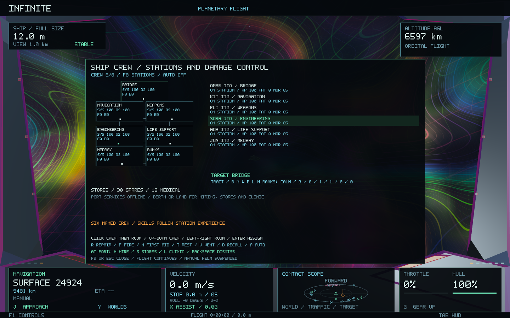
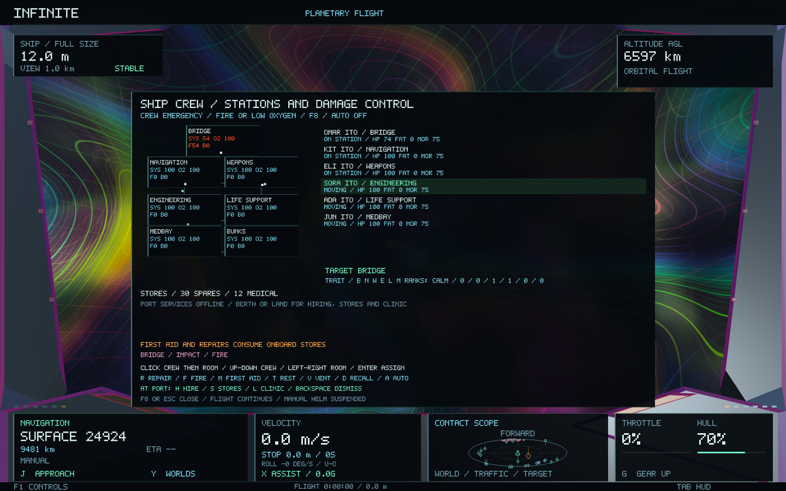
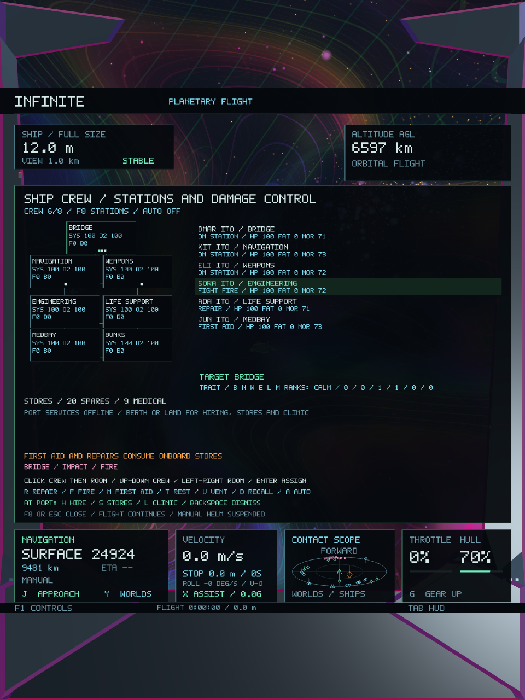

# Player ship crew — Infinite 0.46

Six named crew join the existing player ship, with room for eight. **F8** opens a live crew deck with a compartment schematic, moving crew tokens, roster, health, fatigue, morale, station skills, stores and incident reports. The player remains the captain and flies the ship directly. The external hull, restored manual handling, roll, universe generators and every scientific scale remain intact.

The design takes its broad emphasis on ship emergencies and crew choices from [Subset Games’ FTL](https://www.subsetgames.com/ftl.html), and distinct onboard roles from [MicroProse’s B-17 Flying Fortress](https://store.steampowered.com/app/2000800/B17_Flying_Fortress_The_Mighty_8th_Redux/). Infinite uses its own names, rules, deck diagram and native vector UI. Its seven abstract compartments are a crew-management simulation, rather than a new walkable 3D interior or a replacement for the ship mesh.

## Stations and orders

| Station | Crew contribution |
| --- | --- |
| Bridge | Copilot coordination speeds movement between jobs. The player retains the helm. |
| Navigation | Additional crew coordination improves response travel time. |
| Weapons | Staff skill, health, fatigue and morale improve actual laser reload/cooling; leaving the station removes its bonus. |
| Engineering | Automatic repairs and firefighting; repairs consume onboard spares. |
| Life support | Staff improve pressurisation; the specialist can assist damage control. |
| Medbay | The medic automatically travels to injured crew for first aid, consuming medical stores. |
| Bunks | Relief crew rest here, recovering fatigue. |

Click a crew row, then a room to assign a station. **Up/Down** selects crew; **Left/Right** selects a room; **Enter** assigns the selected crew member there. Assigning an occupied duty station swaps the previous occupant into the selected member’s old duty. Orders preserve current movement: a reassigned person finishes their current corridor before taking the new route.

While the crew deck is open: **R** repairs the selected room, **F** fights its fire, **M** gives first aid in it, **T** sends the selected person to rest, **V** opens/seals its vent, **D** recalls everyone to their assigned duties, and **A** toggles automatic orders. Automatic damage control uses engineering/life-support crew, leaving other stations to work; the medic follows casualties, and exhausted crew take rest. Existing jobs finish even if automatic dispatch is switched off. **F8/Escape** closes the deck. Manual helm and firing input are suspended while managing crew; the ship, hazards, autopilot and combat continue.

Crew physically traverse a connected compartment graph, taking several seconds per corridor. Routes consider fire and low oxygen. Healthy, rested and experienced crew work more effectively. Calm, agile and hardy traits affect stress, movement and injury tolerance. Skills have three ranks and improve through work; gunnery practice requires firing. Wounded crew below 20% health cannot perform jobs. Stationary casualties can receive first aid from someone in the same compartment.

## Damage control and survival

Actual hull losses from incoming fire or flight incidents allocate deterministic internal damage, injuries and sometimes fires/breaches. The allocation has a separate ship incident counter; it does not change any universe seed or object identity. Repairs to the external hull do not retroactively injure crew or repair internal systems.

Fires consume oxygen, damage systems and injure nearby crew. Breaches leak air. Venting can starve a fire but also endangers anyone inside; sealing the vent allows an intact life-support system to repressurise the room. Engineers patch breaches before restoring system integrity, spending one spare per five repair points. First aid spends one medical unit per twenty health points restored. The ship starts with 30 spares and 12 medical units, capped at 100 and 50.

At zero health a crew member is lost. Shore treatment does not revive them; a new paid recruit can fill the vacant berth with a new identity. Incident history is bounded and retained in the crew save. The player’s own control remains available even if support crew are lost.

Healthy unmanned weapons retain ordinary manual operation. Crew weapon readiness ranges from 65% to 120%, depending on compartment damage and the working gunner; it changes servicing speed, without auto-aim or automatic firing. No crew modifier changes thrust, steering, roll or coordinate magnification. Crew, stores and compartments travel with the ship through cruise and shrinking.

## Port services and saves

At a connected, full-size, stopped berth or landed surface port, the F8 panel shows live prices and availability. **H** signs a recruitment contract, **S** buys a pack of ten spares/five medical units, **L** buys shore treatment and rest for surviving crew, and **Backspace** dismisses the selected crew member. The next recruit’s name is shown before purchase. Ordinary H hostile targeting is restored when the panel closes.

Recruitment, supplies and clinic work consume unreserved port food, oxygen, medicine and hardware, with paid local labour and money conservation. Outages, poor port condition, insufficient stock or insufficient credits block services. Crew do not silently repair the external hull; existing paid hull repair services remain authoritative. Supply packages fill the onboard stores up to their caps.

Wallet version 5 reads versions 1–4, adding cumulative, durable crew-service receipts. The asynchronous economic worker commits each purchase before the main thread applies it. Applying the same receipt twice grants nothing extra. A paid recruit that cannot yet fit remains an unredeemed contract until a berth opens. Crew identities, duty assignments, in-transit movement, skills, health, fatigue, morale, hazards, stores and applied receipts have a separate seed-validated `INFINITE_CREW 1` save. Invalid crew saves stop loading with the source file retained. Existing ship and universe save formats are unchanged.

Crew simulation runs in fixed quarter-second steps with at most eight people and seven rooms. Pathfinding and incident history are bounded. No dependency, texture, shader or world-generation task is added. Crew hazards pause while the game window is unfocused, consistent with suspended local combat.

## Validation

**All 45 core tests pass**, including the complete economy, weapon, handling, persistence, city/world preservation and galaxy-to-atomic continuity suite. Historical wallet fixtures use their actual version-2/version-3 fields, independently of the current wallet trailer. [Core test results](crew-0.46/core-tests.log), [focused assertions](crew-0.46/focused-details.log).

**212 crew checks pass** for station swaps, vacancy bonuses, walking and reassignment without teleporting, in-transit persistence, fire/repair/first aid, finite stores, venting/repressurisation, casualties, non-resurrection, replacement crew, work-based gunnery training, automatic response, frame-rate-independent replay, seed validation and malformed saves. Real transactions verify money/material accounting, duplicate-command rejection, durable receipts, legacy wallet migration and recruitment surviving an asynchronous worker/SQLite restart. Wide/narrow panel checks reject overlapping room cards. [Crew assertions](crew-0.46/crew-details.log), [focused regression tests](crew-0.46/focused-tests.log).

**All six native gameplay/image checks pass across 44 captures:** five crew frames, six NPC encounter frames and 33 existing economy frames. The crew fixture applies actual hull damage, dispatches walking firefighters, repairers and first-aid crew, verifies stores are consumed, checks the restored state and exact camera invariance, and captures the final portrait deck. The crew names are unique, medbay/bunks cards are separated, and weather lettering is suppressed while the deck is open. Existing NPC attacks/retreats, equipment trading, hull repairs, recovery outcomes and freight accounting still pass. [Native test results](crew-0.46/native-tests.log), [crew scenario](crew-0.46/native-crew.log), [NPC scenario](crew-0.46/native-npc-combat.log), [economy scenario](crew-0.46/native-economy.log).

The [preservation manifest](crew-0.46/preservation.json) verifies **182 protected files unchanged** against `5a07a9b`, including generators, spatial addressing, world/city/atomic meshes and shaders. Separate exact comparisons confirm player flight dynamics, original activity generation and NPC combat are unchanged. Crew movement is confined to its own abstract compartment graph.

The final crew native fixture records **319 frames**, **69.65 ms median / 142.79 ms p95** raw frame time and **137,494,528 bytes peak RSS** on the shared machine. These include loading, resizing, readbacks and concurrent validation; they are diagnostic measurements rather than a matched speedup comparison. Crew state stays below its **32 KiB** test budget, including a full roster and bounded history. [Measurements and executable hashes](crew-0.46/validation.json), [frame data](crew-0.46/native-crew-frames.csv).

**Infinite 0.46.0 / build 51** is built, packaged and ad-hoc signed. All **28 code/data sections** match the tested executable. [Complete build](crew-0.46/complete-build.log), [package verification](crew-0.46/package.json), [signature](crew-0.46/signing.log). Tests use isolated saves. Completed test executables were temporarily compressed with verified SHA-256 hashes during disk pressure and restored byte-for-byte after validation. [Test storage verification](crew-0.46/test-storage.log).

