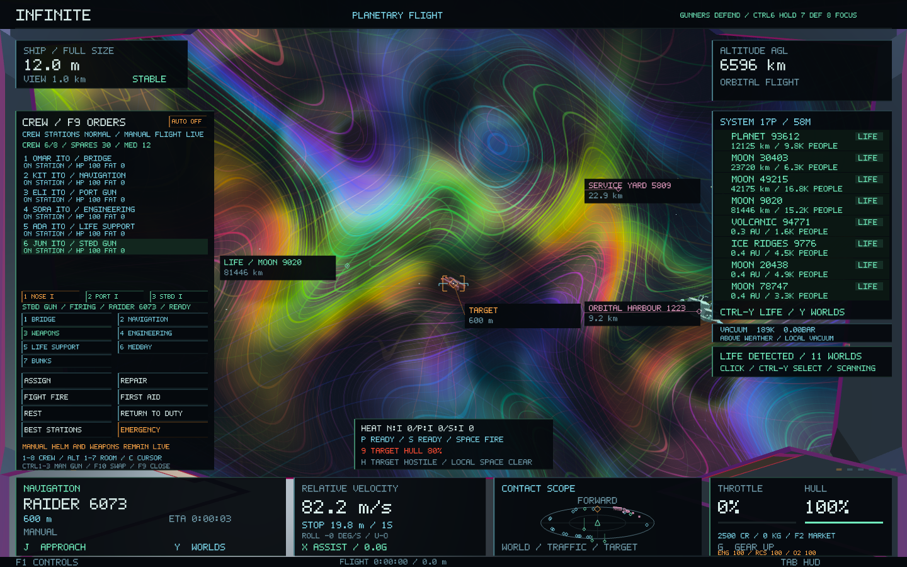
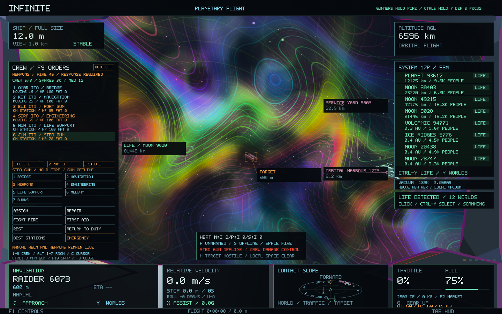
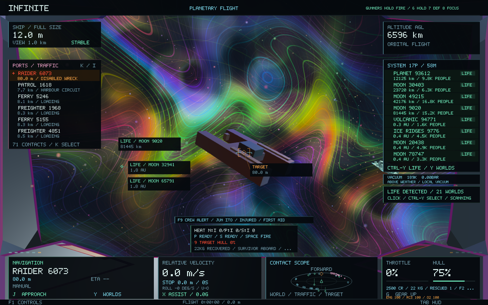
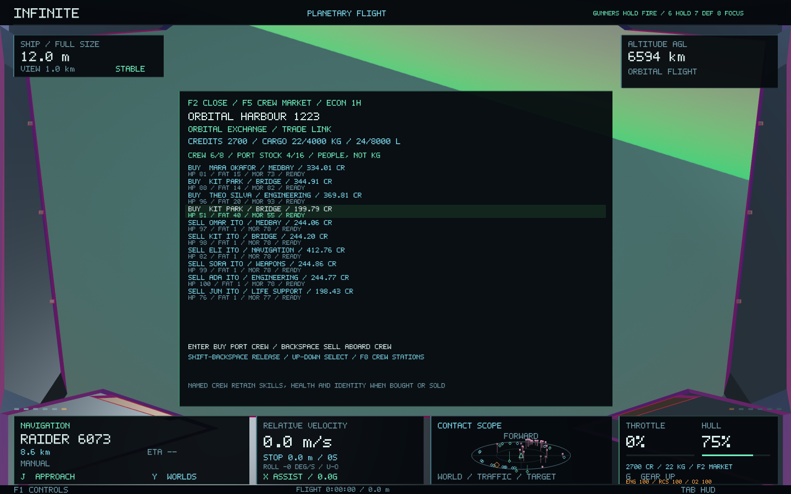

# Autonomous gunners, ship systems and physical recovery — 0.52

These three additions sit above Infinite's existing universe, addresses, seeds, geometry and rendering. A healthy ship retains the existing manual handling and roll controls. Damage adds explicit limitations that crew can repair using the existing rooms and supplies.

## Autonomous crew gunners

With the F9 console closed, use **6: hold fire**, **7: defend**, or **8: focus the selected hostile**. The current order appears in the top-right instrument strip. Hold fire is the default for saves without a fire-control setting. With F9 open, use **Ctrl+6/7/8** for these orders; unmodified numbers retain crew selection.

Only crew actually at a fitted, safe and working console can fire it. The captain's current console is excluded: the nose gun at the helm, or the occupied gun after an F10 exchange. Other stations can therefore keep defending while the captain flies or operates one gun. Existing Space firing remains available.

Gunners respect the individual station's azimuth/elevation limits, actual muzzle position, laser range, cooldown and heat. Bridge and weapon exchanges retain real crew walking and readiness. Gunner condition and skill affect acquisition time, cadence and deterministic aim error. Before firing, the existing geometry/terrain/ship ray test must hit the intended hostile; an intervening civilian or other hull blocks the shot. Gunners reserve a heat margin instead of repeatedly driving their weapons into overheat. Reloading guns skip target searches.

## Targetable systems and damage control

Press **9** with F9 closed to cycle **hull → engines → manoeuvring thrusters → nose gun → life support** on the selected ship. The weapon instrument identifies the selected component and its integrity; an amber marker identifies its physical position. The captain still aims the weapon. A hit must pass through the component's volume to damage it. Crew focus fire uses the selected component too, with the gunner's normal aim error.

Component hits do less hull damage, allowing a ship to be crippled or disarmed before it is destroyed. Failed NPC engines leave the ship adrift at its recorded position; failed manoeuvring systems reduce steering and a failed nose gun prevents firing. NPC beam hits can also damage the player's propulsion, thrusters, individual gun stations or life support. Component attribution respects the actual beam's miss distance and retains the existing NPC shot spread.

Player engines use Engineering integrity, thrusters use Navigation integrity, and life support uses its existing room. Each gun has its own integrity alongside the shared weapons bay. Failed engines remove thrust; failed thrusters remove steering authority; damaged guns reload more slowly and failed guns cannot fire. Destroyed life support consumes the remaining cabin oxygen. Ship instruments show engine, RCS and life-support integrity; F9 identifies unavailable guns and crew tasks.

Use existing **F9/F8 damage-control orders** to fight fires, patch breaches and repair rooms. Repairing the weapons bay also restores damaged mounts. Repairs consume existing finite spare parts, and injuries and fatigue retain their existing effects. A damaged ship keeps its physical velocity and coordinates; repairing it restores authority rather than resetting motion.

## Physical salvage and survivor rescue

Select a destroyed or engine-disabled ship. **J** approaches a closer recovery holding point for these contacts. Then match its velocity below **3 m/s**, approach within **120 m of its hull**, remain full size with the drive disengaged, and **hold 0 for six seconds**. Release the key, move out of range or lose safe access and the recovery progress resets. Terrain or other obstructing geometry blocks access.

The recovery instrument reports approach, speed, obstruction, progress and pending transfers. A finite manifest retains what has already been taken:

- Disabled economic freighters retain their actual onboard consignment. Recovery transfers cargo from that manifest into the player's available hold space. Goods that do not fit remain aboard the wreck.
- A wreck can provide a finite 20 kg alloy / 2 kg electronics scrap allocation. Repeat visits and restarts cannot replenish it. Registration and pickup record material imports/exports on the existing ledger, and freight transfers reduce its retained cargo.
- Some ships have a surviving crew member if life support survived. Their identity, name, skills, injuries and condition come from a separate deterministic gameplay stream. A survivor needs a free berth: regular crew plus rescued passengers cannot exceed eight. A survivor that cannot fit remains aboard the wreck.

Survivors remain passengers rather than silently replacing or operating as regular crew. Their mass contributes to the existing ship payload. The HUD reports rescued passengers and directs you to **F2 → Services → Disembark rescued survivors**. Berth or land at a functioning port at full size and below 3 m/s, then select that service and press Enter.

The port pays **200 credits per survivor** from its own available cash and takes them into the existing local crew office. Insufficient funds or berths leave remaining passengers aboard. Their identity and injuries remain intact; the existing **Crew Market** can subsequently hire them into the ship's roster. There is no payment for selling a survivor at handover, and no new crew-trade system replaces the existing one.

New bounty offers retain their funded cash reward, while their wreck scrap is recovered physically. Existing bounty offers and accepted/claimable entitlements keep their older salvage bonus. Recovery registration reserves that legacy allocation so the same scrap cannot be claimed twice.

## Persistence and architecture

The existing economy worker owns wreck manifests, cargo transfers, survivor receipts, port rewards and passenger records. The flight thread sends bounded commands and consumes immutable snapshots. Wallet and economy version **9** read all supported older formats. Crew version **4** appends individual gun integrity; weapon combat version **3** appends NPC component integrity. Older ships receive intact added components. The existing physical ship save format is unchanged. Fire orders have a separate small save; acquisition and recovery progress reset safely on restart.

Wreck records and damage records are bounded, and no new dependencies, texture passes or procedural universe generators are introduced. Baseline checkpoint: `c1cf67d`. Concurrent Dune, ellipsoid and fractal work is excluded from this change.

## Validation

All **53 core suites passed**, including the original handling/roll, spatial continuity, galaxy-to-atomic round trip, economic conservation and restart tests. Six focused suites passed again after the final migration and HUD changes. All **six native gameplay/image checks passed**, covering the new ten-frame combat-to-rescue sequence, existing station exchanges and NPC combat, including portrait layouts.

**200 existing runtime sources and shaders remain byte-for-byte identical to checkpoint `c1cf67d`.** Universe generators, addresses, deterministic seeds, scientific geometry and existing rendering shaders are preserved. The signed 0.52.0 package matches all 28 tested code/data sections.

[Core suites](crew-combat-recovery-0.52/core-tests.log), [final focused checks](crew-combat-recovery-0.52/final-focused-tests.log), [native checks](crew-combat-recovery-0.52/native-final-tests.log), [preservation manifest](crew-combat-recovery-0.52/preservation.json), [package verification](crew-combat-recovery-0.52/package.json).

The new checks cover crew firing safety and arcs, component shots and persistence, real thrust/steering loss, crew repairs and spare consumption, close/slow recovery, partial holds, finite freight/scrap accounting, survivor berths, retained identity, port-funded rewards and hiring through the existing crew market. The packaged app was also reopened successfully on the existing saved flight, with the new gunner and component instruments visible.
