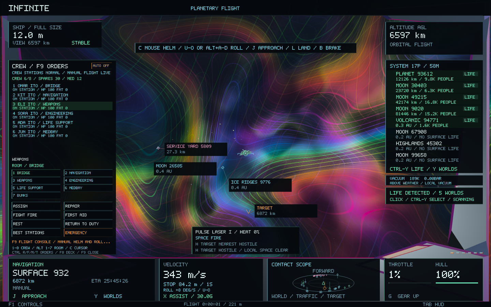
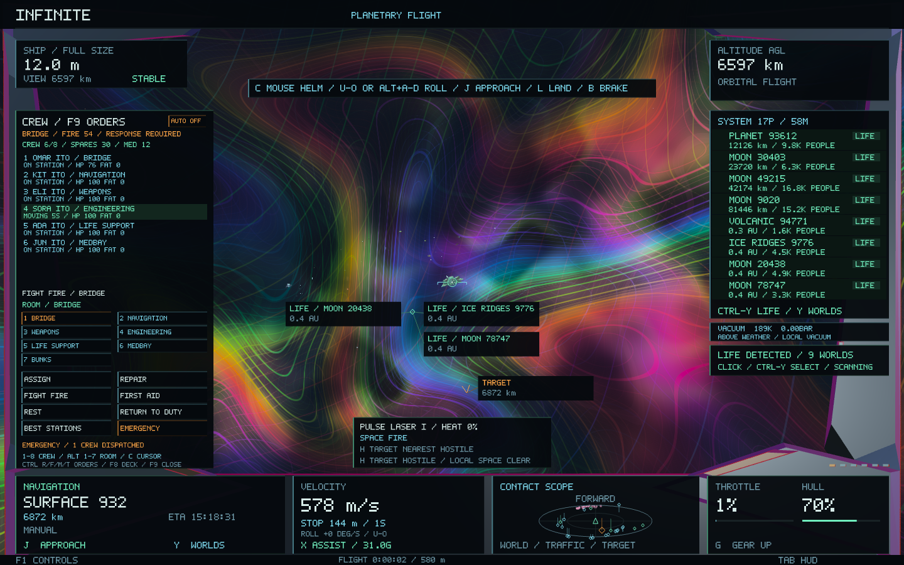
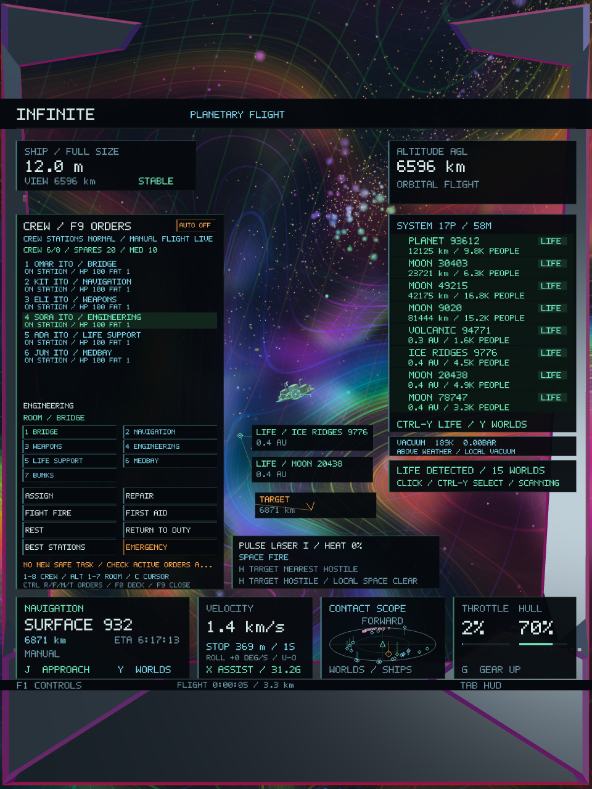

# In-flight crew management — Infinite 0.48

Version 0.49 adds [individual gun consoles](CREW_GUNS_0_49.md): click a gun button or use Ctrl+1/2/3 to assign the selected crew member. Best Stations now includes installed auxiliaries after the normal duties.

**F9** opens a compact crew command console on the left of the cockpit. Manual steering, roll, throttle, weapon fire, autopilot, hazards and crew simulation continue. The forward aim point, flight instruments and weapon panel remain visible. The full **F8** deck remains available for its compartment map, venting, detailed skills and port services.

The console uses the existing named crew and simulation. It adds orders and feedback above the same ship, coordinates and universe. Crew trading remains available through **F8 → F2** or the normal market pages.

## Flight controls and orders

| Control | Action |
| --- | --- |
| F9 | Open/close the flight console; from a market or the full deck, return to the flight console |
| Escape while the console is open | Close the console |
| 1–8 | Select a crew member |
| Alt + 1–7 | Select a compartment |
| Ctrl + Enter | Assign the selected person to the selected station |
| Ctrl + R | Repair the selected compartment |
| Ctrl + F | Fight fire in the selected compartment |
| Ctrl + M | Give first aid in the selected compartment |
| Ctrl + T | Rest the selected person in bunks |
| Ctrl + G | Return the selected person to their assigned duty |
| Ctrl + J | Best Stations: assign the available crew to suitable duties |
| Ctrl + H | Emergency: dispatch available responders |
| F8 | Open the full crew deck |
| C | Use the existing cursor/mouse-helm toggle |

Every order also has a labelled button. With the cursor released, click a crew row, choose a compartment and click the order. Selecting a room alone does not move anyone. Clicking AUTO ON/OFF toggles existing automatic damage control. The wheel over the panel selects crew; outside it, existing wheel behaviour remains. Tab hides the HUD and closes the console, releasing its number-key shortcuts. Opening F9 preserves mouse capture, so keyboard orders can be issued while using the mouse helm.

Alt selects compartments without engaging the existing Shift boost. The Ctrl order shortcuts use keys outside the continuous throttle/strafe/roll inputs. Ordinary H hostile targeting, J approach, G gear and other controls remain available when their command modifier is not held. The larger F8 deck retains its original suspension of manual helm/fire input while managing its map.

## Crew choices and feedback

The roster shows each person's duty, health, fatigue and current task. Movement reports estimate the remaining corridor route, retaining the current leg when an order changes. The selected person's detail explains the work, target and blockers: depleted stores, fire too hot for repairs or first aid, unsafe oxygen, incapacitation or death. Room, injury and fatigue alerts also appear in the compact crew HUD when the console is closed.

Completed repairs, firefighting and first-aid orders now return crew to their assigned duties and record completion in the existing incident history. Orders remain visible when blocked, so resupply or fixing the unsafe room can allow work to continue. Manual rest continues until recalled; existing automatic rest returns rested crew to duty. No order teleports crew between rooms.

**Best Stations** finds a bounded maximum-weight assignment across the six working stations and up to eight people. Fitness uses the same skill ranks, health, fatigue and morale that drive actual crew work. A small preference for existing duties avoids unnecessary swaps. Unfit people are excluded from working stations and relief crew rest in bunks. People keep their names, identities, traits, experience and condition.

**Emergency** selects available crew for the most severe fire, repairable damage/breaches and safe first aid. It favours relevant specialists and relief crew while reducing preference for taking bridge, navigation and weapons operators. Already assigned responders are recognised; active repair/fire/medical orders are retained. Unsafe first-aid sites and fire-blocked repair sites are skipped until conditions improve. Press again as the incident changes, or keep automatic response enabled. Firefighters and responders still walk, take injuries and consume the existing finite stores through actual work. The command does not vent rooms or repair the external hull.

## Persistence and preservation

Assignments, orders, walking, condition, supplies, hazards and automatic response already persist in crew save version 2. This release adds no save-format migration. Wallet and economy formats remain unchanged. The console, selected row and selected room are transient UI state.

Universe generators, seeds, terrain/city/atomic structures, coordinates, rendering shaders, crew markets, NPC combat, ship dynamics and restored flight controls are unchanged. Read-only task descriptions do not modify procedural or crew state. The station matching has at most 256 crew subsets; crew state, pathfinding and incident history remain bounded.

## Validation

All **47 core tests pass**, including **1,747 in-flight crew checks**, **212 existing crew checks** and **205 crew-market checks**. Existing generation, continuity, flight handling/roll, trading, combat and persistence suites remain green.

The operational checks cover specialist assignment, insufficient fit crew, exact identity/skill retention, travel continuity, task completion, explicit rest/recall, emergency dispatch without duplicate assignments, real repair/medical consumption, deterministic replay, read-only instruments, save round trips and console fit. Layout checks keep the aim point and flight instruments clear across wide, square and narrow canvases.

The native flight scenario applies live throttle and roll while issuing real orders, then applies an actual hull hit, dispatches firefighters/repairers/first aid, checks finite stores and completed work, and captures the console in wide and portrait windows. Each scripted command is checked against the exact physical ship and camera state at dispatch. Existing crew, crew-market, NPC combat and economy fixtures run with isolated saves.

All **ten native gameplay/image checks pass across 53 captures**: five flight-console, five full-deck crew, four crew-market, six combat and 33 economy frames. Wide and portrait screenshots were visually checked; the AUTO status fits and flight notices no longer cover the weapon readout in the flight console.

The final flight-console fixture records **274 frames**, **71.86 ms median / 120.94 ms p95** raw frame time and **144,048,128 bytes peak RSS**. These diagnostics include startup, resizing, readbacks and concurrent fixtures on a shared machine; they are not a matched performance comparison.

**Infinite 0.48.0 / build 53** is built, packaged and ad-hoc signed. All five native scenarios use the exact final executable, and all **28 code/data sections** match the signed app. The preservation manifest verifies **192 protected files** against `58a1170`. User saves were not used in validation. During disk pressure, completed test executables were temporarily compressed with verified hashes and restored byte-for-byte; [storage verification](crew-flight-0.48/test-storage.json).

Final test results and executable hashes are recorded in [validation.json](crew-flight-0.48/validation.json). [Core results](crew-flight-0.48/core-tests.log), [native results](crew-flight-0.48/native-tests.log), [preservation manifest](crew-flight-0.48/preservation.json), [package verification](crew-flight-0.48/package.json), [complete build](crew-flight-0.48/final-build.log).

