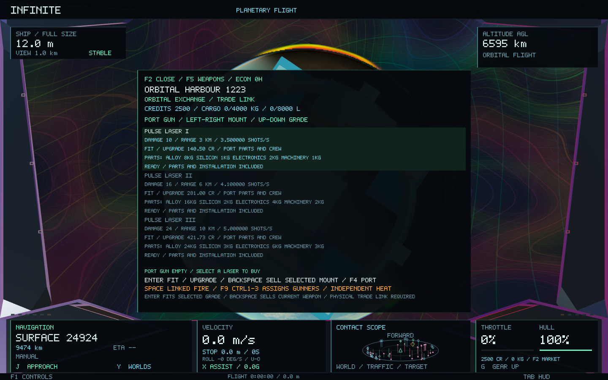
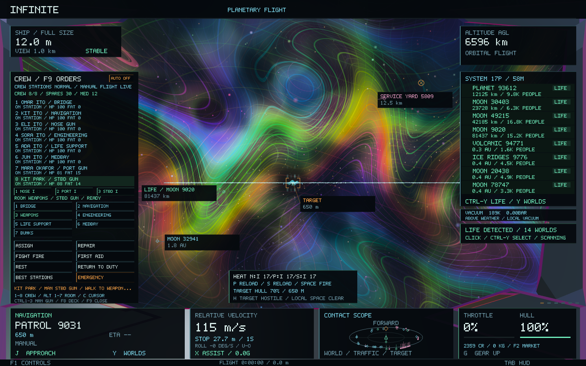
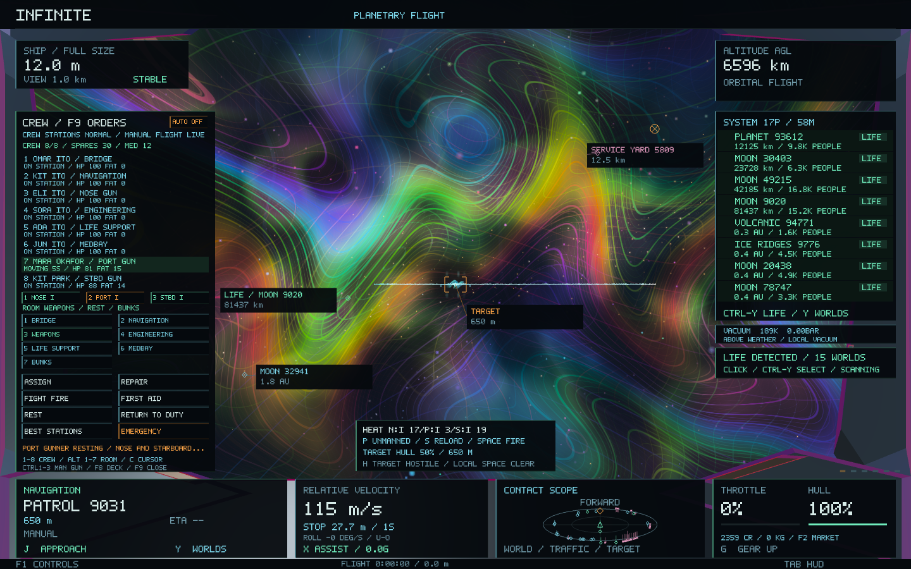
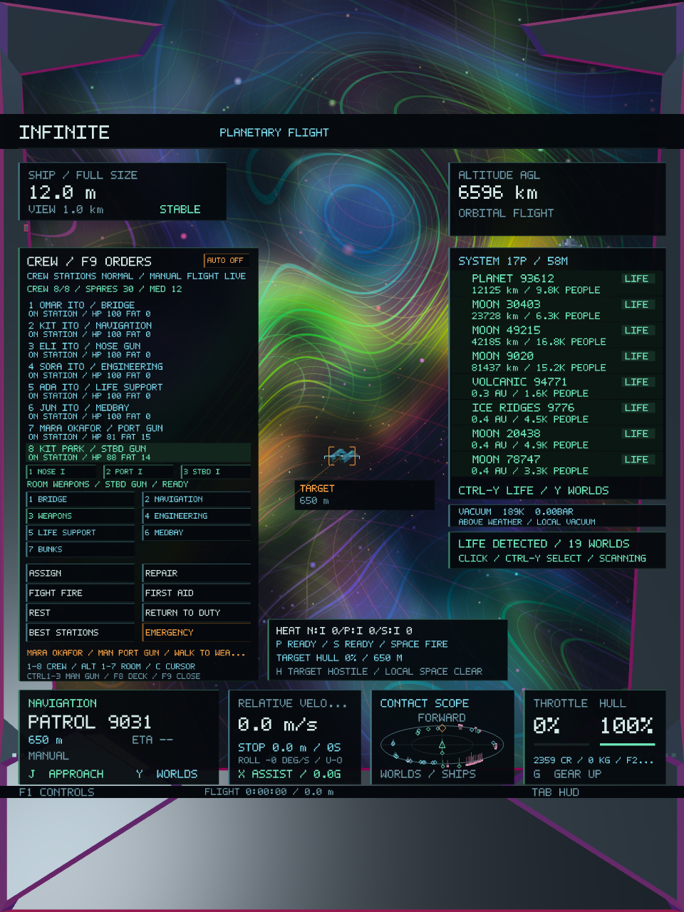

# Crewed ship weapon stations — Infinite 0.49

The ship now has three independent laser mounts: its existing nose gun and two optional port/starboard guns. All use the existing Pulse Laser I–III equipment and combat rendering. The extra consoles share the existing weapons bay; no compartments, ship/world coordinates or procedural structures are replaced.

Existing ships retain their fitted nose weapon and start with empty auxiliary mounts. Each extra gun must be purchased and staffed. The original nose gun keeps manual operation, including its existing crew servicing bonus.

## Fit a mount and assign a gunner

| Control | Action |
| --- | --- |
| F2 → F5 until Weapons | Open the existing armourer |
| Left / Right in Weapons | Select nose, port or starboard mount |
| Up / Down | Select laser grade I–III |
| Enter | Buy or upgrade the selected mount |
| Backspace | Sell the selected mount |
| F9 | Open the flight crew console |
| 1–8 or click a crew row | Select a crew member |
| Ctrl + 1 / 2 / 3 | Assign that person to nose / port / starboard console |
| Click a gun button in F9 | Assign the selected person to that console |
| Hold Space | Fire the nose gun and ready, manned extra guns |

The same Ctrl+1/2/3 assignment shortcuts work in F8. Existing room assignment to Weapons selects the original nose console; use the individual gun buttons/shortcuts for the extras. Selecting or assigning crew does not steer or move the physical ship. Gunners walk through the retained compartment graph and must arrive before their extra guns operate. Reassigning a moving person preserves the current corridor leg.

Weapons are bought, upgraded and sold individually through the existing funded port economy. Upgrades use only the additional hardware plus installation labour; buybacks return the selected gun's hardware to stock. Other mounts, cargo and sealed freight stay intact. Physical berth/landing, full-size and stopped-ship access rules remain. No ammunition commodity, new goods index or new dependency is added.

## Manning and combat

Each gun console has one assigned crew member. Normal station swaps preserve console ownership, and multiple gunners can occupy the same weapons bay without sharing a console. Resting, travelling, incapacitated or diverted crew cannot operate an auxiliary. An unsafe/decompressed/burning or destroyed weapons bay also prevents auxiliary operation. The console roster names each gunner's specific gun, with moving/blocked status and separate mount buttons. The weapon card reports independent heat and staffing/reload status.

Health, fatigue, morale, gunnery skill and bay integrity affect auxiliary reload/cooling readiness. Gunners gain experience from their own firing mount; an inactive console does not train from another gun's shots. Manual and automatic damage-control orders take a gunner away from firing until they return to duty. Passive cooling continues while a gun is unmanned.

Best Stations includes installed auxiliary consoles, prioritising the six existing duties before filling extra gun roles. With eight fit crew it can staff all six normal duties plus both auxiliaries. With fewer crew, the captain can explicitly reassign existing crew to guns at the cost of those other duties, or buy additional crew at a port. Selling a gun leaves its crew assignment intact but the empty mount cannot fire; Best Stations can return surplus crew to bunks.

Space remains the firing command; the extra guns do not select targets or start fights by themselves. Their gunners align the separate muzzles with the captain's sight line. Each muzzle performs its own obstruction trace, so intervening cover remains authoritative. Nose/port/starboard have independent heat, overheat and reload timers. Their hits accumulate in one bounded target-damage ledger, producing one disabled craft and preserving existing NPC response and freight-wreck handling.

Existing firing inhibition while landed, managing the full F8 deck/markets, using a travel/shrinking field, changing physical size or with a destroyed hull still applies. The F9 flight console leaves manual helm, roll and firing active. Physical hull size scales all muzzle offsets and range through the existing coordinate system.

## Saves, limits and preservation

Wallet version 7 reads versions 1–6 and stores the two additional equipment grades. Crew version 3 reads versions 1–2 and stores individual gun-console bindings; old gunners retain the nose console. Combat version 2 reads version 1 and stores all three thermal/reload histories and shot counters. Equipment remains authoritative in the wallet, and crew readiness is derived after loading, so a combat save cannot enable an unmanned gun.

People traded at ports keep their identity, traits, experience and condition; ship-local console assignments are cleared on transfer. The ledger format remains version 7. Three guns, eight crew, seven compartments, twelve visible pulse effects and 2,048 target damage records remain bounded. Existing GPU pulse geometry, materials and shaders are reused.

Universe generators, procedural seeds, spatial addressing, microscopic/atomic structures, terrain/cities, ship dynamics and the physical ship state remain unchanged. The preservation manifest additionally checks the exact ShipState definition, original CrewStation IDs and compartment corridor graph against baseline `1f49bbf`.

## Validation

All **48 core tests pass**, including **209 new crewed-gun checks**, **183 existing weapon checks**, **2,119 crew-console checks**, **212 crew-system checks** and **206 crew-market checks**. Existing economic, combat, handling and galaxy-to-atomic continuity suites remain green.

The new core checks cover independent fitting/upgrading/selling, conserved goods and money, replay rejection, wallet migration, worker/SQLite restart, walking to consoles, distinct staffing, station swaps, rest/recall, Best Stations, per-gun training, independent heat/overheat, shared damage, decompression gating, manual nose-gun preservation and crew/combat save migration.

The native scenario uses real starting funds to buy two auxiliary lasers and two named crew, shows unmanned and moving consoles, fires all three guns at an existing craft, rests one gunner and verifies only that auxiliary stops, recalls them and disables the same target through the shared damage ledger. It checks persistence and captures the station UI in wide and portrait windows. Existing crew, crew-market, flight console, NPC combat and economy native scenarios also run using isolated saves.

All **12 unique native gameplay/image checks pass across 62 captures**, including nine new station/battery frames. The initial economy run completed its gameplay assertions but failed final profiling CSV output during disk pressure; its two checks passed when rerun alone with the same executable after test-storage cleanup. Both raw runs are retained. The scripted station fixture retains its last armourer HUD balance while showing crew views; committed purchase balances are asserted against the actual wallet and recorded in the scenario log.

The new native fixture records **349 frames**, **82.81 ms median / 266.40 ms p95** raw frame time and **148,799,488 bytes peak RSS**. These shared-machine diagnostics include loading, resizing, captures and a concurrent economy fixture; they are not a matched performance comparison.

**Infinite 0.49.0 / build 54** is built, packaged and ad-hoc signed. All six native copies match the final executable; all **28 code/data sections** match the signed app. The preservation audit verifies **190 protected files** and three structural definitions. Test executables temporarily compressed during disk pressure were restored byte-for-byte; [storage verification](crew-guns-0.49/test-storage.json). User saves were not used in validation.

Final results and hashes are in [validation.json](crew-guns-0.49/validation.json). [Core tests](crew-guns-0.49/core-tests.log), [initial native run](crew-guns-0.49/native-tests.log), [economy retry](crew-guns-0.49/native-economy-retry.log), [preservation](crew-guns-0.49/preservation.json), [package verification](crew-guns-0.49/package.json), [build log](crew-guns-0.49/build.log).

