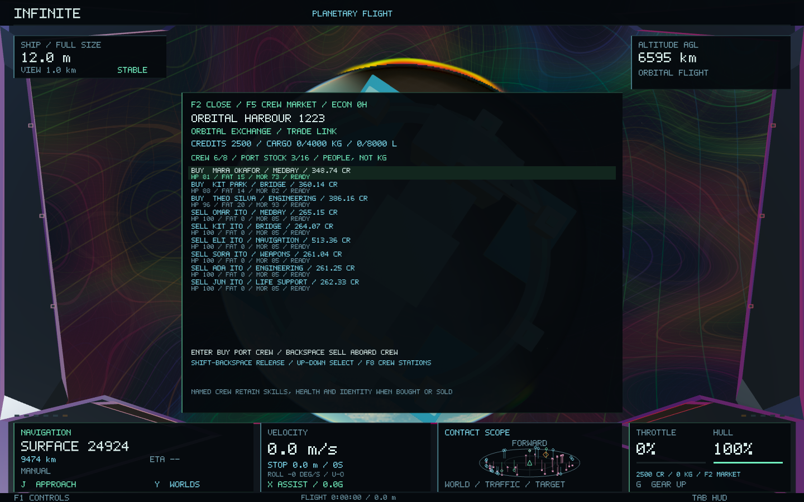
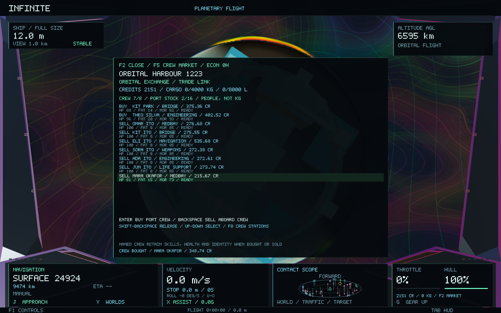
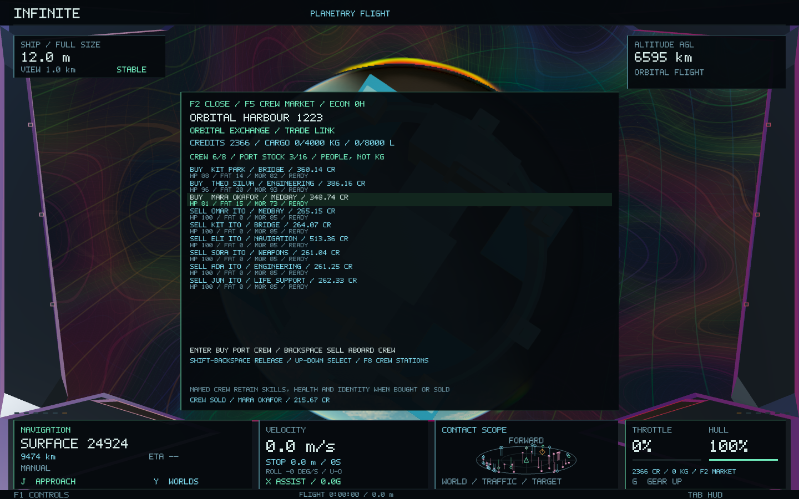
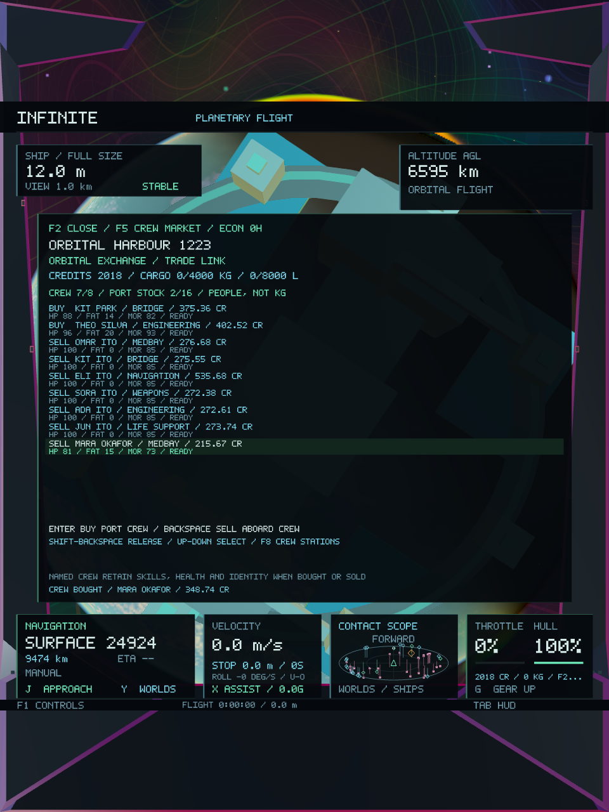

# Crew trading — Infinite 0.47

Crew are now individually traded through the existing port economy. Buying moves a named person from port stock into a ship berth; selling pays the port's bid and moves that same person into its stock. Names, identities, traits, skills, health, fatigue and morale survive transfer, repurchase and save reload. New arrivals start in bunks, ready for assignment through the existing crew deck.

## Controls

Approach an orbital port and stop, or land at a surface port. The ship must be full size and physically connected to that port's trade link.

| Control | Action |
| --- | --- |
| F2, then F5 until Crew Market | Open the crew exchange |
| Up / Down | Select a port offer or a person aboard |
| Enter on a BUY row | Buy the selected person |
| Backspace on a SELL row | Sell the selected person for the displayed bid |
| Shift + Backspace on a SELL row | Release the selected person without payment |
| F8 | Open the crew deck and assign stations |
| F8 → F2 | Open Crew Market directly from the crew deck |
| F8 → H | Buy the currently displayed port offer |
| F8 → left / right bracket | Cycle port offers |
| F8 → Backspace | Sell the selected crew member |
| F8 → Shift + Backspace | Release the selected crew member without payment |

The F8 supplies and shore-clinic controls remain **S** and **L**. Ordinary flight and hostile-targeting controls resume when the panel closes. No turn, roll, throttle or cockpit-motion behaviour changes.

## Stock and pricing

Each port starts with three deterministic, named offers. Its stock becomes persistent on the first transaction, including an empty stock: reopening a menu or returning to a system does not regenerate purchased people. Ports hold up to sixteen people and the ship retains its existing eight living berths. Crew use individual berths, with no kilogram cargo or goods-index conversion.

Experience increases value. Health, fatigue and morale affect condition. Prices also reflect local wealth, stock scarcity and specialty demand: sealed habitats favour life support, industrial sites engineering, orbital exchanges navigation or weapons, and other surface ports medicine. The displayed specialty is the person's strongest skill.

At the same local valuation, the asking price is 118% plus a 10-credit fee, and the bid is 72%. An immediate buy/sell loop costs money. Improving someone's skills or condition, or finding a port with different demand, can change their value. Real player and port balances fund every transaction; an insolvent or damaged port can refuse a sale. Dead crew cannot be sold and may be released without payment.

## Persistence and integration

The economic worker commits the port stock, payment, ownership title and boarding receipt through the existing atomic SQLite transaction. A new command sequence cannot sell the same person twice. Reconciliation removes transferred people and applies purchases once, recovering a committed purchase if the separate crew save is older. Pending transfers briefly hold crew time steps so the sold condition matches the quoted snapshot; incoming hull damage is still observed.

Purchasing a replacement for a casualty retires the lost person's ownership title and boarding receipt in the same transaction. Repeated losses and replacements therefore reuse the eight receipt slots; a removed casualty cannot leave a hidden receipt that blocks later purchases.

Wallet version 6 reads versions 1–5; economy ledger version 7 reads versions 1–6; crew version 2 reads version 1. Existing hired crew remain valid and tradable. The old recruitment action remains readable for compatibility, while current UI recruitment uses finite market offers. Ownership history is bounded at 8,192 identities, boarding receipts at eight and touched markets at 128 per system. Reaching a bound refuses new transfers rather than forgetting ownership or recreating stock.

This layer changes the crew economy and its UI. Universe coordinates, seeds, world generation, terrain, cities, microscopic structures, atom meshes, shaders and flight dynamics remain unchanged. The audit verifies **185 protected files** against baseline `76b77fc`. [Preservation checks](crew-trade-0.47/preservation.json).

## Validation

All **46 core tests pass**, including **205 crew-market checks** and the existing **212 crew-system checks**. The cross-scale round trip, deterministic generation, ship handling/roll, economic accounting, weapons, combat and persistence suites remain green.

The new crew-market test covers deterministic stock, paid purchase/sale/repurchase with exact person attributes, conserved money and goods, duplicate-sale rejection, insufficient cash, full berths, closed offices, dead crew, release, repeated casualty replacement with a full boarding history, empty-stock persistence, old save migration and stale crew-save recovery. It also trades through the actual asynchronous runtime, evicts systems from the cache, restarts SQLite and verifies the same person is still in port stock.

The native scenario buys, sells and repurchases one actual port offer. It checks crew counts, payment, exact person identity/condition, unchanged camera and crew-save round trip, with wide and portrait captures. Existing crew emergencies, NPC combat and economic gameplay scenarios run alongside it using isolated saves.

All **eight native gameplay/image checks pass across 48 captures**: four crew-market frames, five crew-emergency frames, six NPC-combat frames and 33 economy frames. The crew-market run records 220 frames, **68.96 ms median / 117.98 ms p95** raw frame time and **144,097,280 bytes peak RSS**. Startup, resizing, GPU readback and concurrent fixtures are included; these shared-machine diagnostics are not a matched performance comparison.

**Infinite 0.47.0 / build 52** is built, packaged and ad-hoc signed. All four native scenarios use the exact final executable, and all **28 code/data sections** match the signed app. Existing user saves were not used by the tests.

Final test counts, executable/package hashes and frame measurements are recorded in [validation.json](crew-trade-0.47/validation.json). [Core results](crew-trade-0.47/core-tests.log), [native results](crew-trade-0.47/native-tests.log), [build log](crew-trade-0.47/build.log), [signature](crew-trade-0.47/signing.log).

