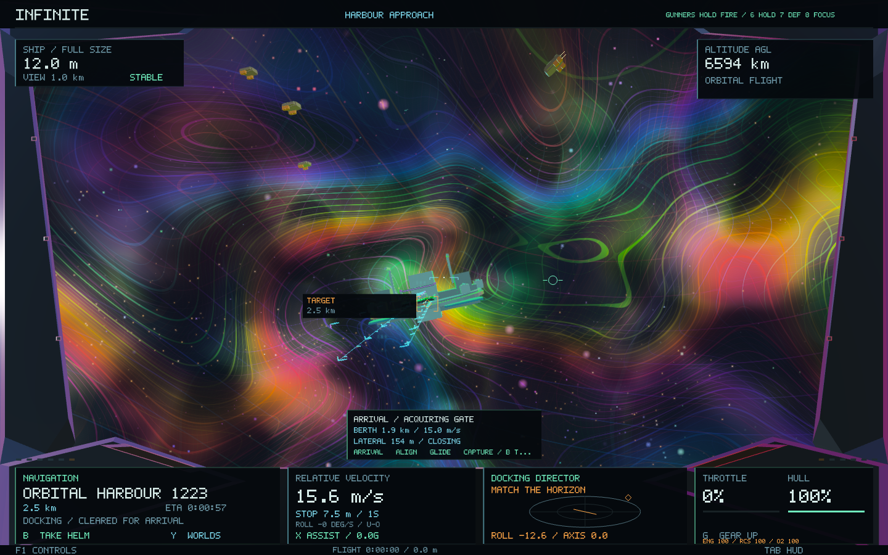
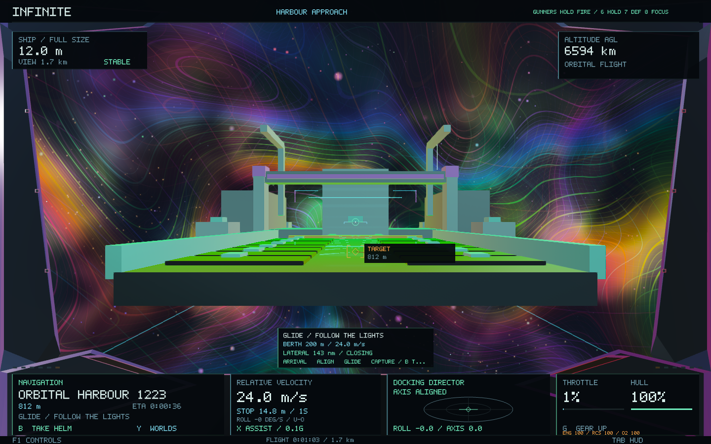
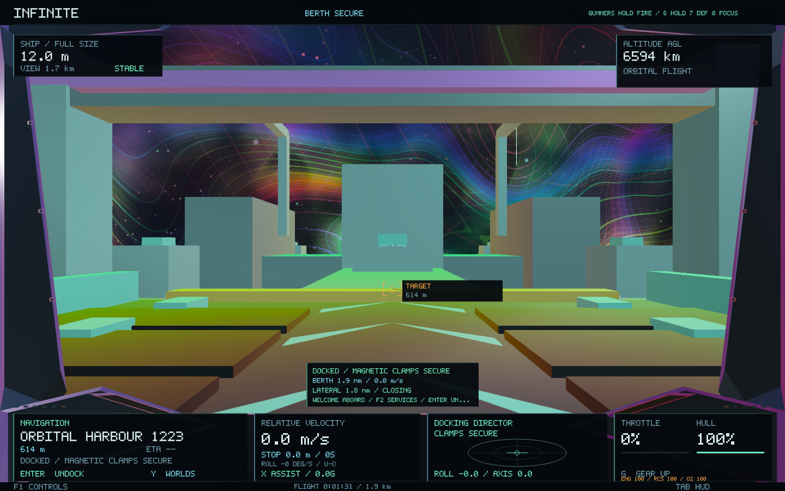
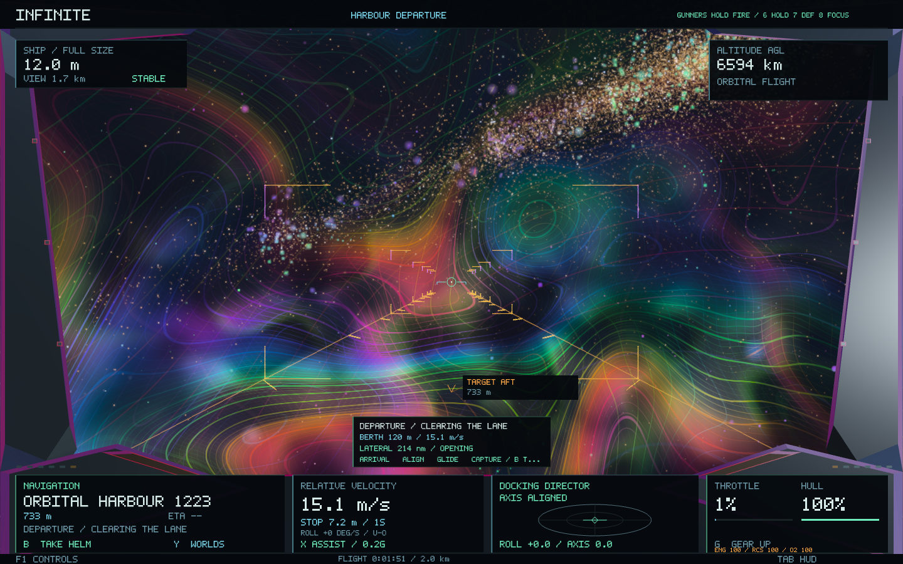

# Orbital docking — 0.54

Docking now flies a visible maneuver into a real berth on the existing orbital harbour: arrival, roll alignment, a lit glide lane, soft capture and guided departure. The ship uses its existing thrusters throughout the approach. The harbour keeps its original identity, position, orbit and seed; the terrace and lights are additions to its presentation.

## Fly the approach

- Select an orbital harbour with **K** or the existing contact targeting, then press **J**. Long-distance navigation transitions into docking near the station.
- Follow the cyan arrival lights. The docking director shows lateral displacement, roll and heading alignment. A rear-side arrival routes around the station before entering the lane.
- **B**, or ordinary helm input, takes over. The director and lights remain available nearby for a manual approach. **L** requests soft capture when close, slow and aligned; **J** requests the full assisted approach again.
- After capture, use the existing **F2** market and services. Close the market and press **Enter** to release the clamps, turn outward and fly clear along the amber departure lane. Manual thrust can also release the ship.

The manoeuvre requires a healthy harbour and a full-size ship. Freighter rendezvous, planetary landings, normal handling, roll controls, long-range travel and shrinking retain their existing behavior. Cruise cannot engage while the clamps are closed.

## What the player sees

The station has an open terrace with a violet gantry, inset deck panels, centreline chevrons and edge lights. Seven spatial gates and travelling chevrons define its approach in actual berth coordinates. The lane turns green when secured and amber for departure. These are depth-tested world geometry, using the existing Hyperion rendering and compositing passes.

Near the berth, the cockpit prioritizes docking information instead of the long world/contact catalogues; hostile contacts can still bring those lists through. The central card reports the stage, berth distance, closing speed and lateral error. The existing scope becomes a docking director. The capture progress bar fills only while the ship is settled.

## Physical and spatial continuity

The adapter derives the berth from the harbour's existing `ActivityBody`; it creates no universe address or procedural seed. Guidance uses the harbour's position, orientation and velocity. Alignment and translation use the existing allocated thrusters, including their mass and authority limits. Manual takeover preserves the current pose and velocity.

Final capture requires less than 0.45 m of position error, less than 0.18 m/s of relative speed, close heading/roll alignment and a continuous 1.6-second dwell. Only then does the mechanical latch constrain the remaining sub-metre error. A moving berth carries the captured ship at its actual velocity. Departure turns the ship on its existing attitude controls before accelerating outward.

Near a selected harbour, automatic render-unit refinement keeps the deck and nearby lights in front of the physical near-clipping plane. It changes no coordinates, hull size, momentum or generated geometry. The tests exercise render-unit changes during the maneuver.

Ship save format 5 is retained. After restoring the saved navigation, ship and selected harbour, a physically aligned, settled berth pose can resume its clamp. No wallet, economic ledger or procedural-world migration is introduced.

## Validation

The complete 56-suite core run passed. After the final berth presentation changes, the docking and orbital-activity suites passed again. The focused docking tests cover both harbour sizes, angled/rear arrivals, a moving berth, hull clearance, every capture stage, manual takeover, manually aligned final capture, guided departure, render-unit changes, save recovery and portrait/wide HUD bounds.

Ten native checks cover docking, exploration, crew-station control, port economics and landing. The native docking fixture physically flies and captures eight stages, verifies physical port access and checks that no step jumps the ship. The landing/cockpit pair was rerun successfully after an initial capture run exhausted temporary disk space.

The final docking repeat also requires the outbound guide to remain submitted when its station is behind the cockpit. Guide visibility is independent of the station mesh's viewing-direction cull; depth testing still applies.

A mixed Release/ASan run encountered libc++ container annotations across build boundaries. Validation was repeated with all 57 core translation units consistently instrumented under ASan/UBSan, without disabling the container checks. Results and the exact tested executable are retained in the [validation record](docking-0.54/validation.json) and adjacent logs.

The generator, spatial-coordinate and shader sources remain unchanged. Existing control and multiscale continuity suites passed. Native graphics were exercised on macOS/Metal; these runs are correctness checks, not a comparative performance benchmark.
