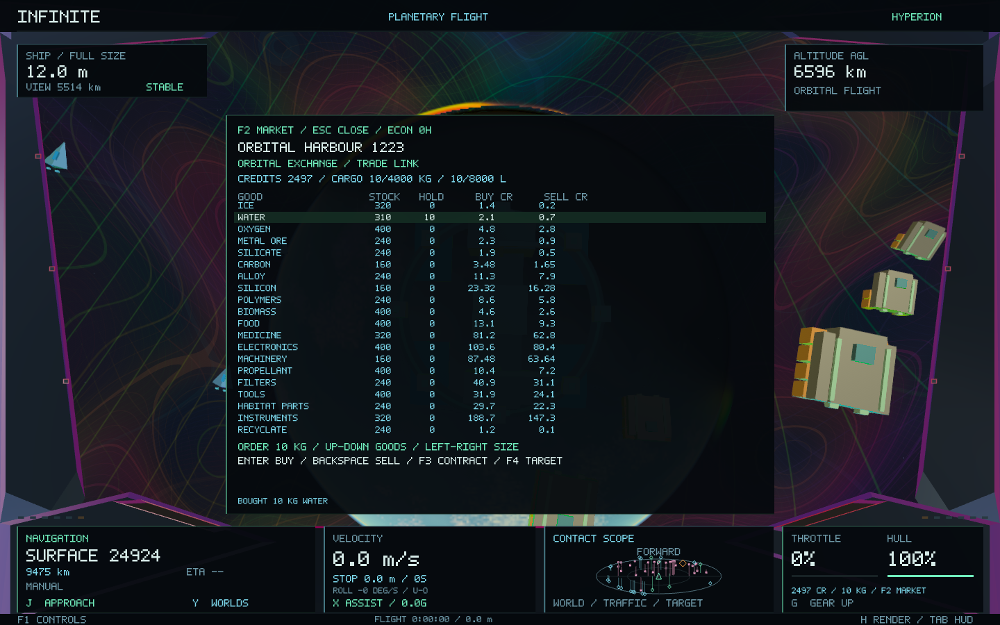
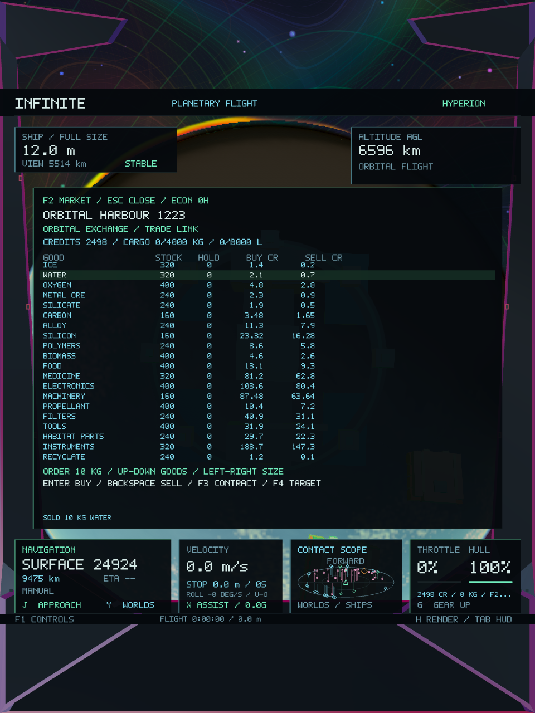

# Persistent civilian economy — Infinite 0.38

This release implements the first playable stage of the economic design: physical inventories, production, wages and household consumption, local markets, funded supply contracts and cargo-backed NPC freight. Existing planets, moons, settlements, buildings, populations and activity identities provide its locations. Economic state is an overlay; it never writes to universe generation.

## Playing

Press **F2** in ship mode to open the nearest market, or select a harbour/surface port with **K / Shift-K** first. Remote quotes can be inspected while approaching. Close the panel with **F2** or **Escape**, then **J** approaches the selected facility.

At an orbital facility, stop below **3 m/s** near its holding point. A surface market requires a full-size ship landed within **250 m** of its existing landing point. The panel displays **TRADE LINK** when transfers are permitted. Its arrows select goods and order size; **Enter** buys and **Backspace** sells. Orders are 1, 10, 100 or 1,000 canonical kilograms. Prices in the table are totals for that order size.

**F3** accepts the displayed funded supply contract, or delivers available cargo against an accepted contract at its destination. Partial deliveries are supported. **F4** selects an accepted contract's destination in the current system; **J** approaches it and **F2** reopens its market. Contract acceptance can be remote, while delivery requires a trade link. Existing M-marker, T-tour, R-flight reset, navigation, landing, roll and rendering controls remain available outside the modal market.

The ship starts with **2,500 credits** and an empty **4,000 kg / 8,000 litre** cargo bay. Both limits apply. Credits and carried mass remain visible above the gear instrument when the panel is closed. Bulk cargo adds physical mass and inertia at fixed engine thrust. It must be unloaded before shrinking; camera magnification does not resize inventory. An order awaiting the ledger also temporarily reserves its potential payload, preventing a buy/shrink race.

## Goods and production

Twenty material classes form the initial economy: ice, water, oxygen, metal ore, silicate, carbon, alloy, silicon, polymers, biomass, food, medicine, electronics, machinery, propellant, filters, tools, habitat parts, scientific instruments and recyclate.

Eighteen recipes connect extraction, ice processing, electrolysis, smelting, silicon refining, polymers, greenhouses, food processing, medicine, electronics, machinery, filters, tools, habitat fabrication, instruments and recycling. Extraction draws down finite economic reserves derived from existing chemistry and water availability. Manufacturing consumes recorded inputs and produces recorded outputs and waste. These are bulk economic recipes, not a detailed chemical-reaction solver. Manufacturing output plus declared waste equals input mass.

Existing industrial, agricultural, civic and utility buildings determine capabilities. Population and existing jobs bound the available workforce; utility counts provide power. Sealed habitats and extreme temperatures raise the effective power cost. Existing deterministic storm forecasts can reduce available power. Output buffers bound production when products are already sufficiently stocked, preserving warehouse space. Equipment condition affects throughput, and machinery and filters supply maintenance. No land is flattened, city regenerated or new population invented to accommodate production.

Households hold separate cash accounts, buy food and water, and require oxygen in sealed settlements. Essential shortages reduce health and productive labour. Production pays wages from the firm's account into household accounts. Public infrastructure purchases, taxes, carrier payments and contract escrow transfer finite money between accounts. The public freight cooperative retains an operating reserve and distributes surplus to existing households, keeping earned money in circulation. Initial firm, household, public and carrier endowments are explicit canonical starting balances.

## Prices, orders and contracts

Local quotes respond to unreserved stock relative to a target inventory. Targets include expected industrial inputs and population needs. Price arithmetic, money and kilograms use integers. Buy and sell spreads and a handling margin prevent an immediate buy/resell profit. Bulk quotes integrate each kilogram's changing inventory level rather than charging the entire order at the opening price.

Orders carry price limits and monotonically increasing sequence IDs. Changed prices, insufficient cash, missing stock, warehouse limits and cargo limits reject the transfer. Replayed commands cannot pay twice. Successful transactions update the port and wallet together in the same SQLite transaction before a new snapshot is published.

Shortages generate bounded supply contracts. Their rewards are deducted from the issuer's cash into escrow when offered. Deliveries release that escrow; expiry returns the unused balance. A contract never invents a reward balance. The cockpit displays remaining quantity, material and reward, and F4 supplies the return destination.

## Real freight

Existing freighter activity slots retain their identities. Surplus inventories and funded demand generate jobs. Stock and buyer funds are reserved before pickup. Repositioning, loading, transit, warehouse holding and delivery have persistent state. Payment transfers to the seller and carrier; departure consumes recorded propellant. Cargo cannot simultaneously exist in a warehouse and aboard a vessel.

The dispatcher considers a bounded shortlist of suppliers and assigns at most four new jobs per dispatch batch. Scheduled transitions resolve on economic ticks; new dispatch decisions use a fifteen-second cadence. Nearby geometry presents the same manifests and jobs used by the ledger. Idle vessels occupy separate berths; surface transfers hover above the existing port. Radial departure/arrival legs and planetary arcs keep local freight routes above their host bodies, with a stellar bypass when needed. These are kinematic freight paths, not new N-body or combat simulation.

NPC trade networks are local to each star system in this first stage. The player can carry goods between systems. Banking, corporate investment, migration, interstellar NPC freight and microscopic material-quality research remain later stages. The current release adds no player fuel meter or new restriction on long-range cruise; local inventory, handling, payload and transfer limits already apply.

## Determinism, persistence and performance

`EconomicNetwork` is an immutable adapter over the existing universe and surface society. `Economy` owns the mutable ledger without depending on the camera or renderer. `EconomyRuntime` owns one background worker and a separate `economy.sqlite` file beside the existing saves. Main/render receive immutable snapshots.

The canonical clock uses five-second ticks representing five economic minutes. It follows the existing activity clock, independently of zoom, magnification, frame rate and render mode. Newly accessed networks start at the same canonical epoch and catch up in bounded worker batches. Trading pauses while a network catches up. This uses fixed economic ticks and scheduled shipment milestones; it does not evaluate every inhabitant or atom.

At most three mutable networks remain resident. Dormant networks are committed to SQLite and regenerated/reloaded from their stable definitions on return. Their stock, contracts, reserves and money do not reset. Latest-view requests can cancel pending definition extraction. Cached data never comes from renderer request order. The active recipe and universe seed namespace are separate from all existing generator streams.

Save restoration validates stock non-negativity, storage bounds, reserve depletion, cargo reservations, escrow, commodity accounting and monetary accounting before replacing live state. Invalid storage is retained and trading is disabled. A failed disk transaction preserves the last committed public snapshot. Ship save formats and the existing flight database remain separate and compatible.

## Validation and evidence

The baseline passed all 35 existing core tests, with checkpoint `checkpoint/infinite-0.37-before-economy` at `34e3883`. The new economic suite checks manufacturing mass balance, inventory and monetary conservation across hundreds of ticks, frame-batching independence, actual freight completion, funded/partial/expired contracts, sequence replay, price limits, wallet/network restart, dormant-network eviction, outages and recovery, payload physics, shrinking guards, fitted UI and generator preservation.

The starting-system adapter finds **95 existing market sites and 123 existing freight vessels**. The final build passes **36 core tests** and **9 native checks**; the economic suite contains **64,610 checks**. The final economic loop and image checks passed again after the stock-buffer, cash-circulation and cancellation safeguards. [Core results](economy-0.38/core-tests.log), [economic checks](economy-0.38/economy-tests.log), [native regressions](economy-0.38/final-native-tests.log), [final economic rerun](economy-0.38/last-native-economy-tests.log).

Measured on Apple M1, 16 GiB, macOS 26.4.1, Release build:

| Measurement | Observed result |
| --- | ---: |
| Starting-system adapter plus first 100 economic ticks | 846.4 ms on the worker/test thread |
| Next 1,000 economic ticks | 205.2 ms total, about 0.205 ms/tick |
| Starting-system definition and mutable ledger | 307,044 bytes |
| Native worker state plus published snapshot | 434,468 bytes |
| Final native trading workload | 364 frames, median 27.28 ms, p95 73.03 ms |
| Native peak RSS | 133.84 MB |

The rendering workload overlapped CPU regression tests and includes streaming, resizing and screenshot readback. It is an observation, not a controlled rendering speedup comparison. Initial definition generation and sleeping-network catch-up never execute on the rendering thread. The test visits four systems, forces eviction, reloads the original ledger, and stresses cancelled/context-stale commands without changing its wallet.

The native economy fixture exercises actual worker-backed buying and resale, visible cargo, all three rendering modes with the same camera and world geometry, portrait layout and active freight. The existing native piloting fixture covers safe landing, persisted flight, launch, roll and atomic shrinking. The existing continuity journey verifies the galaxy-to-atomic return. [Preservation hashes](economy-0.38/preservation.json) match 129 generation, activity and shader files against the checkpoint. The signed **0.38.0 / build 38** package matches all 28 tested Mach-O code/data sections. [Package verification](economy-0.38/package.json).

## Sources and implementation boundary

The user's Hyperion source supplies the local reference: `economy.hpp`, `economy.cpp::reserveFor`, `marketPrice`, `tradeOrderPrice`, `updateSettlement`, `updateRoute` and `advanceEconomy`. Its actual inventories, input/output recipes, paid freight and escrow informed this design. Infinite retains its own world, coordinates, settlements, renderer and ship physics.

External research: [X4 trading and mining](https://wiki.egosoft.com/X4%20Foundations%20Wiki/Manual%20and%20Guides/X4:%20Foundations%20Manual/Trading%20And%20Mining/), [Victoria 3's lead designer on economic modelling](https://www.gamedeveloper.com/design/deep-dive-modeling-the-global-economy-in-victoria-3), [Prosperous Universe workforce and efficiency](https://handbook.apex.prosperousuniverse.com/wiki/efficiency-factors/), and [BEA input-output accounts](https://www.bea.gov/sites/default/files/2021-02/BEA-Input-Output-Accounts.pdf). These inform the system; their world-generation or simulation code is not imported.
