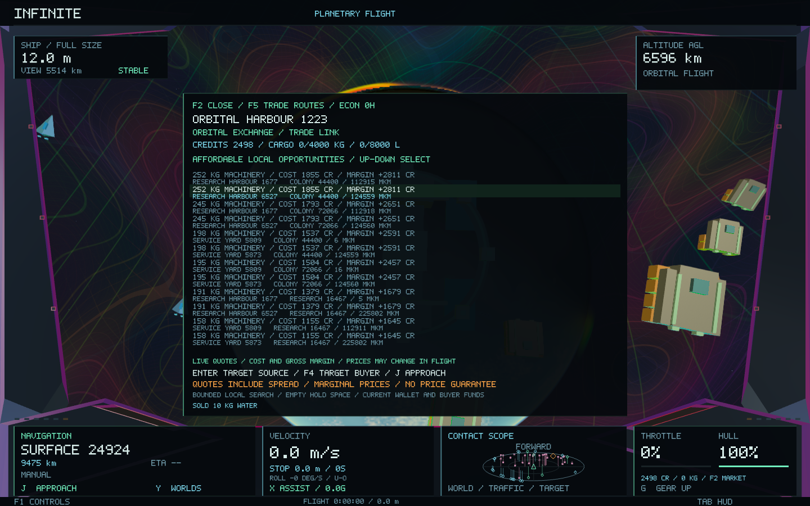
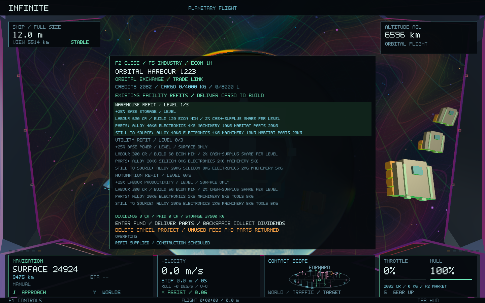
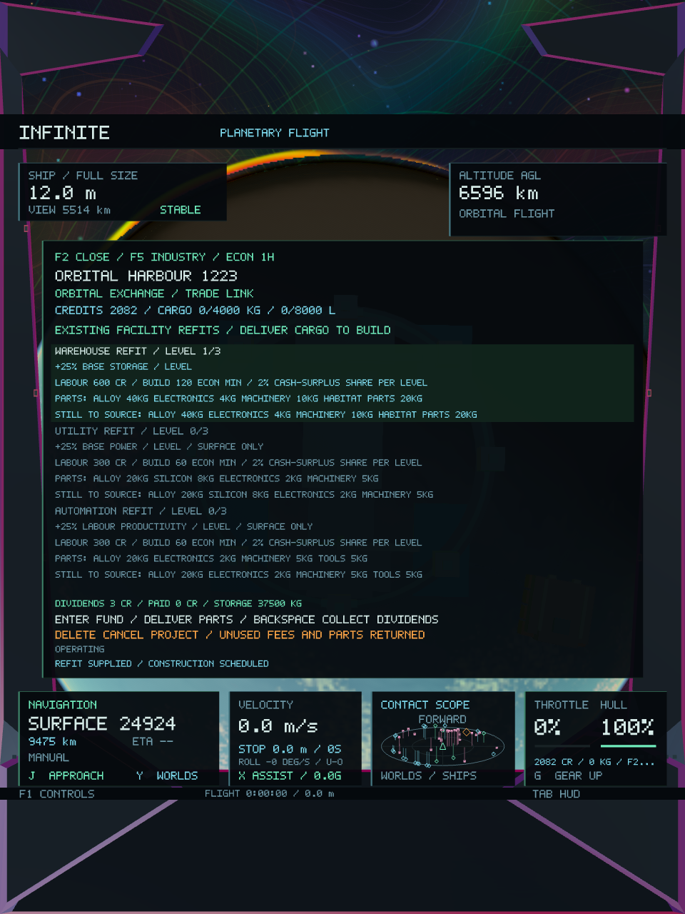

# Economic development — Infinite 0.39

The next economic layer connects profitable trading to investment in existing settlements and orbital exchanges. Player-owned refits consume delivered materials, pay construction crews and improve real warehouse, utility or manufacturing capacity. A bounded trade board identifies affordable cargo routes from current inventories and prices.

## Playing

**F2** opens the nearest or selected market. **F5** cycles **goods → trade routes → industry**. All three pages use the same fitted cockpit panel, including narrow/portrait windows. The market pauses helm input as before; close it before flying with **J**, landing with **L**, or launching.

| Page | Controls |
| --- | --- |
| Goods | Up/Down good, Left/Right order size, Enter buy, Backspace sell. F3 accepts/delivers the port's supply contract. |
| Routes | Up/Down selects a route. Enter targets its supplier and preselects the material/order quantity. F4 targets the buyer. J approaches the selected facility. |
| Industry | Up/Down selects warehouse, utility or automation. Enter funds the next refit and delivers matching cargo, or adds more materials to an existing project. Backspace collects that site's accrued dividends. Forward Delete cancels an unfinished project. |

On Mac keyboards, forward Delete is **Fn+Delete**; the ordinary Delete key is Backspace. F5 operates while the market is open. Depending on macOS keyboard settings, function keys may also require Fn.

Selecting a route bookmarks its buyer independently of the changing price shortlist. After purchasing cargo, **F4** returns to that buyer and selects the carried order quantity. Selling all of that material clears the bookmark. **Shift+F4** always targets the accepted supply contract; forward Delete on goods/routes clears the trade bookmark. Bookmarks last for the current session/system. Cargo, money, contracts and industrial projects persist in the ledger.

Physical cargo transfers, funding/material delivery and project cancellation require the existing trade link: a full-size ship, out of cruise and below 3 m/s; surface ports also require landing within 250 m. Quotes and digital dividend collection work remotely within the current network. Returning construction materials reserve pending payload immediately, just like a purchase, preserving the existing cargo/shrinking guard.

## Capital and construction

Each existing site supports three levels per eligible module, with one pending project at a time:

| Refit | Effect per level | Level-one parts |
| --- | --- | --- |
| Warehouse | +25% of base usable storage | 20 kg alloy, 5 kg machinery, 2 kg electronics, 10 kg habitat parts |
| Utility | +25% of base effective power | 20 kg alloy, 5 kg machinery, 2 kg electronics, 8 kg silicon |
| Automation | +25% labour productivity and processing batch capacity | 20 kg alloy, 5 kg machinery, 2 kg electronics, 5 kg tools |

Parts and labour costs scale with the next level. Level one reserves **300 CR** for labour and takes **12 economic ticks** once supplied; subsequent levels take 24/36 ticks and cost 600/900 CR. One tick is five flight seconds representing five economic minutes, so an uninterrupted first refit takes one minute of flight time. These are abstract bulk industrial retrofits using the existing economic recipes, not new city buildings or detailed engineering bills of materials.

Enter can start a project without every part aboard. It takes only matching missing materials from the actual hold; partial deliveries remain attached to that facility. The industry page lists outstanding parts, additional sourcing needs, escrow price and work progress. Installed/held capital materials remain in the commodity accounts, outside saleable warehouse inventory. They cannot also be sold or shipped.

Surface construction reserves two existing crew units and one effective power unit from the normal production budget. It pauses through outages, unhealthy staffing, insufficient environmentally adjusted power or severely worn equipment. The same temperature, sealed-habitat and deterministic storm penalties govern production and construction. Orbital exchanges support warehouse refits serviced by the existing freight/service cooperative; utility and automation refits require surface plants.

Cancellation returns deposited components when the hold has room and refunds only unused labour escrow. Wages already earned remain with the workers. Commissioned projects cannot be cancelled. Larger warehouses are respected by player sales, contract delivery, freight dispatch/delivery and save validation. Automation still consumes the original recipe inputs and power and pays wages; reserve depletion, household supply and equipment condition continue to limit production.

## Cash-backed returns

Every commissioned level grants a two-percent share of positive operating cash surplus, assessed every twelve ticks. Before reserving a dividend, the firm retains at least its original operating cash endowment. A refit's funding goes directly into labour escrow, so funding itself cannot count as trading income. Unprofitable or cash-constrained firms pay no guaranteed yield.

Dividends move from firm cash into a persistent claim account. Collection transfers that balance to the existing player wallet, exactly once per command. Money remains conserved across firms, households, the public treasury, carrier, freight commitments, contract escrow, construction escrow, dividends and player transfers. This phase introduces no loan-created money, compulsory fuel meter or new travel restriction.

## Trade intelligence and production feedback

The trade board evaluates a bounded local shortlist: four cheapest available suppliers and four strongest buyers per good, at most 320 pairs across twenty goods, retaining twelve opportunities. It runs on the existing economic worker when publishing a snapshot. No route search or ledger simulation runs on the rendering thread.

Orders are bounded by actual unreserved stock, free hold mass and volume, wallet balance, buyer financing and warehouse space. Binary search finds an affordable quantity up to 1,000 kg with positive marginal gain. Displayed cost/revenue use integrated kilogram-by-kilogram quotes, including both spreads; they are not opening spot prices multiplied by cargo mass. Routes sort by gross margin, then reference-frame separation. The selected route still uses ordinary market orders and their stale-price checks. NPC purchases, production and travel time can change the eventual margin; nothing reserves these speculative opportunities.

Plant feedback now names missing input goods, depleted resources, storage, power, labour or payroll bottlenecks. Construction remains separate from the generators: an upgrade can improve throughput or utilisation inside existing facilities, but cannot create population, move buildings, add deposits, change climate or change recipe chemistry.

## Persistence and validation

The economic payload advances to version two. Version-one saves migrate in place with the same inventories, cash, freight, contracts and tick; no retrospective ownership or dividends are granted. The wallet and ship formats are unchanged. Pending parts, remaining labour escrow, paid work, module levels and dividend claims survive SQLite restart and the existing three-network LRU eviction policy. Restore validates level bounds, orbital eligibility, material requirements, progress/escrow arithmetic and total money/material accounting before replacing live state.

The new suite covers partial supplies, replay, cancellation/hold overflow, spent-work refunds, outages and extreme climates, commissioning, effective power/productivity, expanded storage above its old capacity, maximum levels, dividend funding/replay/restore, version-one migration, tick batching, executable trade recommendations, cargo/wallet limits, layout bounds, atomic worker commits, eviction and restart. The existing economy suite continues to cover production, paid freight, contracts and conservation. All 38 core tests pass, including physics, city/world preservation and the galaxy-to-atomic round trip.

Native validation exercises actual buying, resale, project funding, buying construction supplies, delivering them, commissioning and real freight against an isolated ledger. Nine captures cover all three market pages and portrait layouts. Screenshot fixtures hold page/size changes through readback. World geometry fingerprints and the camera remain identical throughout the economic interaction.

[Core results](economy-0.39/core-tests.log), [economic ledger checks](economy-0.39/economy-tests.log), [development checks](economy-0.39/development-tests.log), [native checks](economy-0.39/native-tests.log). [Source hashes](economy-0.39/preservation.json) match **184 protected source files** against `d18814c`: generators, identities, coordinates, weather, settlement/mesh generation, activity, physics, optics and shaders are unchanged.

## Measurements and package

Measured with the same Release configuration on Apple M1 / 16 GiB, macOS, against the 95-site / 123-vessel starting network. The baseline is the clean `d18814c` executable before these edits. Final timing runs were separate from the native/GPU and parallel regression workloads; single-run differences are within ordinary timing variation.

| Measurement | Before | 0.39 |
| --- | ---: | ---: |
| Adapter plus first 100 economic ticks | 476.8 ms | 478.4 ms |
| Next 1,000 ticks | 105.4 ms | 103.0 ms |
| Network definition plus mutable ledger | 307,044 B | 336,740 B |
| Worker state plus snapshot, same native network | 434,468 B in the 0.38 report | 498,516 B |
| Trade search, 9 repeated current-network samples | — | 3.73 ms median / 3.74 ms maximum |

The retained state grows by about 29 KiB per mutable network; the published route list and snapshot bring the representative total to **0.475 MiB**. Runtime eviction tests remain below the existing 4 MiB test budget after visiting four systems. Capacity arithmetic stays inline in the freight dispatcher; route discovery is bounded and runs on the worker, normally once per five-second economic update. It is also refreshed after committed commands so affordability reflects the latest wallet/cargo. Simulation time is effectively unchanged in these samples; this is not a claimed speedup.

The larger native economic workload completes **378 frames**, median **22.36 ms**, p95 **40.44 ms**, with **147.08 MB peak process RSS**. It includes streaming, nine readbacks, a window resize, purchases and worker catch-up, so it is not a matched rendering benchmark. [Baseline timing](economy-0.39/baseline.log), [final ledger timing](economy-0.39/economy-tests.log), [trade timing](economy-0.39/development-tests.log), [native profile](economy-0.39/native-frames.csv).

The final build passes **38 core tests**, **64,610 existing economic checks**, **332 new development checks** and **four native gameplay/image checks**. The new native pages were visually inspected at wide and portrait dimensions. The built executable is packaged as **Infinite 0.39.0 / build 43**, ad-hoc signed and verified; all **28 Mach-O code/data sections** match the tested executable. [Build output](economy-0.39/build.log), [package verification](economy-0.39/package.json).

The original [economic design and research](ECONOMY_0_38.md) remains the foundation. This implementation extends that finite-inventory model with industrial investment and trading information; the existing universe generators, spatial hierarchy, navigation, physical handling and atomic depth remain intact.
