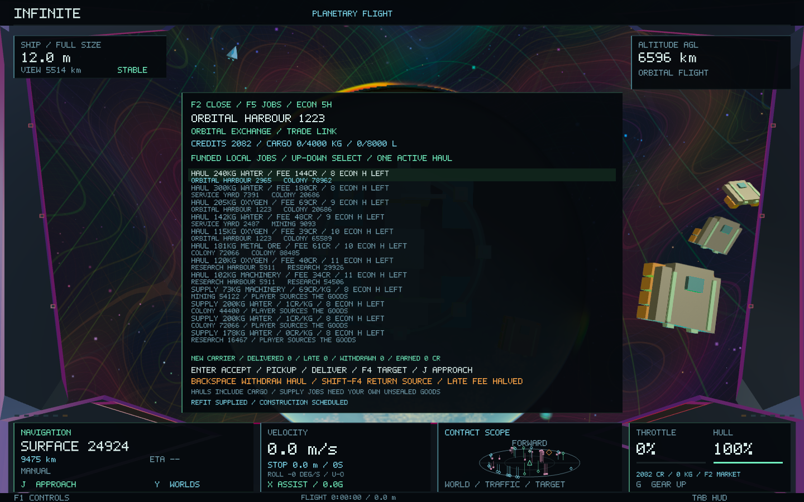
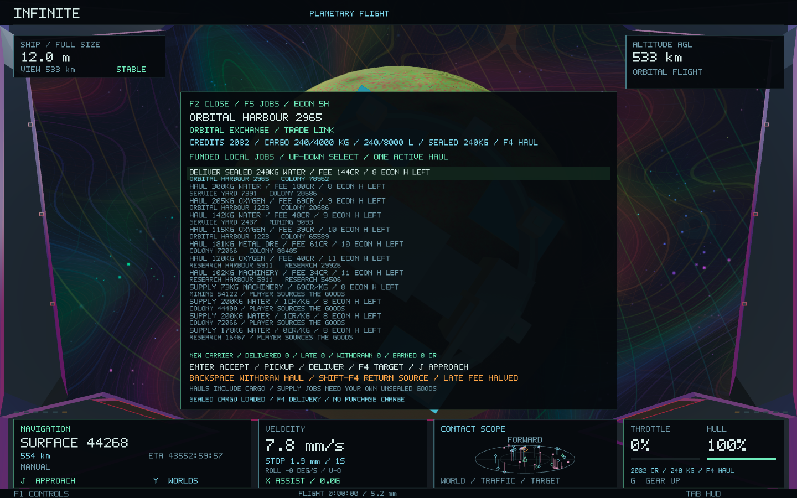
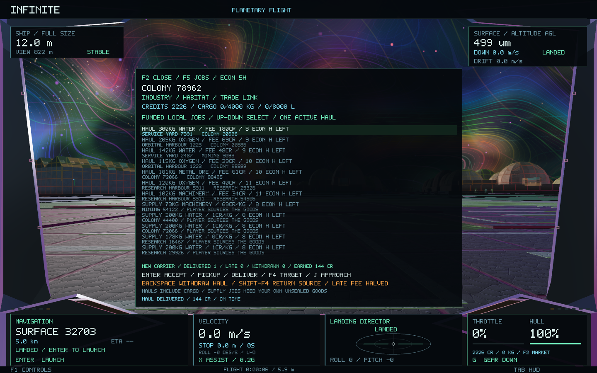
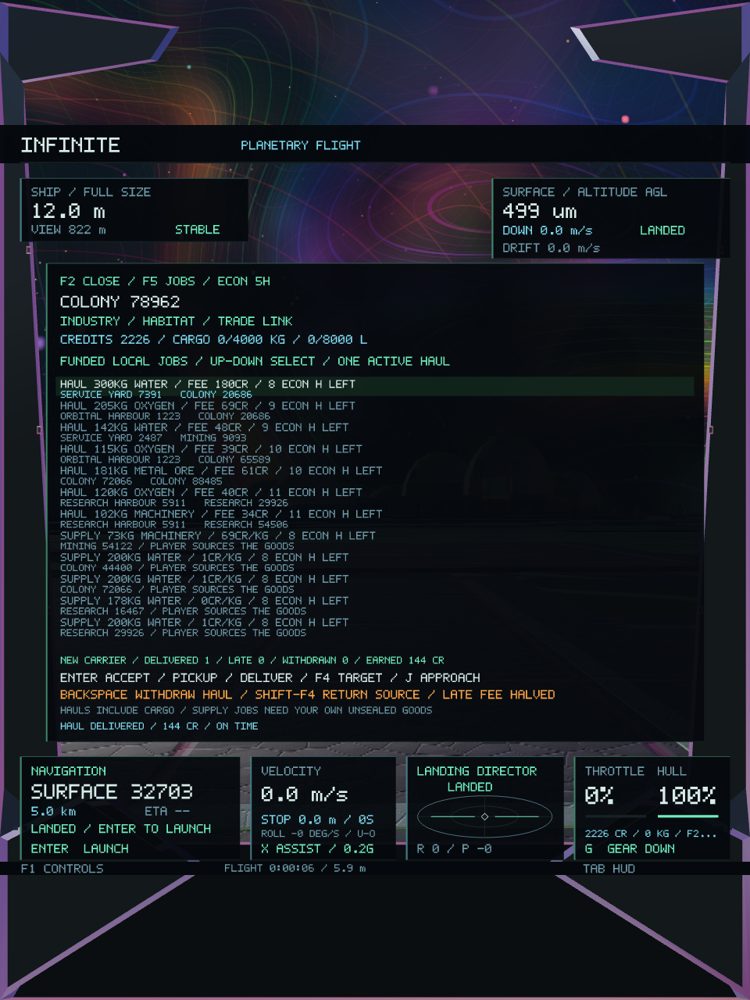

# Cargo-backed hauling and carrier work — Infinite 0.40

This phase adds paid transport work to the existing economy. A buyer reserves money for actual goods and a carrier fee; an existing supplier reserves the goods. The player can accept the job remotely, physically collect the consignment and deliver it for the funded fee. Buying the goods is not required, so a new pilot can earn transport income without a large trading bankroll.

The restored classic flight controls remain unchanged. This is an economic overlay over the existing sites, inventories, ship hold, world addresses and navigation.

## Playing

Press **F2**, then **F5** to cycle **goods → routes → industry → jobs**. The new jobs page lists active work first, followed by a bounded selection of funded hauling and supply offers throughout the current system. Up/Down selects a row.

- **Enter:** accept an offer remotely, pick up a reserved haul at its supplier, or deliver at its destination. For supply contracts it accepts or delivers the selected supply job.
- **F4:** target the selected job's next port; **J** uses the existing approach system. On other pages or outside the market, F4 prioritises your active haul.
- **Backspace on jobs:** withdraw an uncollected haul remotely, or return a loaded consignment at its original source.
- **Shift+F4 on jobs:** target the active consignment's return source. Outside jobs, Shift+F4 retains the accepted supply-contract shortcut.

At another system, F4 targets the active haul's system first. Approach that system, then use F4 for its port. Only one haul can be accepted at a time. Supply contracts, personal trading and facility investment remain available alongside it.

Pickup, delivery and loaded returns use the same physical trade-link checks as ordinary cargo: full-size ship, cruise disengaged and speed below 3 m/s; solid surface ports require landing within 250 m. Remote acceptance does not load cargo. A pending pickup immediately reserves its potential payload against shrinking, before the worker acknowledges it.

## Sealed cargo and payment

Consignments occupy the real cargo bay and count toward mass, volume, handling and the existing bulk-cargo shrinking restriction. They are marked sealed. The goods table's **FREE** column shows unsealed stock available for sale; the header retains total physical cargo and the active consignment. Unsealed goods of the same material can still be traded independently.

Sealed material cannot also be sold, used to fulfil another supply contract or installed in a facility refit. The seal follows the global wallet across system changes, cache eviction and restart.

The buyer funds both the integrated supplier price and the carrier fee when an offer is created. Goods stay reserved at the source until pickup. All payment remains in escrow until accepted delivery; then the supplier receives the goods price and the player receives the fee. This keeps refundable consignment money out of spendable firm income and dividends. No actor creates a reward balance.

A pickup costs the player no credits. On delivery, the buyer receives the actual cargo. Command sequence IDs make acceptance, pickup, delivery and withdrawal exactly-once operations. A full bay, wrong port or full destination warehouse rejects the operation without removing goods or paying twice.

## Deadlines and returns

Offers expire if their pickup deadline passes before collection. Stock reservations and buyer funds are released. An expired uncollected booking is reconciled out of the player's wallet when its system catches up, even if the old offer record has left the bounded archive.

Cargo already aboard never disappears because a deadline passes. It remains sealed and deliverable. Late delivery pays half the carrier fee and returns the unused half to the buyer; the supplier still receives its agreed goods price. The job page identifies overdue work and displays the reduced fee. Overdue cargo stops counting as expected inbound supply, so a player travelling away for a long time cannot indefinitely suppress replacement deliveries to a settlement.

Returning a loaded consignment requires its original source and enough warehouse room. The components go back into that source's real inventory and the held payment returns to the buyer. The player cannot remotely discard entrusted goods to free the job slot. Before pickup, withdrawal simply releases the stock and refunds the buyer.

## Career and dispatch

The jobs page records completed deliveries, late deliveries, withdrawn/expired bookings and total freight fees earned. Carrier rank progresses from new carrier to courier, trusted carrier and veteran with on-time deliveries. These are persistent service records; rank does not mint credits or increase rewards without funding.

Haul offers use existing surpluses and shortages, after accounting for inbound NPC and player freight. They share the same stock reservations with production, markets and NPC dispatch. The bounded dispatcher considers four suppliers per good, creates at most two offers per twelve-tick batch, allows at most eight waiting offers and retains at most 32 records. The cockpit lists at most twelve jobs. This adds no replacement freighters, new settlement identities or world generation.

The canonical five-second economic clock, background worker, immutable snapshots and three-network LRU cache remain in use. Ledger payload version three and wallet version two retain older economic saves, construction projects, dividends, cargo and money. New records store the source/destination addresses and the sealed manifest; no procedural seeds or addressing rules change.

## Validation coverage

The hauling suite checks money and material conservation, backed stock reservations, replayed commands, no-cost pickup, hold mass/volume limits, wrong-port refusal, full destination warehouses, physical returns, pre-pickup expiry and overdue delivery. It also checks that sealed stock cannot be resold, used in a supply job or installed in a refit, while separately owned stock of the same good remains usable. Replacement orders resume when player cargo becomes overdue.

Worker tests carry a sealed consignment through four systems, eviction, shutdown and restart before paying it once. Version-two industrial ledgers and version-one wallets migrate without changing retained projects, stock, credits or cargo. Malformed saves are rejected without mutating live state. Different tick batch sizes produce identical ledgers, and narrow/wide cockpit layouts retain their bounds.

The native economic fixture uses a separate test save. It exercises the earlier market, trade and industrial pages, then accepts a funded haul, collects it at an existing orbital port and lands at its existing surface destination before delivery. It captures all four pages, cargo/payment changes and portrait layouts. Trading and commissioning checks retain identical camera and world-geometry fingerprints.

The [preservation manifest](economy-0.40/preservation.json) records 184 unchanged source files against `7d402fe`, including the restored manual flight controls, generators, identities, addressing, terrain/city meshes, weather and GPU shaders.

The final build passes **39 core tests**, including **2,983 hauling checks**, **332 investment checks** and **64,610 existing economic checks**, plus **two native gameplay/image checks**. The native run validates thirteen wide/portrait captures; the new jobs pages were also visually inspected. [Core results](economy-0.40/core-tests.log), [detailed checks](economy-0.40/core-details.log), [native results](economy-0.40/native-tests.log), [native scenario log](economy-0.40/native-economy.log).

## Measured cost and package

The retained 95-site, 123-vessel network provides the following state comparison against the 0.39 report:

| Measurement | 0.39 | 0.40 |
| --- | ---: | ---: |
| Network definition plus mutable ledger | 336,740 B | 337,892 B |
| Representative native worker state plus snapshot | 498,516 B | 503,964 B |

The new representative snapshot costs **5,448 B (5.3 KiB)** more, for a total of **0.481 MiB**. Four-system eviction tests stay within the existing 4 MiB test budget. Dispatch and job extraction run on the existing background worker, with bounded offers, archives and displayed rows.

The final native scenario completes 701 frames and thirteen readbacks in 32.16 seconds, with **24.70 ms median / 75.16 ms p95** frame time and **161,169,408 B peak process RSS**. The core ledger fixture measures 7,939.88 ms for adapter plus the first 100 ticks and 2,333.89 ms for the next 1,000 ticks while other core tests run. This machine was heavily loaded by other applications, and the expanded native scenario differs from 0.39; these timings are diagnostic observations, not a matched performance comparison or speedup claim. [Frame profile](economy-0.40/native-frames.csv), [ledger measurements](economy-0.40/core-details.log).

The executable is packaged as **Infinite 0.40.0 / build 45**, ad-hoc signed and verified. All 28 Mach-O code/data sections match the tested build. [Build log](economy-0.40/build.log), [package verification](economy-0.40/package.json). The native fixture uses disposable test data and leaves the player's existing save untouched.

