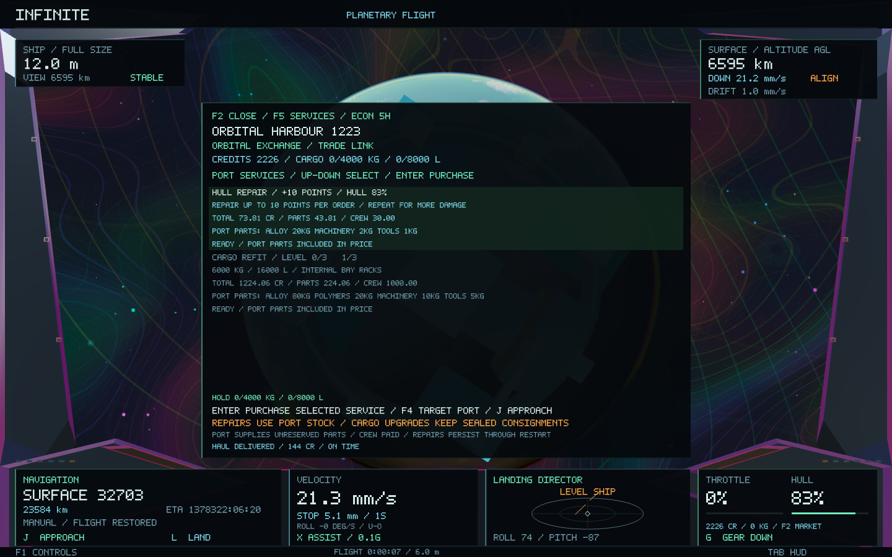
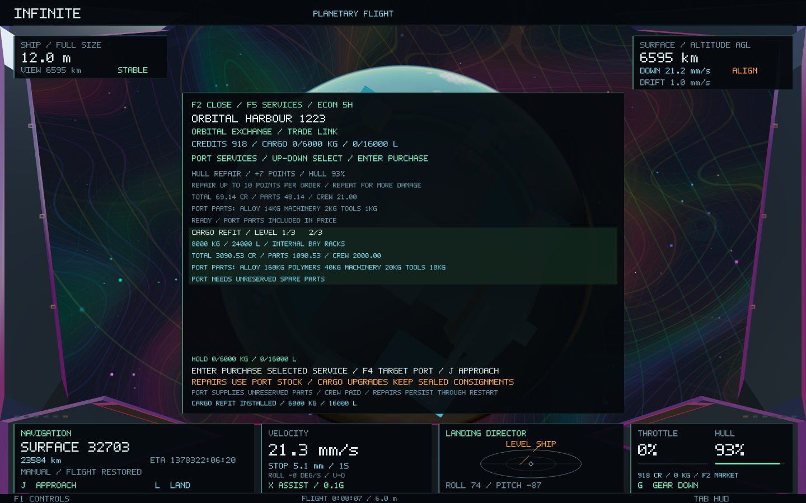
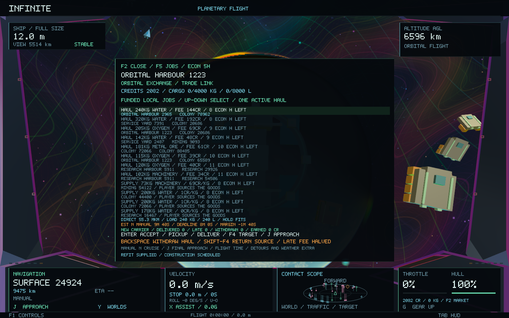
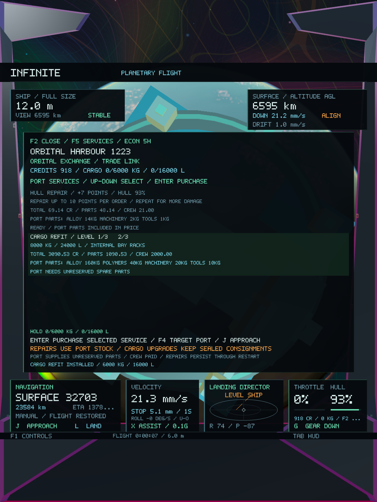
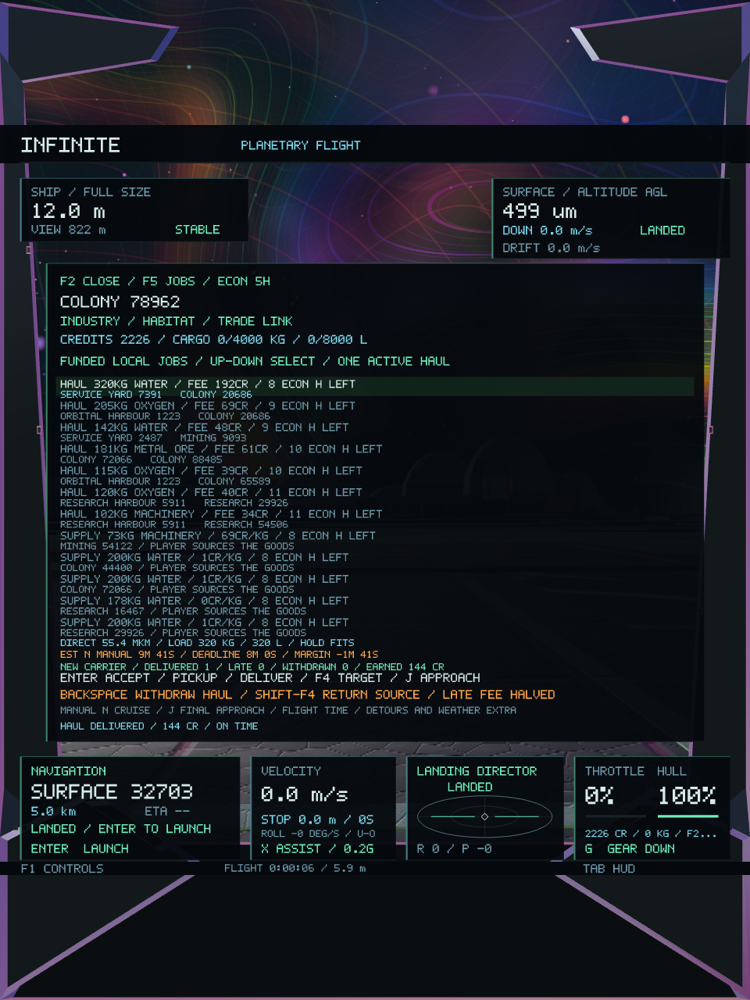

# Port services, cargo progression and job planning — Infinite 0.41

Existing ports now sell hull repairs and three cargo-hold refits. Hauling and trading use the expanded capacity, while the jobs board combines fees with distance, mass, volume, travel estimates and deadline margin. The universe, geometry and restored steering remain intact.

## Controls and services

Open **F2**, then cycle **F5** through goods, routes, industry, jobs and **services**. Up/Down selects a service; **Enter** purchases it at the displayed total. **F4** targets the displayed service port and **J** approaches it. Services require the existing physical trade link: full-size ship, cruise disengaged, speed below 3 m/s; surface ports also require landing within 250 m. Remote browsing shows quotes and availability.

Hull repairs restore up to **10 percentage points per order**, capped at the ship's missing hull. Repeat for further damage. Parts come from the port's unreserved stock: two kilograms of alloy per point, plus machinery and tools in repair batches. The quote includes the integrated material price and crew labour. Port outages or unhealthy crews stop services, and missing parts or insufficient credits prevent purchase.

Material revenue goes to the port, with labour paid to local households or the existing orbital cooperative. Repair parts enter the maintenance-consumption ledger. Every payment transfers existing credits; repair rewards and replacement stock are not created.

Cargo refits configure internal bay racks without changing the ship's exterior or flight controller:

| Cargo level | Mass limit | Volume limit | Labour, before port parts |
| --- | ---: | ---: | ---: |
| Original | 4,000 kg | 8,000 L | — |
| 1 | 6,000 kg | 16,000 L | 1,000 CR |
| 2 | 8,000 kg | 24,000 L | 2,000 CR |
| 3 | 10,000 kg | 32,000 L | 3,000 CR |

Each refit uses 80 kg alloy, 20 kg polymers, 10 kg machinery and 5 kg tools multiplied by its level. The port supplies the parts, and their actual stock-dependent cost appears before purchase. Installed parts are exported into persistent ship capital; the level represents the fitted configuration. Upgrades retain existing cargo and sealed consignments. Limits persist across systems, eviction and restart.

Funded hauling offers can now exceed the earlier 300 kg batch when real surplus, buyer demand, warehouse room and buyer funds permit. They are bounded at 10 tonnes; pickup still checks both the ship's actual mass and volume limits. Trade order sizes and trade recommendations use expanded capacity too. Higher payloads feed the existing mass/inertia calculation with unchanged thrust and steering algorithms. Cargo aboard or awaiting pickup acknowledgement continues to prevent shrinking; an empty upgraded bay retains the normal shrinking ability.

## Repair persistence

Paid hull work adds to a cumulative receipt in the economic wallet. The physical ship records how many paid points it has applied. On acknowledgement or restart, only the difference is applied, up to 100% hull. Replayed snapshots and commands cannot heal later damage twice. If economic payment commits before the ship save updates, the next start recovers the unapplied work.

Wallet version three stores cargo level and repair receipts. Ship version five appends the applied repair counter; versions one through four remain readable with their velocity, position, size, hull and actuator state retained. Economy ledger version four retains previous ledger formats, investments, freight, contracts and money.

## Job planning

The selected job now shows its cargo mass and volume, whether the hold fits, direct trip distance, estimated travel time, remaining deadline and signed margin. Before pickup, a haul includes travel from the current ship to its supplier and then to the buyer. After pickup it includes only the buyer leg, and cargo already aboard is counted once. Supply jobs needing goods explicitly require procurement instead of inventing a sourcing route.

Estimates use **manual N cruise for transit and J for final approach**, the configured cruise speed, payload-dependent braking, proximity slowdown and port handling. They are planning estimates rather than autopilot arrival guarantees; obstacles, alignment, weather, manual choices and full-route guided flight can add time. Distance is direct distance, so a detour can be longer. Deadline margin uses actual flight seconds, separate from the accelerated economic clock. Unknown ship positions suppress timed estimates. Spatial frame and render magnification do not change the SI inputs.

The existing jobs controls remain: Enter accepts/picks up/delivers, F4 targets the next job port, and Backspace withdraws or physically returns the active haul. Supply contracts, trade routes, facility investment and dividends remain available.

Bulk prices retain their original per-kilogram marginal formula. Monotonic constant-price intervals are summed together so larger quotes do not require a per-kilogram loop on the cockpit thread. Economic generation, dispatch and bounded trade discovery continue on the existing worker.

## Validation and measured cost

The final implementation passes **40 core tests** and **two native gameplay/image checks**. This includes **575 services/planning checks**, **333 investment checks**, **2,983 hauling checks**, **64,610 existing economic checks** and **185 handling/roll checks**, plus the existing force, persistence, world-preservation and galaxy-to-atomic round-trip suites. [Core results](economy-0.41/core-tests.log), [detailed checks](economy-0.41/core-details.log), [baseline checks](economy-0.41/baseline-tests.log).

The services suite checks actual material use, wages, money/material conservation, replay, stale quotes, missing and reserved parts, outages, insufficient funds, all cargo levels, invalid saves and older save migration. It carries a funded haul larger than the original hold through pickup, save/restart, shrinking refusal and delivery. Worker tests retain refits and repair receipts through four systems, eviction and restart. Repair tests cover both sides of an interrupted application and confirm old receipts do not heal later damage again. Sixty bulk-price scenarios cover all twenty goods and three stock/target regimes; bulk totals equal successive one-kilogram marginal bills, including shortages and saturation.

Planning tests check loaded and uncollected cargo, missing supply goods, hold mass/volume, unknown position, configured drive speed, decreasing distance, overdue margins and read-only state. Services and jobs retain cockpit bounds at four aspect ratios. The native test completes the earlier market/industry/hauling loop, repairs a real ship from 83% to 93%, buys the first hold refit, verifies the exact debits and captures **17 wide/portrait screens**. The new screens were visually inspected. [Native results](economy-0.41/native-tests.log), [scenario log](economy-0.41/native-economy.log).

The [preservation manifest](economy-0.41/preservation.json) compares against `33e72b7`: **181 protected source files** are unchanged. It also records identical hashes for the entire pilot steering/collision section and the force/rotation/gravity/drag section. The payload clamp increases to the purchased maximum; force curves, steering gains, geometry, seeds and coordinates are retained.

| Representative state | 0.40 | 0.41 |
| --- | ---: | ---: |
| Definition plus mutable ledger, 95 sites / 123 vessels | 337,892 B | 337,892 B |
| Native worker state plus snapshot | 503,964 B | 504,236 B |

The representative snapshot grows by **272 B** to about **0.481 MiB**. Four-system cache tests remain below 4 MiB. The expanded native run completes 811 frames, with **21.71 ms median / 47.58 ms p95** frame time and **154,763,264 B peak RSS**. It includes seventeen captures, resizing, streaming and additional port visits, so this is diagnostic timing rather than a matched rendering comparison or speedup claim. [Frame profile](economy-0.41/native-frames.csv).

**Infinite 0.41.0 / build 46** is packaged, ad-hoc signed and verified. All **28 code/data sections** match the tested executable. [Core build](economy-0.41/build.log), [final viewer build](economy-0.41/native-build.log), [package check](economy-0.41/package.json). Test saves are isolated from the existing player save.

