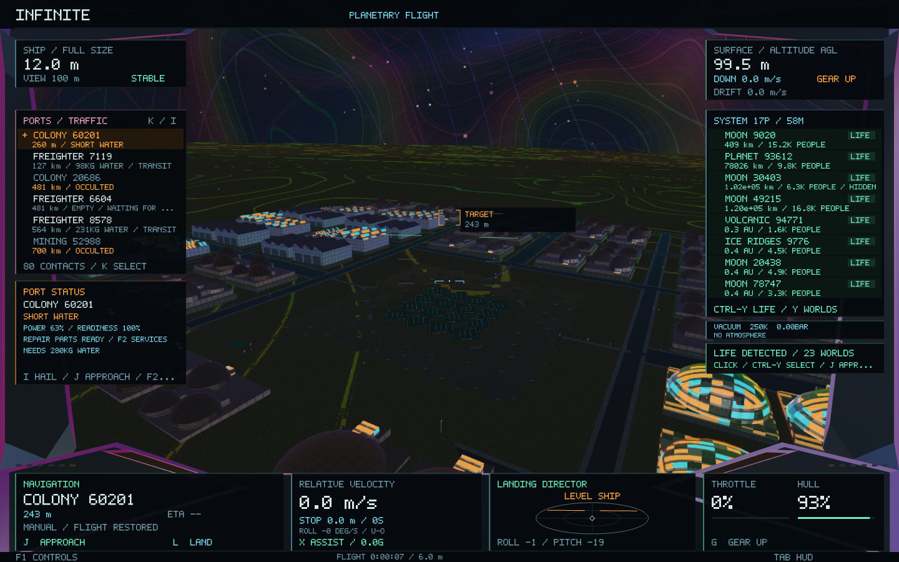
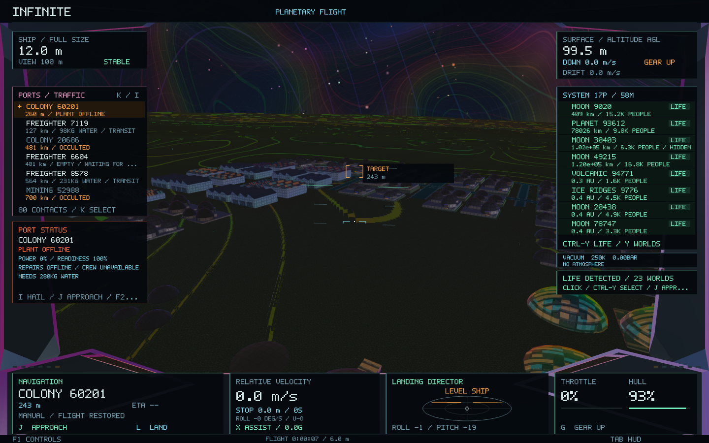
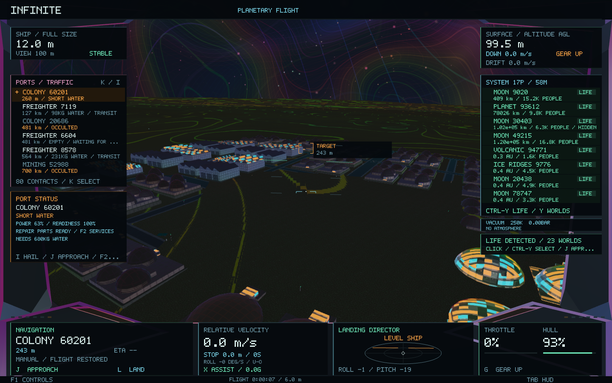
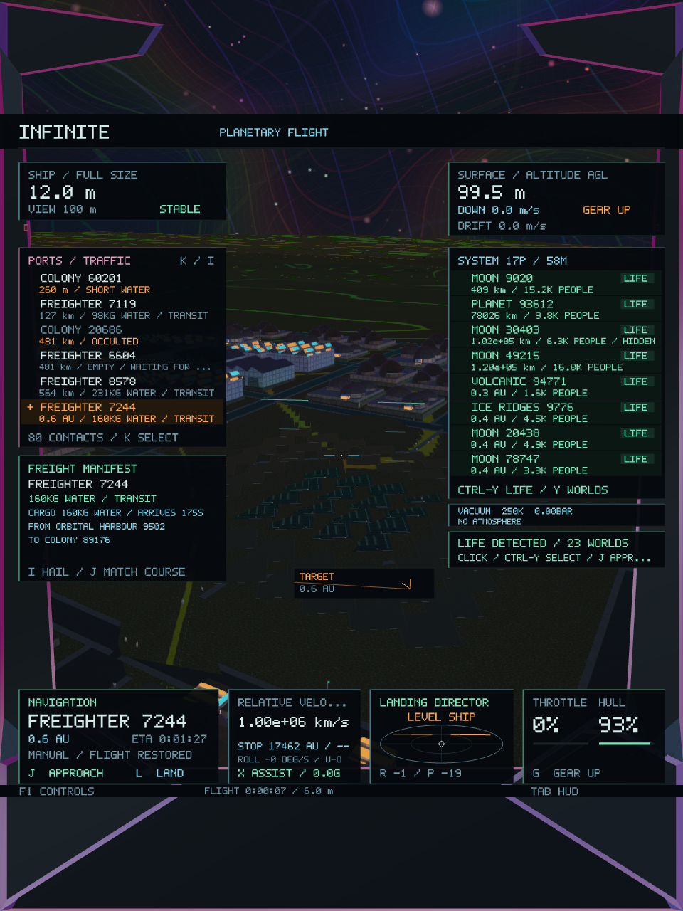

# Visible economic state — Infinite 0.42

This update exposes the existing ledger in the cockpit, city lighting and civilian freight reports. It adds no settlements, residents, buildings, ships, contracts or economic simulation rules. Flight controls, world seeds, spatial identities and geometry remain intact. Existing ship, wallet and ledger save formats are unchanged.

## Port reports before landing

The ports/traffic list now includes a compact economic status. A nearby known port retains a row among busy civilian traffic, alongside the selected contact. K cycling and mouse selection still use the original contact identities and order.

A persistent **PORT STATUS** card shows the selected port, or the nearest known port when a freighter is not selected. It reports power availability, operational readiness, missing supplies, repair-parts availability and an affordable profitable route when the existing trade planner finds one. Outages and supply shortages receive stronger warning colours. The report distinguishes a lack of spare parts from the player's ability to pay; **F2** still provides the exact service quote.

**K** selects contacts, **I** hails them, **J** uses the existing approach and **F2** opens their market. Surface ports continue to require landing for trading and services. Unknown or catching-up economic state does not claim live availability. Reports and labels fit the existing cockpit safe area, including portrait windows.

## Settlement lighting

The worker derives a bounded lighting target from existing power, household essentials, health and maintenance condition. Power availability includes the existing climate, weather and installed utility modules; outages use the existing ledger outage state. Readiness reflects actual available household supplies and the current health/condition values.

Powered rooms, spectral trim and existing street-light materials dim during shortages and outages. Supplies and restored power recover their illumination. A small emergency-light floor retains readability. Transitions blend smoothly, and incomplete catch-up snapshots do not drive rapid lighting changes.

The renderer carries this scalar in the existing 80-byte instance record and changes only architectural emission and interior lighting. Opaque surfaces retain their depth and opacity. Sun/sky illumination, building placement, shadows, roads, collision shapes, resident counts and resident trajectories remain unchanged. Shared meshes and instanced batches remain in use. An unscanned settlement retains its original presentation until ledger data is available.

## Freight manifests

Existing freighters expose their actual cargo or reserved pickup, source, destination, departure/arrival countdown and waiting reason. Loading is distinguished from goods already aboard; an empty ship heading to pickup is labelled empty. Idle ships show their berth and no assigned destination. A full destination warehouse is identified as the reason a carrier is holding.

The selected ship has a **FREIGHT MANIFEST** card, and I hails include the full report. These fields come from the existing freight assignments. Route interpolation, positions, velocities, orientations, vessel seeds and navigation targets are retained.

## Architecture

One pure extraction pass builds port signals after the worker publishes routes and jobs. Main/render consume the immutable snapshot. Signals and labels do not issue orders or modify stock, money, production, households or histories. The renderer keeps one bounded per-site lighting vector for the current network; it allocates no new world geometry or light objects. Metal, Vulkan/SPIR-V and OpenGL presentation binaries use the same material change, with no new dependency.

## Validation and measurements

**41 core tests and two native gameplay/image checks pass.** The new suite adds **61 checks** for shortages, repair stock, crew availability, real-supply recovery, outage/recovery, catch-up status, trade hints, all five freight phases, unchanged actor paths and fitted HUD reports. Existing services, hauling, investment, accounting, handling, population, city/world preservation and galaxy-to-atomic tests also pass. [Core results](economy-0.42/core-tests.log), [detailed checks](economy-0.42/core-details.log), [baseline](economy-0.42/baseline-tests.log).

The native fixture validates **22 captures**, including a controlled outage/recovery in an isolated ledger for the real **Colony 60201**. Its lighting target changes **0.6475 → 0.06 → 0.6475**. All three captures retain the same navigation camera, city descriptor **17899170596612588743** and submitted geometry fingerprint **7319388714327343702**. Pixel checks identify **58,515** changed pixels when dimming and **30,063** when recovering within the central windshield region. The screens and wide/portrait freight reports were visually inspected. [Native results](economy-0.42/native-tests.log), [scenario log](economy-0.42/native-economy.log), [image checks](economy-0.42/native-details.log).

The [preservation manifest](economy-0.42/preservation.json) compares against `f3a3420` and confirms **176 source/resource files unchanged**, including generators, coordinates, city meshes, ship controls, physics, economic simulation rules and the remaining shader binaries. Only the two architectural fragment programs change in each of the three supported prebuilt backends. [Shader compilation](economy-0.42/shaders.log).

| Representative state | 0.41 | 0.42 |
| --- | ---: | ---: |
| Definition plus mutable ledger, 95 sites / 123 vessels | 337,892 B | 337,892 B |
| Native worker state plus snapshot | 504,236 B | 531,216 B |
| GPU instance record | 80 B | 80 B |

Snapshot/reporting overhead is **26,980 B (26.3 KiB)**, bringing the representative total to **0.507 MiB**. The lighting vector is bounded at 4,096 floats (16 KiB), with only 95 entries in this network. Four-system cache tests remain within their existing 4 MiB budget.

The expanded native scenario records **1,481 frames**, **56.52 ms median / 147.14 ms p95**, and **149,946,368 B peak process RSS**. It includes additional city geometry, five new captures and controlled transitions on a heavily loaded machine. These are diagnostic measurements rather than a matched rendering comparison or speedup claim. [Frame profile](economy-0.42/native-frames.csv).

The tested executable is packaged as **Infinite 0.42.0 / build 47**, ad-hoc signed and verified. All **28 code/data sections** match the tested build, and the native test uses that exact executable. Tests use isolated data and retain the existing player save. [Build log](economy-0.42/build.log), [package verification](economy-0.42/package.json).

