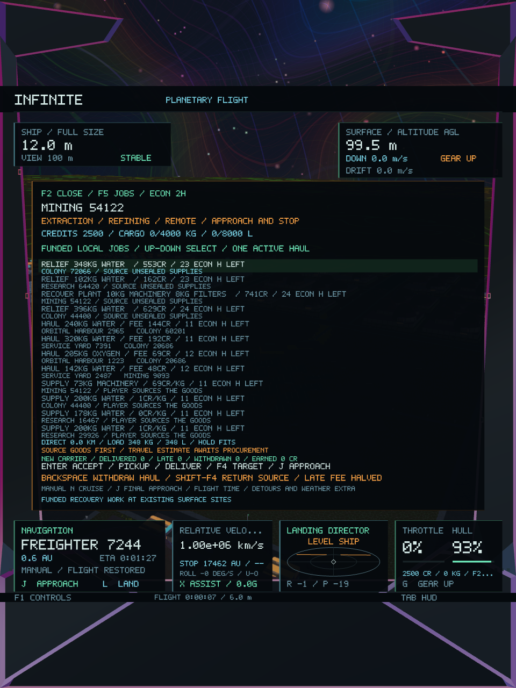
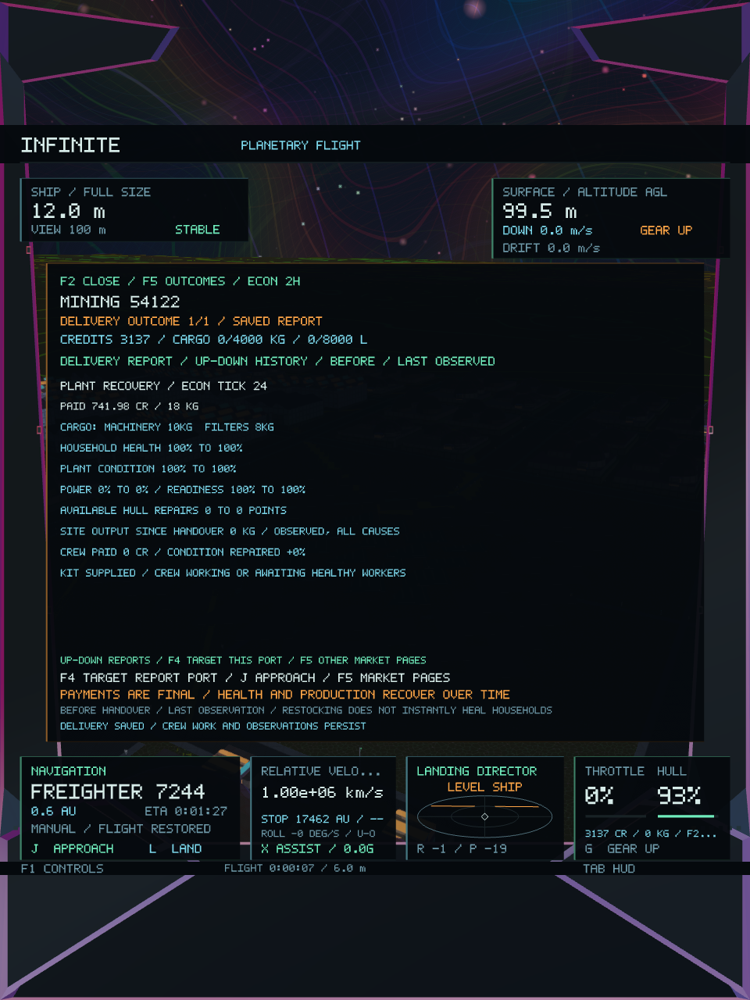
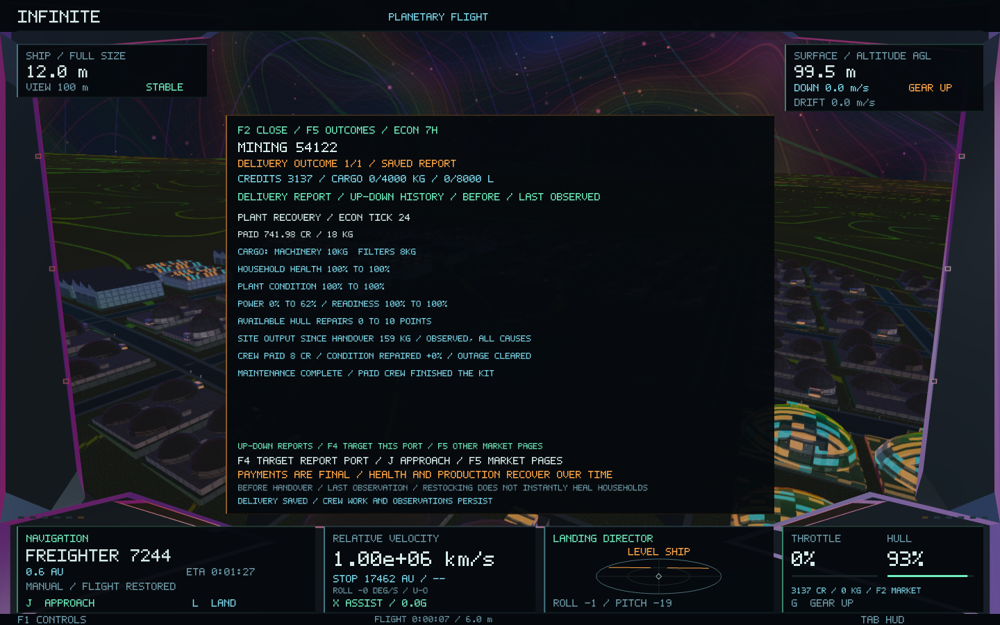

# Recovery work and delivery outcomes — Infinite 0.43

Recovery jobs use existing inhabited, landable surface settlements. They do not add worlds, buildings or people, manufacture emergencies or alter procedural seeds. The restored flight controls, universe structures and colourful renderer are retained.

## Recovery jobs

**F2 → F5 → Jobs** lists funded recovery work alongside supply contracts and sealed freight. **Enter** accepts remotely, **F4** targets the settlement and **J** uses the existing approach. Delivery still requires a physical trade link: stop below 3 m/s and land at a surface port. Buy the listed goods at existing markets and return to the job. Enter hands over matching unsealed cargo; partial deliveries are paid immediately and leave the remaining requirements visible.

Household relief requests food, water and oxygen where the existing settlement is sealed. Requests reflect actual available supplies and consumption, with a twelve-tick buffer and a maximum of 1,000 kg per commodity. Supplies enter ordinary household consumption. Health recovers through the existing simulation rather than receiving an immediate delivery bonus. A large bundle can be delivered in several trips; planning checks both mass and volume.

Plant recovery requests machinery and filters when a real plant outage is active or maintenance condition is low. The buyer funds the supplies and crew wages in escrow before posting. Delivered kit parts are reserved so ordinary trading, freight and production cannot spend them. Two existing healthy workers use one machinery/filter pair per tick, improve condition and receive real wages from escrow. Their labour is withheld from ordinary production while working, and a facility refit reserves its construction crew before maintenance can use the remaining workers. Crew work can pause if household health falls too low. Two spare machinery kilograms are released for ordinary port services on completion. A repair clears its original outage only when that same outage is still active; a later outage is preserved.

Incomplete jobs expire after 288 ticks (24 minutes of flight time). Paid goods remain at the settlement, partial-kit reservations are released and unused escrow returns to the buyer. A fully supplied crew job can finish after its delivery deadline. At most eight recovery jobs are active, at most two are posted per twelve-tick batch, and at most 32 job records are retained. Ordinary supply offers do not duplicate an active recovery job at the same site.

## Clear outcomes

Successful sales, supply deliveries, freight deliveries and recovery handovers create a persistent report. The market opens **Outcomes** automatically after the acknowledgement. **F5** cycles to it later, **Up/Down** selects older reports and **F4** targets the reported port.

Reports show exact payment and cargo, household health, plant condition, power, readiness and available hull-repair points before handover and at the last observation. Maintenance reports also show actual crew wages, repaired condition and whether that job cleared an outage. Partial deliveries identify what remains. Production is labelled **site output since handover / observed, all causes**; it is not attributed entirely to the player. Reports observe twelve subsequent economic ticks; crew reports continue through completion and then observe twelve more ticks.

Each system retains sixteen reports. An active crew report is protected from eviction. Data remains in the existing worker-owned SQLite ledger and immutable snapshots; rendering issues no economic mutations. Ledger version 5 reads versions 1–4. Existing wallet version 3 and ship version 5 are unchanged. A transaction sequence cannot issue a second payment or report when replayed.

## Verification

**42 core tests and both native gameplay/image checks pass.** The new suite includes **647 checks** for real shortages, sealed habitats, multi-good planning, partial delivery, conservation, duplicate commands, expiry, reserved parts, unhealthy crews, outage recovery, construction/recovery crew sharing through plant restart and periodic maintenance, newer-outage protection, pinned report eviction, bounded history and v4 migration. A worker test also verifies atomic delivery/report publication and report persistence through SQLite restart. Existing handling, services, industry, city/world preservation and full galaxy-to-atomic round trips pass. [Core results](economy-0.43/core-tests.log), [detailed results](economy-0.43/core-details.log).

The native scenario validates **26 captures**. A controlled outage at the existing **Mining 54122** settlement posts a funded plant-recovery job. The fixture buys **10 kg machinery and 8 kg filters from actual suppliers** for **104.98 CR**, delivers them for a **741.98 CR** payment, and observes **8 CR** in escrow-funded crew wages. The player nets **637 CR** after procurement. Power availability returns from **0 to 625 permille (62.5%)**, available hull repairs return **0 → 10 points**, and the site produces **159 kg** during observation. Its maintenance condition was already full; the report correctly records **zero condition gain** while the outage is cleared. Damaged-condition recovery is covered separately by the core tests. Screens were visually reviewed in wide and portrait layouts; the report uses **TO** because the existing HUD font omits greater-than glyphs. [Native checks](economy-0.43/native-tests.log), [scenario](economy-0.43/native-economy.log), [image results](economy-0.43/native-details.log).

The [preservation manifest](economy-0.43/preservation.json) confirms **186 protected source/resource files unchanged** against `060e8e7`, including procedural generators, world/city geometry, coordinates, ship handling and every shader. No new rendering pass or dependency is introduced.

The representative hauling-worker fixture grows from **530,445 to 535,797 bytes**, an increase of **5,352 bytes (5.2 KiB)**. The existing four-system cache test remains below its **4 MiB** budget. Job and report storage is bounded. The final native run records **1,649 frames**, **65.83 ms median / 142.55 ms p95** raw frame time and **157,351,936 bytes peak RSS**. These include loading, gameplay, resize and capture stages on a shared machine; they are diagnostic measurements, not a rendering speedup claim. [Measurements and hashes](economy-0.43/validation.json), [frame data](economy-0.43/native-frames.csv).

**Infinite 0.43.0 / build 48** is packaged, ad-hoc signed and verified. All **28 code/data sections** match the tested executable, and the native test copy has the same complete SHA-256 hash. Tests use isolated saves. [Final build](economy-0.43/final-build.log), [package verification](economy-0.43/package.json), [signature](economy-0.43/signing.log).

