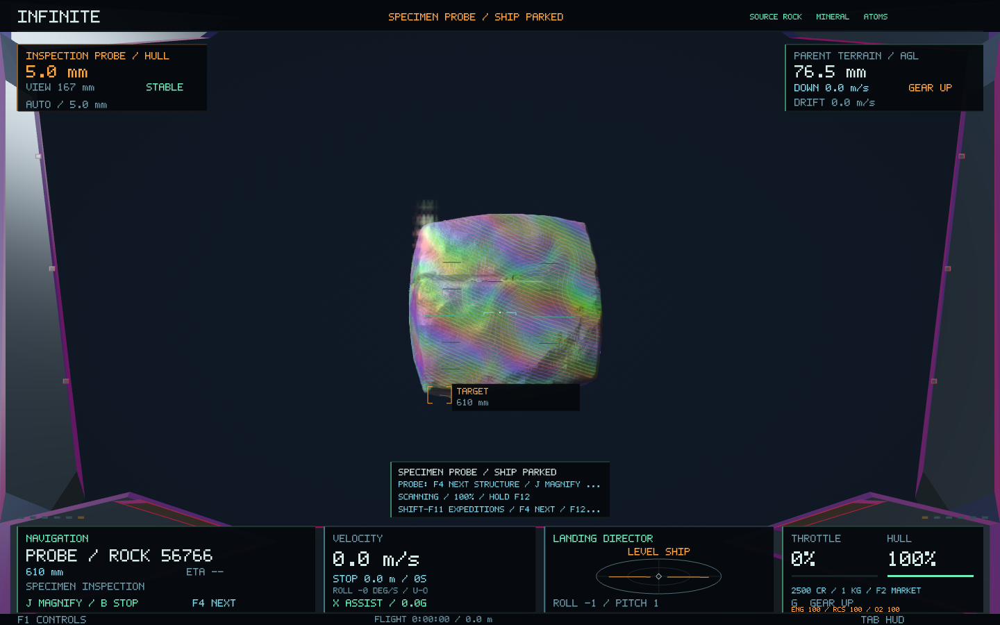
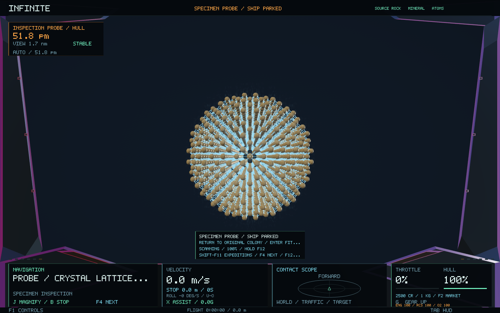

# Material expeditions — 0.55

A colony's thermal-exchanger fault now leads to one connected expedition through Infinite's existing terrain, rock, mineral and atomic structure. The colony finances the repair. The player brings back a physical core, assays its original material lineage in a port lab, and returns to install an adapted exchanger.

## Play the expedition

1. Press **Shift-F11** to open Expeditions, or select the new **F2 → F5 → Expeditions** market page. **Up/Down** selects a record.
2. **F4** targets the colony. Use the existing **J** approach and **L** landing controls. Once landed and stopped at the colony, open Expeditions and press **Enter** to diagnose and accept. The colony must have the real refit parts, fitting crew and funds; supplying its market can resolve a shortage.
3. **F4** now targets a real core site beyond the settlement. Approach at full size. Hover within 80 m of the marked core, below 40 m of the ground and slower than 3 m/s. Hold **F12** to survey, then **Ctrl-Space** to collect a sealed 1 kg core. The colony loans a sampler for this job; it occupies no weapon mount.
4. Return to a healthy port, land or dock, and press **Enter** on the expedition page to open its specimen lab. The full-size ship and all its cargo remain parked there.
5. The inspection probe starts at the original rock. Hold **F12** to assay it. **F4** selects the registered mineral, and **J** magnifies that structure. Repeat the assay and magnification to inspect its atomic lattice. Normal helm, roll and size controls let you fly around the material between observations. Each assay needs eight units of observation work; navigation crew and scanner upgrades retain their normal benefits.
6. **Shift-F11** or **Escape** returns to the same parked ship. **Shift-F4** on the expedition page targets the original colony. Land there and press **Enter** to fit the exchanger and receive the funded **900 CR** reward.

Completing the job installs one genuine utility refit: **+25% of base power**, up to the existing three-level limit. The fitting crew is paid, the core is consumed in the repair, and the colony receives a saved maintenance outcome. Its contact report identifies your exchanger; powered settlement lights receive a modest persistent increase. Production still depends on workers, supplies, health and the existing economy rules.

**Backspace** cancels an unfinished expedition. The colony receives its remaining funds and set-aside kit back. A recovered core becomes ordinary mineral cargo aboard your ship; it is not silently deleted. The colony needs warehouse room to accept its kit. Cancellation does not erase the shared prospect's depletion.

## What stays the same

No universe generator, seed, address, terrain algorithm, city layout, object identity or atomic structure is changed. Offers attach to existing populated surface colonies on solid planets. A core's source is an ordinary canonical terrain → mountain → rock → grain → lattice lineage, not an independently generated lab scene.

The sealed core is a sample of that material. The lab reconstructs its surrounding source field as read-only context; it does not claim that an entire boulder is in a one-kilogram container. Rock, grain and lattice meshes use the normal geometry generator, inherited environment and LOD. The specimen adapter hides unrelated ancestors, terrain streaming and traffic while retaining the complete coordinate transforms used by those meshes.

The lab's **J** command is explicitly a magnification change, not travel by the parked ship. Normal flight outside the lab, long-range travel, regular shrinking, weapons and crew-station controls are unchanged, including **F10** station swapping. Leaving the probe restores the serialized ship, camera, momentum, hull, size, cargo mass, navigation history and selected contact. Quitting in the lab saves the parked ship, while core custody and completed assays remain in the economic ledger.

## Accounting and persistence

The new `INFINITE_EXPEDITIONS 1` custody ledger is written in the same SQLite transaction as the existing wallet, exploration records and active economies. Existing wallet, exploration and ship save formats remain unchanged. Sample mass and volume are derived from this authoritative custody record on load.

On acceptance, the colony's reward and crew wages enter escrow. Its actual utility parts leave saleable stock for a durable local fitting kit. Cancellation returns those exact resources; completion incorporates the parts into the existing facility-capital accounting. Reward replay cannot pay twice. A pending utility expedition blocks a competing player utility refit at that colony.

Core extraction uses the same finite level-7 prospect register as bulk mining and all finer material scales. It requires a fresh post-diagnosis survey, real proximity, completed coring work, unobstructed access, and physical hold capacity. Assays require custody, a physically opened powered lab, the registered material lineage, and rock → mineral → atomic order. A different grain or unrelated lattice cannot complete the expedition.

Generation and ledger updates run on the existing economy worker. Only compact immutable mission descriptions reach the cockpit. Records are bounded at 64, with at most one offer per visited system; source geometry uses the existing bounded cache and GPU representations.

## Validation and images

The automated checks cover the complete physical collection and repair chain, source descriptor and mesh preservation, cargo/depletion accounting, cancellation, duplicate reward prevention, four worker restarts, exact parked-ship restoration, and source-only specimen rendering. The native scenario captures all stages and the expedition panel at 600 × 1000 pixels.

The native fixture uses a controlled test colony to exercise its full workflow; the worker/restart test separately uses a real generated colony. [Verification record](expedition-0.55/verification.json).
