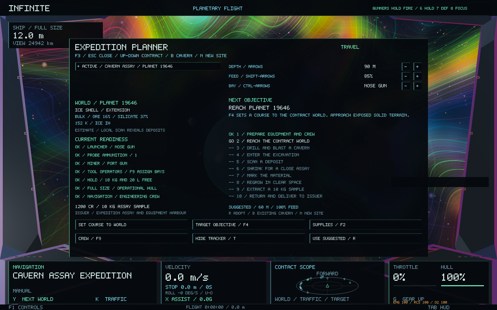
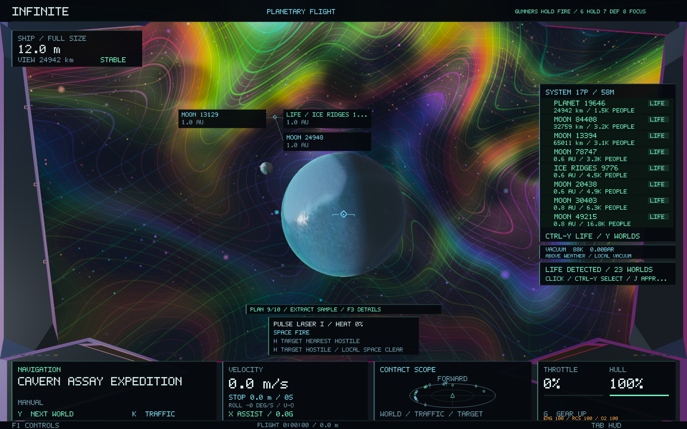

# Expedition planner — 0.60.0

Press **F3** in flight, or on the Survey market page, to review a cavern-assay expedition before departure. The planner shows the issuing port, funded reward, target world's existing geology and chemistry, required tools, ammunition, cargo space and crew readiness. Bulk composition is a forecast; local deposits still require physical surveying.

## Prepare and depart

1. Select an offer with **Up / Down**, the mouse wheel or its row. **Enter** accepts it and reserves the existing issuer-funded reward.
2. Follow the readiness checks. **F2** opens the relevant equipment service or cargo page; **F9** opens in-flight crew assignments. The captain can operate the occupied tool station; auxiliary bays require a ready assigned operator.
3. Set **depth** with Left / Right, **feed** with Shift-Left / Right, and the **probe bay** with Ctrl-Left / Right. The on-screen minus/plus buttons do the same. **R** adopts a conservative suggestion from the existing world's geology and material density. Suggestions do not guarantee a deposit or prevent thermal cutouts.
4. The primary button changes with the expedition. **Enter** follows it. **F4** targets the objective without engaging approach; the primary course button engages the existing approach system. **F3 / Esc** closes the planner.

The launcher commits depth and feed together with launch. Invalid settings retain ammunition and create no excavation. Existing in-camera drilling controls remain available.

## Follow the expedition

The ten objectives cover preparation, travel, drilling, entry, overview, close assay, marking, regrowth, extraction and return/delivery. An accepted contract has a compact flight tracker; **T** in the planner hides or restores it.

The planner derives progress from the existing contract, saved bore records, physical ship size and position, and actual cargo. It does not maintain a second mission completion state. An old scan must be refreshed after accepting the job. Selling the sample removes delivery readiness. Completed caverns remain usable after probe ammunition is spent.

**B** cycles saved caverns on the contract world. **N** plans a new drilling site without removing earlier excavations. Regional resource reserves remain shared: another hole in the same depleted region does not refill it. Newly launched probes on the planned world become the tracked excavation after their saved receipt arrives.

Inside a cavern, the planner identifies the next survey or extraction step and selects its deposit when targeting the objective. Shaft exit remains a manual maneuver, with **Ctrl-J** guidance. Outside, it can route to the saved entrance or back to the actual issuing port. Sample handover remains an explicit action available through the existing physical port-access rules; warehouse space and balance limits still apply.

## Preservation and verification

Universe generators, seeds, addresses, identities, geometry, scale hierarchy, ship dynamics and atomic depth are unchanged. The planner is a read-only adapter over existing world, economy, crew and exploration data. Accept, deliver, approach and equipment actions use the existing gameplay paths.

Planner selection, presets and tracker preference persist in a small per-universe settings file. Contract and excavation progress stay in the existing ledger and save formats. Existing saves need no migration.

The native fixture stages real ledger commands against an isolated economy and captures their planner views; it does not automate the flight to each work site. Separate core lifecycle checks validate physical entry, close surveying, marking, extraction, stale records, sold cargo and paid handover.

Validation passed:

- **61 core regression tests**, including continuity, restart, ship handling, crew, mining and economic conservation. [Regression log](expedition-planner-0.60/regressions.log)
- **10,405 focused planner assertions**, largely layout bounds across ten aspect/camera combinations for each lifecycle stage, plus readiness, pending actions, atomic launch presets, stale scans, sold samples, full ports and restart. [Focused checks](expedition-planner-0.60/focused-tests.log)
- **16 native planner views**, including the drill-camera overlay, paid delivery, portrait layout and compact tracker. Navigation and world identity stayed unchanged; runtime text checks found zero overlaps. [Native log](expedition-planner-0.60/native.log)
- **16 probe/cavern views** and **12 existing UI layouts** passed. [Image checks](expedition-planner-0.60/image-checks.txt)
- The signed **0.60.0 / build 72** app passed a 120-frame normal startup using an isolated save. [Startup log](expedition-planner-0.60/startup.log)

The final focused regression rerun is recorded in [final checks](expedition-planner-0.60/final-checks.log). **F3** retains its goods-contract action on the other market pages.
