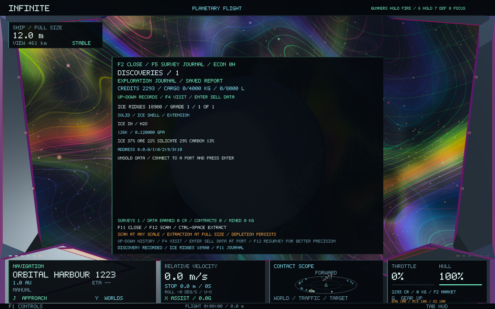
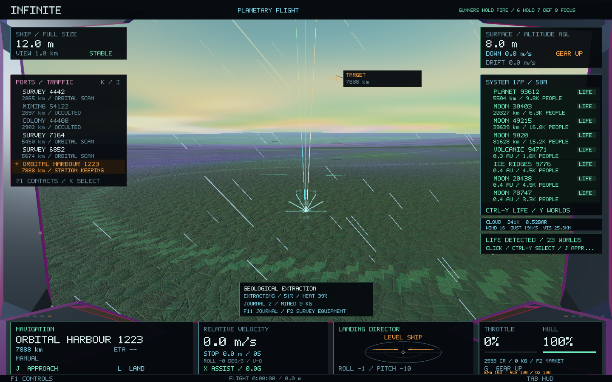
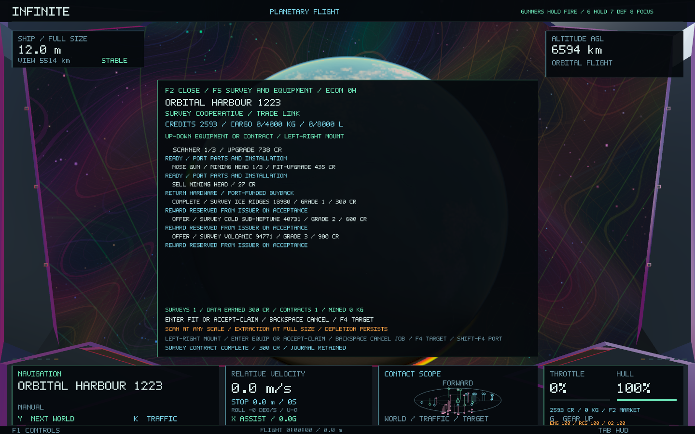

# Surveying, extraction and discovery work — 0.53

Exploration now connects the existing procedural worlds and material structures to the ship's crew, cargo hold and port economy. The scanner reads the universe's real descriptors. A separate gameplay ledger records observations and finite extraction; the existing generators, coordinates, identities, seeds, scientific geometry and rendering shaders remain unchanged.

## Survey first

**Hold F12** while facing a nearby planet. Close to solid ground it surveys the local surface prospect; inside material it surveys the current rock, mineral or atomic frame. The instrument reports observation progress. Releasing the key, losing access or changing target resets incomplete work. Cruise and the travel field inhibit observations.

**F11** opens the permanent survey journal. Up/Down selects a record. Reports retain the object's identity, actual inherited ice/metal/silicate/carbon fractions, dominant mineral/formula, formation process, temperature and pressure. Mineral and atomic reports identify the real crystal phase. Scanner grades improve displayed composition precision rather than inventing a different composition. A capable Navigation crew member accelerates observations; an expert operator adds one precision grade, up to III.

Scanning works while shrunken. Mineral and atomic observations require close physical access at the corresponding scale. **Z** retains its existing shrinking ability. Unload cargo before shrinking, as required by the existing ship rules. **F4** in the journal selects the recorded object, and **J** uses the existing navigation; it does not teleport the ship or silently shrink it.

At a connected port, **Enter** on a journal entry sells its unsold data grade. Payment comes from that port's cash. The same grade pays once; a higher-grade observation can sell its additional information later. Reports remain in the journal after sale and restart.

## Equip and extract

Use **F2 → F5 → Survey and Equipment**. Up/Down selects equipment or a contract; Left/Right selects the existing nose, port or starboard mount.

- **Scanner upgrade:** three grades, with port-supplied electronics, silicon, tools and paid installation.
- **Mining head:** fits into an empty weapon mount. Sell a laser through the Weapons page before installing a head in its place, or choose an empty auxiliary mount. Fitting never destroys an existing gun. Heads can be upgraded through three grades and sold back for their physical hardware.
- **Staff an auxiliary head** through the existing **F9 → Ctrl+1/2/3** station assignment. The captain operates the occupied station; other heads need a living crew member actually at a safe console. Existing F10 exchanges still use the same station and relief pilot.

Survey a solid surface prospect first. Then **hold Ctrl+Space** at full ship size, within 40 metres of the terrain and below 3 m/s. Landed ships can operate the tool. The actual terrain height supplies the beam's endpoint, and intervening ships block it. Equipment grade, crew readiness, component integrity, the weapons-bay condition and Engineering support control operation. The head heats up and pauses to cool; its beam does not apply combat damage.

Completed work transfers up to **10 kg per tool grade** into the actual hold, subject to both mass and volume capacity. The prospect's recoverable half-cubic-metre sample uses real material density and the existing inherited composition. Ice, metal ore, silicate and carbon enter the existing market and production recipes. This release extracts bulk material from planetary surface prospects; the tool preserves the existing visible terrain and rock geometry.

Every surface prospect has one fixed level-7 terrain address. Rock, grain and lattice observations descending from it share that same depletion record. Zooming, revisiting, changing reference frames or restarting cannot replenish it. Material that does not fit stays in the prospect. Pending cargo is provisionally included in ship payload until the worker acknowledges its transfer.

## Funded discovery contracts

The Survey page offers three real planetary targets in each visited economic system, with grade-I, II and III requirements. **Enter** accepts a selected offer and reserves its reward from the issuer's cash. An issuer without sufficient funds cannot accept the liability.

**F4** selects the target; **J** approaches. Make a new F12 observation after accepting, at or above the required grade. Return to the issuing port, berth or land and stop, then press Enter on that contract to claim the reserved reward. **Shift+F4** on the Survey page selects the port. **Backspace** cancels an accepted contract and returns the escrow to its issuer. Completed contracts cannot pay twice, and an observation made before acceptance does not complete a new assignment.

## Saves and implementation

The existing economy worker owns an additional `exploration` payload in the same SQLite database. Wallet, network and exploration changes commit in one transaction. Existing wallet/economy, physical ship, crew and combat save formats are retained; older saves receive a grade-I scanner and an empty journal. Normal gameplay performs no new SQLite writes on the rendering thread.

The journal and depletion register each retain up to 1024 records; contract history retains up to 128. A full register reports its limit and preserves its existing records. The limits do not replace scenes or alter universe streaming. Frame-thread work is limited to the current observation or extraction attempt; journal presentation uses worker-prepared immutable descriptions.

`Exploration.cpp` handles scientific readings and physical work, `ExplorationEconomy.cpp` handles equipment, goods and escrow, and `ExplorationView.cpp` builds the journal and Survey page. These consume the existing Universe and ship APIs.

## Validation

Validation covers actual descriptor and geometry preservation, crew/equipment effects, nanoscale crystal readings, obstruction and size/speed safety, finite depletion shared across scales, funding and cancellation, one-time data payments, equipment ownership, asynchronous cargo/depletion commits, SQLite restart and fitted portrait/wide HUD layouts. The native fixture walks through equipment, orbital scanning, the journal, a paid contract, surface scanning, mining and retained cargo.

The final Release build passed all **55 core suites**, including the existing galaxy-to-atomic round trip, and both native exploration checks. ASan/UBSan passed for the exploration implementation, utility beam and 55 focused survey/mining assertions; the remaining linked core library was built in Release mode. The native fixture used isolated test saves and produced eight verified captures. The normal saved flight was left untouched.

A source audit found **218 existing runtime sources, headers and shaders byte-identical** to checkpoint `4951957`, including the universe generators, addressing, seeds, scientific geometry, rendering shaders and ship dynamics. The packaged **0.53.0 / build 60** app passes ad hoc signature verification; all 28 Mach-O code/data sections match the tested executable. Restart the app to load this build.

The [validation record](exploration-0.53/validation.json), [core results](exploration-0.53/core-tests.log), [native results](exploration-0.53/native-tests.log), [sanitizer results](exploration-0.53/sanitizer-tests.log) and [preservation audit](exploration-0.53/preservation.json) retain the evidence. Native frame timings are recorded in the run log; this feature makes no before/after rendering performance claim.

The following are actual native captures from the test flight:

The [portrait journal capture](exploration-0.53/survey-journal-portrait.png) also verifies the compact cockpit layout at 600 × 1000.
