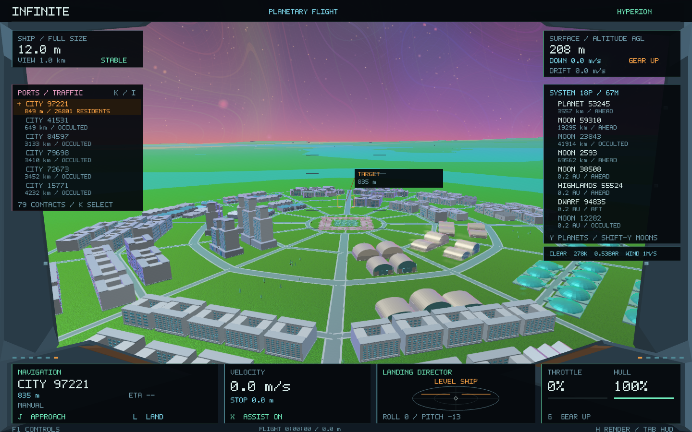
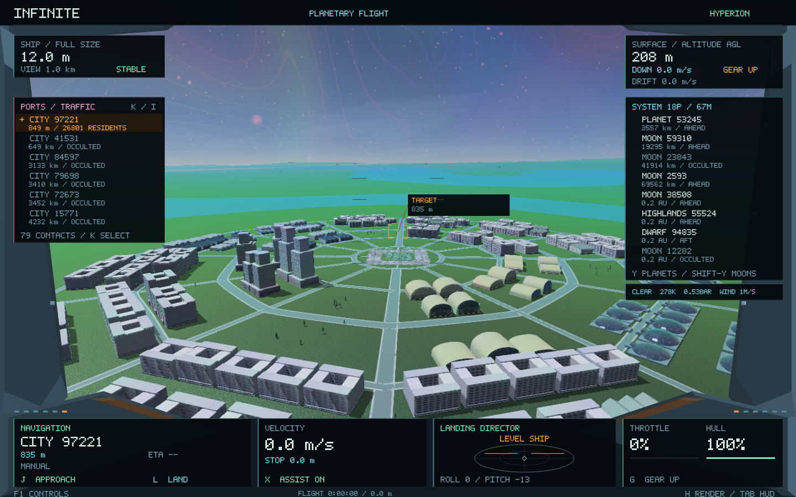
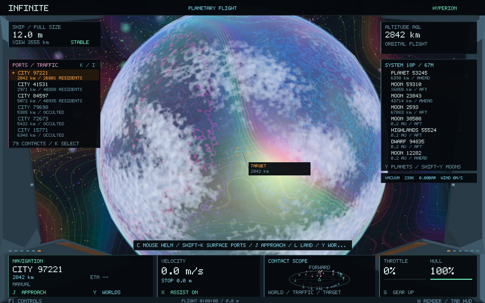

# Graphics presentation — Infinite 0.21

This release gives the existing universe stronger light, shadow and material separation. Cities cast real sunlight shadows onto their terrain, glass has a distinct reflection, and clouds have optical structure. The same planets, city layouts, rocks, minerals, atomic sites and flight state remain authoritative. **H** continues to select Original, Hyperion or Hybrid.

## Actual Hyperion reference

The reference remains the user's native game at `../Hyperion`. The relevant implementations inspected for this pass are:

- `src/flight/lighting.hpp::PRISM_NEAR_SUN_GLSL`: receiver-plane-corrected shadow filtering and fading at the map boundary.
- `src/flight/renderer.cpp::drawSunShadows`: a bounded light-space view, snapped light axes and cached geometry shadows.
- `src/flight/architecture.hpp`: glass versus rough coatings, room lighting, prismatic paint, grazing reflection and material-scale surface patterns.
- `src/flight/shaders.hpp::cloudFragment` and `worldFragment`: cloud billow/self-shadow, optical extinction, forward scattering and directional/sky illumination.

Infinite translates these techniques to bgfx rather than importing Hyperion's world model. The depth-only D16 target and the use of the existing opaque depth image for receivers are backend adaptations. This pass does not implement Hyperion's complete volumetric weather system, interiors or terrain shadow caster cache.

## Cached sunlight shadows

Existing building, foundation and street-furniture meshes render into one **2048 × 2048 D16 depth map: 8 MiB**. Off-screen buildings remain eligible casters, so turning away from an object does not remove its shadow. The shared middle architectural LOD supplies the same building massing; no new city geometry or collision object is generated.

The map covers the nearest visible existing settlement when the unshrunk ship is below 5 km and the sun is above the local horizon. Its bounded span is 512–4096 m. Light-space texel snapping happens in the planet's double-precision axes before subtracting the camera. The matrix is updated for the current camera and magnification, while the cached depth image can remain unchanged. Only a changed settlement, snapped anchor or light direction requests another caster render.

The final flight pass reconstructs the receiver from the existing opaque depth buffer. Four filtered comparisons include the source's receiver-plane correction, a correction for perspective-depth precision and an edge fade. Empty sky cannot receive a shadow. Atomic inspection and shrinking do not retain a city shadow field. Original mode does not apply the new lighting.

The map uses reserved view 70, between existing scene submission and bloom/display. There is no new full-resolution colour buffer, temporal history, per-building texture or CPU generation job. Incomplete transient-buffer submission prevents reuse of an incomplete map. GPU template storage and the ordinary surface instance limits remain bounded by the existing renderer.

## Architectural materials

Read-only surface instances identify architectural presentation separately from geological materials. Existing vertex colours distinguish glass and luminous inlays from wall coatings. Existing mesh positions, indices, colours, dimensions and object IDs remain unchanged.

Patterns use the original mesh's local coordinates multiplied by its physical dimensions in metres. Panel joints, ceramic pigment, room variation and grazing films therefore remain attached during camera motion, precision rebasing and zoom. Glass uses a smoother, darker response with broad sky reflection; coatings retain diffuse light and subtle spectral traces. Existing emissive trim stays recognizable. Room variation uses a fixed shader hash, without consuming a procedural random stream or simulating inhabitants.

Sky illumination keeps shaded façades legible. Planetary broad pigments are less saturated while the existing fine spectral accents remain. Atmospheric scattering favours its Rayleigh colour with a restrained inherited pigment tint. Cockpit flight uses slightly less bloom so bright glass and actual geometry retain their edges. The cockpit itself and all controls are unchanged.

## Weather presentation

The existing weather-cell geometry and `WeatherSample.cloud` supply location, altitude and broad cloud coverage. Hyperion/Hybrid add continuous, footprint-filtered billow, density self-shadowing, sun-facing light and forward scattering within that coverage. Empty cells stay empty. The fine optical field is anchored in the existing planet's coordinates and derives its phase from the existing climate key.

This uses the existing cloud draw, without a new framebuffer or cloud texture. The original weather model still determines rain, snow, dust, wind and atmospheric eligibility. Solid-world rules, temperatures, climates and all weather seeds remain unchanged.

## Preservation and validation

`checkpoint/infinite-0.20-before-graphics` preserves the working baseline (`335d1ed`). [Source preservation](graphics-0.21/preservation.json) verifies 20 byte-identical generator, geometry, city, simulation and navigation source files. Procedural recipes and save schemas are unchanged.

The shading test now includes **800 camera-rebase/magnification comparisons** across both clip-depth conventions and texture origins, plus light-frame centring checks. Existing tests continue to cover immutable geometry, deterministic generation, city topology, all surface-site anchors, legacy universe records, landing and the galaxy-to-atomic round trip. Native captures assert matching camera, geometry and city-data fingerprints in all three modes. The surface image test also checks real shadow activation, Original exclusion, the fixed 8 MiB budget and cached reuse.

Metal is exercised on this Mac. Shader binaries are rebuilt for Metal, SPIR-V and GLSL using the pinned compiler. Other backends are compiled without claiming native runtime verification.

```sh
python3 tools/compile_shaders.py --shaderc build/shader-tool/shaderc
cmake -S . -B build -DINFINITE_GPU_TESTS=ON
cmake --build build -j 4
ctest --test-dir build --output-on-failure
```

## Native comparisons

The same 1440 × 900 city camera, weather time and geometry:





The [capture directory](graphics-0.21/captures/) also contains street-level, protected-colony, orbital-weather and terrain examples. [Validation and measurements](graphics-0.21/validation.json) retain results and their limits alongside the raw profiles.



## Release results and measured cost

All **37 release tests passed** in **276.09 seconds**. A final two-test native weather/city run passed after improving orbital cloud filtering. All **62 surface-site anchors**, **120 legacy universe records**, **17 nine-scale mode proofs** and galaxy-to-atomic return checks passed. The seven final Original-mode world crops are **pixel-identical** to 0.20 in the recorded comparison region.

Same host, Metal, VSync and seven deterministic 1440 × 900 fixture views:

| Measurement | 0.20 | 0.21 |
| --- | ---: | ---: |
| Median frame | 16.666 ms | 16.664 ms |
| p95 frame | 17.376 ms | 17.190 ms |
| Recorded frames | 2,220 | 2,086 |
| Peak process RSS | 144.39 MiB | 143.22 MiB |
| Effect-target storage | 17.03 MiB | 25.03 MiB |
| Maximum surface CPU cache | 2,214,704 bytes | 2,214,704 bytes |
| Uploaded surface templates | 541,900 bytes | 562,636 bytes |

The extra effect storage is precisely the **8 MiB** shadow map. There are only **four shadow-map updates in 150 active shadow frames** in the final city tour. Existing mesh templates add 20,736 bytes because off-screen shadow casters can request a previously unused middle LOD.

The matched Hyperion city-approach sample reports CPU medians of **6.535 → 6.450 ms** and GPU medians of **10.931 → 7.300 ms**. Each sample contains eight frames after trimming two initial and five final frames from the 15-frame mode interval. These short samples avoid the screenshot readback and initial caster upload but are insufficient to establish a causal speed improvement. Whole-tour timings include loading and captures; frame counts differ with asynchronous readiness. RSS is also sensitive to resource residency and system memory pressure. The result supports approximately 60 fps at this resolution on this host, with an explicit additional GPU storage cost.

The signed 0.21 package is checked against the tested executable's 31 code/data sections. Save locations, schemas and the saved ship position are preserved.
