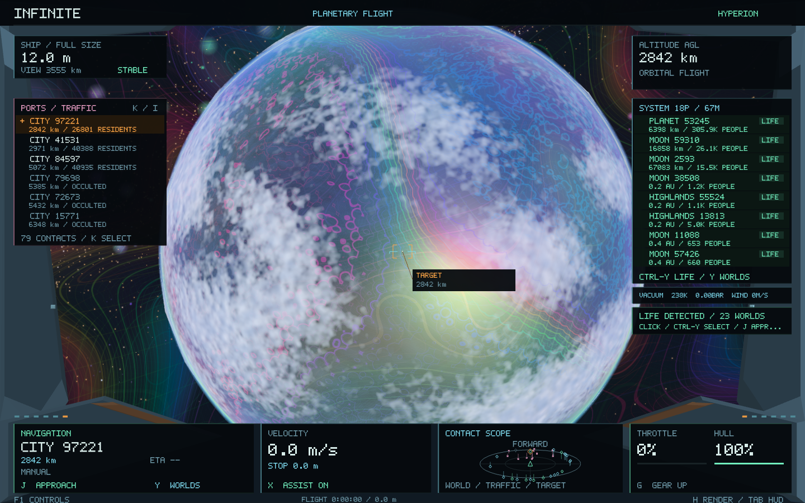

# Life-detection HUD — Infinite 0.22

The system display now makes existing inhabited planets and moons visible without cycling through every nearby moon or station.

- **Green LIFE badges** and population counts identify confirmed surface inhabitants.
- The selected world stays visible, followed by inhabited worlds before other entries. All contacts remain available; the underlying contact list and world identities are not rewritten.
- A **LIFE DETECTED** card reports the number of inhabited worlds in the current system. Click it or press **Ctrl-Y** to cycle confirmed worlds, then **J** to approach.
- Green scope contacts and priority world labels identify life-bearing worlds in the viewing direction. A selected life-bearing world uses a LIFE DETECTED target label, including the existing aft cue when behind the ship.
- Pending worlds show **SCANNING**. A completed empty surface is distinguished from a confirmed population. Hidden inhabited contacts remain listed and explicitly show HIDDEN.

Life here means **actual generated surface residents**, including people in sealed colonies, research stations and mining settlements. It does not infer an inhabited surface from a temperate climate, nearby orbital traffic, or a habitable-looking colour. It does not claim a separate alien-biosphere simulation. Gas-envelope worlds cannot receive surface-life detections under the existing generation rules.

## Discovery and resource handling

The renderer admits a distant survey at most once every eight frames, after visible surfaces have claimed the existing worker slots. Surveys call the same deterministic `generateSurfaceLife` implementation used for landing, then retain only a compact population/port summary for distant bodies. A normal close-surface request can promote a survey already in progress into a full surface result. This pacing reduces contention during initial system discovery; scanning remains explicit in the HUD.

The existing two-job limit, cancellation, full-world LRU cache budget and asynchronous publication remain in use. Remote surveys do not push full distant city layouts into that cache. At most **256 compact summaries** are retained, enough to cover an entire generated system (at most 21 primary planets and six moons each) with bounded metadata. The currently selected unknown world receives survey priority; no generation work is performed synchronously on the render thread.

Scanning is paused during shrinking. Previously confirmed results remain available in the ship's catalogues. The compact observations are an in-memory cache; returning to a system after eviction or restarting the application can trigger another scan of the same deterministic surfaces.

## Selection and preservation

Ctrl-Y cycles confirmed addresses in stable address order, including worlds outside the eight visible list rows and occulted worlds. Neither pending observations nor a zero-population result can become a life target. The displayed rows and mouse hit testing share the same index mapping. Clicking a world or using Ctrl-Y selects it and cancels an old approach without moving the ship or changing its momentum. J explicitly begins the next approach.

Universe, population, terrain, climate, society and city recipes remain unchanged. Settlement layout, resident IDs, surface geometry, seeds, atmospheric rules and landing eligibility remain unchanged. The existing Y / Shift-Y planet/moon controls are retained. F1 documents Ctrl-Y.

Checkpoint `checkpoint/infinite-0.21-before-life-hud` preserves 0.21. Unit tests cover actual versus inferred life, asynchronous summary-only residency, deterministic re-approach, row priority, row uniqueness, empty/pending results, stable target cycling, viewport layout and coherent ship selection. The native city fixture additionally requires confirmed life to be present in its HUD.

Release results and native captures are recorded in [life-hud](life-hud/).

## Release verification

All **37 tests passed** in **308.92 seconds**. A final four-test native HUD/piloting run passed after pacing distant scans and checking that the life panel only intercepts clicks when displayed. Unit coverage includes **697,944 cockpit checks**, **59,836 surface/weather checks** and **6,013 ship/selection checks**. The 62 surface-site anchors and 120 legacy universe records remain exact, and all nine scales retain their round-trip proofs.

The native fixture confirms **23 inhabited worlds** in its example system. All 21 city/weather captures have positive confirmed life telemetry; each also asserts that the life panel and first displayed world row pick their expected addresses. Planet and city geometry/camera fingerprints remain identical across the three display modes.

At 1440 × 900 on Metal, the final city/weather run measured **16.662 ms median**, **20.638 ms p95** over 3,486 frames. It includes initial system surveys, asynchronous scene loading and screenshot readback; it is not an isolated steady-flight benchmark. The shared surface GPU templates, effect textures and 4 MiB full-surface cache budget are unchanged. Observations add at most 256 compact metadata entries.

