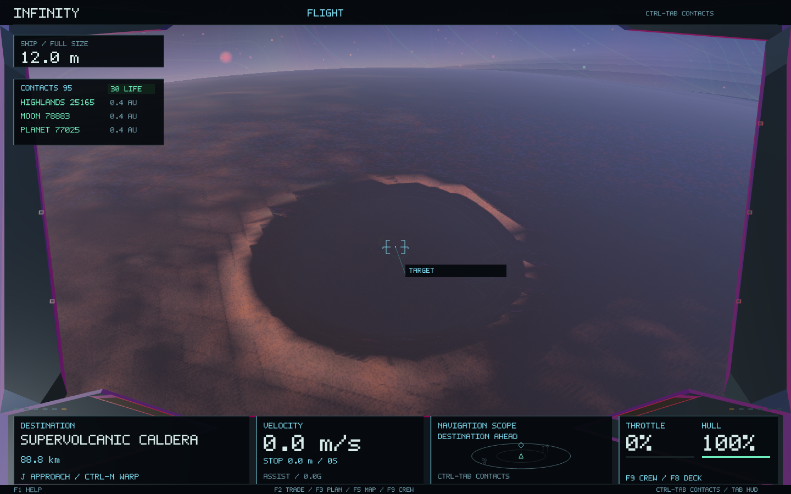
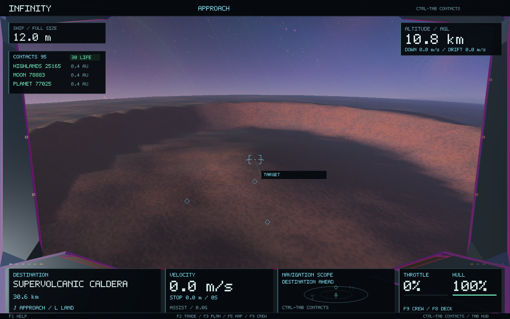
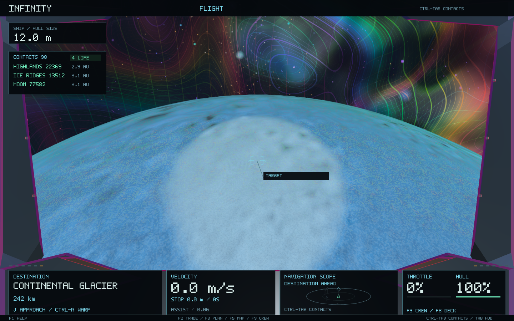

# Rare major landforms

Infinity now occasionally generates large, named geological landmarks in its expanded solid-planet population. These are deterministic additions to the common spherical terrain field, rather than scenery placed over the world.

| Landform | Generating process and shape | Consequences |
| --- | --- | --- |
| Supervolcanic caldera | Inherited silicate-rich hotspot, sufficient internal activity and formation heat; broad collapse floor, ring fault, rim and resurgent dome | Local geothermal warning and heat; fractured mineral exposure |
| Giant shield volcano | The same heat/crust constraints; broad low-gradient edifice, summit caldera and lobate apron | Local summit vent; gravity limits the relief |
| Continental glacier | Cold ice-rich shell; polar accumulation dome with outlets aligned down the inherited catchment slope, crevasses and terminal moraine | Ice exposure and crevasse warnings; no glaciers on hot or gas planets |
| Great rift | Inherited plate-boundary region; elongated fault depression, nested floor and uplifted shoulders | Exposed fractured walls |
| Multi-ring impact basin | A surviving inherited impact site; depressed floor, central uplift and multiple concentric rings | Ejecta and fractured material drawn from the world's existing chemistry |

Sizes follow planetary radius; gravity limits relief. The sampler uses planet-fixed coordinates and compact support with a smooth outer taper. Orbital geometry, streamed terrain, normals, collision, landing, mining and reconnaissance all sample that same field. No renderer-only terrain or time-varying terrain noise is introduced. The forms are analytic process-inspired approximations, not numerical magma or ice-flow simulations; an active geothermal vent does not imply a timed super-eruption simulation.

Each featured world gets at most one small immutable descriptor. Generation and selection happen with the existing planet descriptors, and terrain generation continues through the existing asynchronous cache. No new texture, mesh cache, dependency or GPU pass is required.

## Discovery and preservation

The planet's existing surface targets remain the first entries. A new canonical, accurately centred surface address names its major landform and is appended to the catalogue. Survey formation readings include the feature; the local F5 reconnaissance map marks it when in range. Existing landing and crew hazard systems report vents or glacier crevasses, and engineer heat predictions use the same local exposure as the ship.

The feature layer uses its own versioned `LocalRelief` seed domain. It does not change hierarchical seeds, object IDs, orbit generation or the scale hierarchy. Legacy planets and existing moons retain their terrain recipe. To preserve established settlements and ports, the new layer is limited to wilderness in the expanded planet population: worlds outside society's physical admission limits or in the rejected tail of its frozen admission seed stream. It does not inspect player discoveries, save state, LOD, camera position or mutable cache contents. Settled worlds therefore keep their original terrain and city foundations.

Terrain on a newly featured wilderness world intentionally gains the new relief. Its procedural descriptor fingerprint records the feature and recipe version. Other worlds retain their old descriptor fingerprints. Surveying, shrinking, rendering and returning regenerate the same feature.

## Physical references

The shapes draw on [NPS caldera formation](https://www.nps.gov/articles/000/calderas.htm), [NASA's Tharsis shield volcanoes](https://science.nasa.gov/resource/tharsis-volcano/), [NPS glacial troughs and hanging valleys](https://www.nps.gov/articles/ushapedvalleysfjordshangingvalleys.htm), and [NASA's Valles Marineris model](https://science.nasa.gov/3d-resources/mars-valles-marineris/). Dimensions are scaled to Infinity's generated worlds and are not copies of terrestrial or Martian sites.

## Validation

`rare_major_landforms` tests a real catalogue cohort for rarity, environmental eligibility, deterministic generation in a separate thread, unchanged settlement eligibility, named destinations and surveys, inherited mineral constraints, local hazards, compact support, streamed mesh/collision agreement, reconnaissance and a surface-to-atomic round trip. Existing terrain tests also check the new additive catalogue entry without relaxing their original target-prefix and province checks.

Measured results and native captures are stored in `major-landforms/` alongside this document.

### Observed catalogue and native views

The 128-system test cohort contains 2,624 primary planets, of which 2,112 have solid surfaces. 197 solid worlds (9.33%) have a major landform: 4 supercalderas, 2 giant shields, 176 continental glaciers, 9 great rifts and 6 multi-ring impact basins. These are cohort measurements, not a promised quota per system. Cold wilderness accounts for most of the large glaciers; the giant volcanic edifices are much rarer.

A feature descriptor occupies 128 bytes on this build; ordinary planets store only an empty shared pointer. The measured field benchmark is in `landform-tests.log`; timings are diagnostic and include the base geology sampler. The four native captures reported median CPU frame times of 8.85–9.81 ms while other verification was running. These are fixture measurements, not universal frame-rate guarantees.

The preservation comparison is byte-for-byte identical across four old worlds, including the three existing regional/metropolitan city fixtures: planet seeds/descriptors, 128 sampled terrain heights, city core fingerprints, populations and landing anchors. Full before/after records and the checker source are retained here.

| Type | Natural fixture | Half-width | Relief parameter |
| --- | --- | ---: | ---: |
| Supercaldera | `0,0,0/1:0/2:116/3:8` | 33.64 km | 4,373 m |
| Shield | `0,0,0/1:0/2:116/3:6` | 74.93 km | 6,369 m |
| Glacier | `0,0,0/1:0/2:127/3:15` | 91.65 km | 2,291 m |
| Rift | `0,0,0/1:0/2:114/3:6` | 20.06 km | 3,610 m |
| Impact basin | `0,0,0/1:0/2:105/3:7` | 142.93 km | 6,432 m |

The relief parameter controls the generating profile; it is not the summit's absolute elevation above the reference sphere.

All 80 headless checks have passed. The full run initially passed 77/80: the three historic catalogue/site snapshots correctly noticed the new wilderness descriptor layer. Their adapters now compare every original geological field and every settlement line against the unchanged golden files, allowing only the separately tested additive feature descriptor on empty wilderness. All three preservation checks passed on rerun. The final landform test also adds explicit caldera, shield, glacier, rift and impact profile ordering checks. The app was rebuilt, packaged and its macOS signature verified; the final build freshness check reported no stale objects.

The final isolated sampler check measured 18.49 ms for 10,000 base-field queries versus 19.25 ms with the caldera layer (about 4.1% additional CPU time in that fixture). This includes a loop that samples both the feature and surrounding terrain, and is not a whole-game benchmark. The final test selects daylight examples where available, so its printed caldera/impact examples can differ from the earlier native-capture catalogue examples above; both sets are naturally generated.
