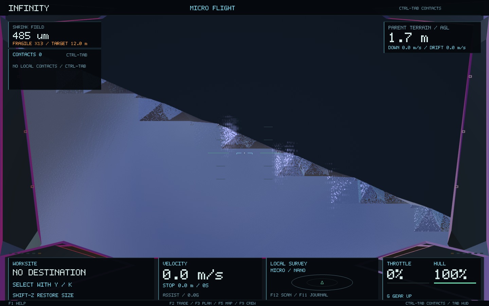
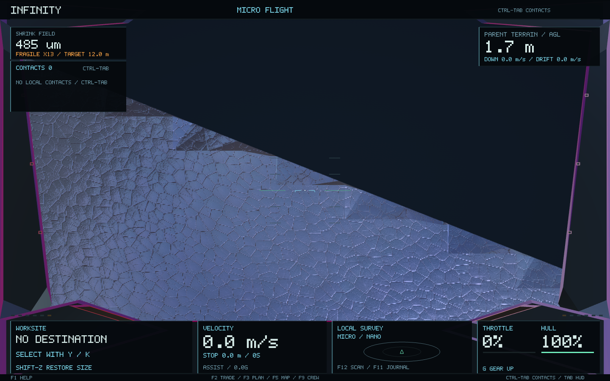
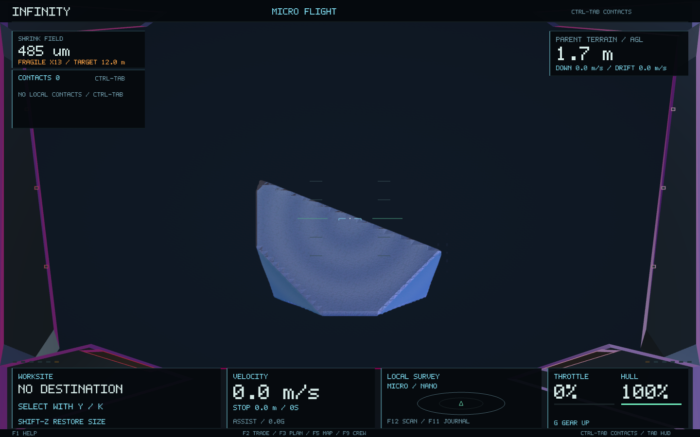
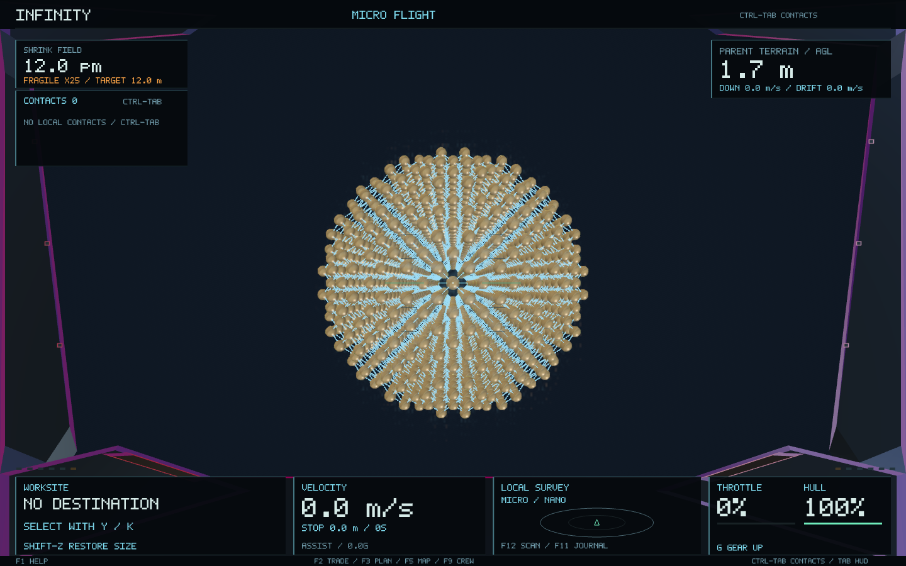
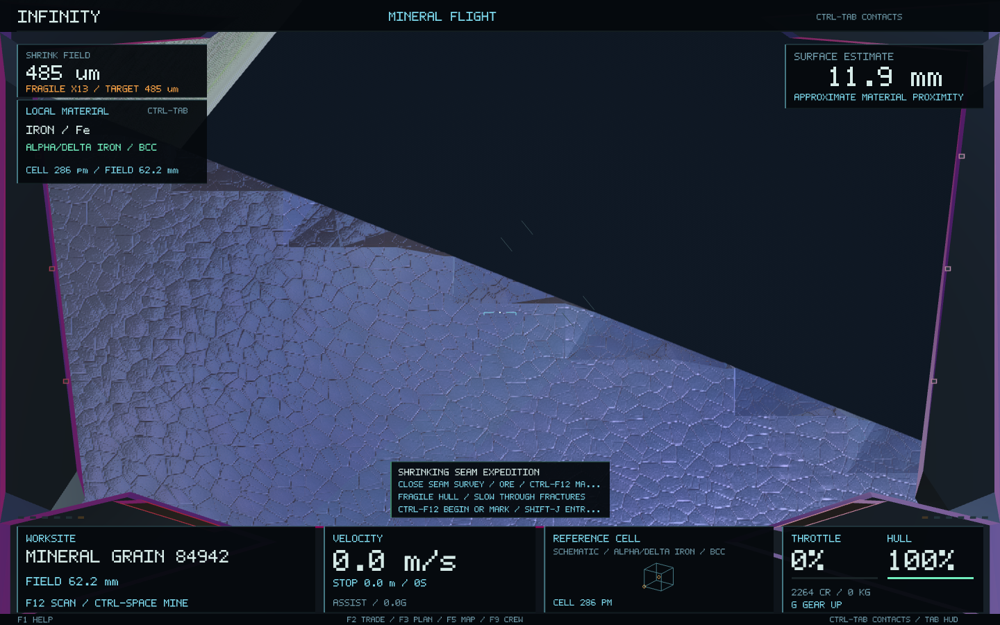
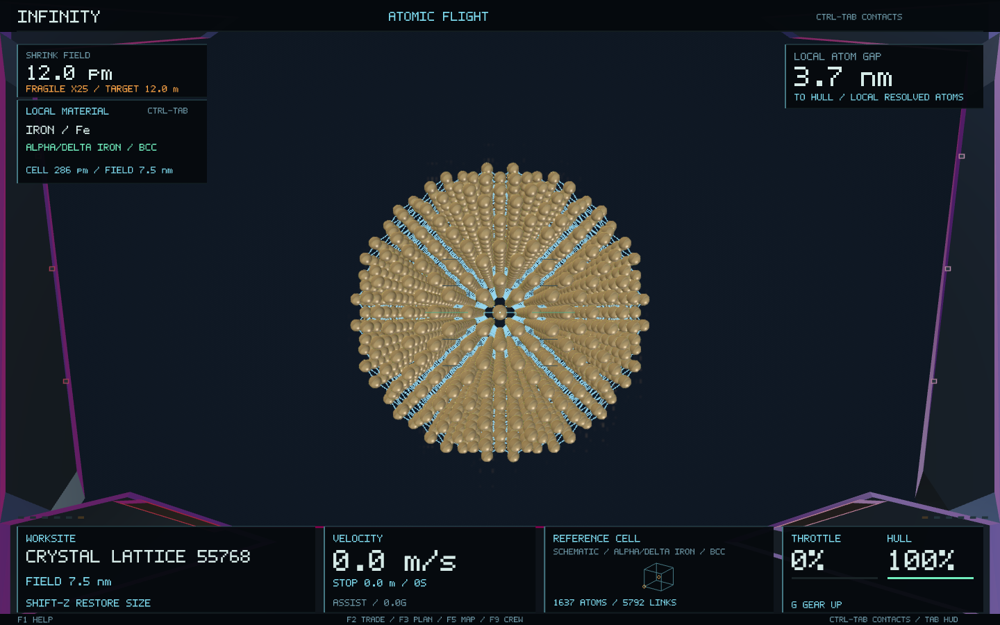

# Micro-view inspection and repair

The running game was inspected, then the actual shrinking seam expedition was reproduced with isolated temporary saves. Its mineral-grain view contained large triangular highlight patches and false bevels. The old screenshot check passed despite this because it only required a nonempty image and visible instruments.

## Findings and changes

**Fine crystal meshing.** Linear interpolation between tetrahedron samples cuts across the maximum of intersecting crystal/host-rock faces. This introduced false bevels where the mathematical surface has a sharp, coherent intersection. Fine grain LODs now refine those same zero crossings with bounded bisection. The scalar density rules, crystal habits, object descriptors, seed hierarchy, and atomic sites do not change. The original coarse grain mesh is retained exactly; fine meshes keep the same number of vertices and triangles and use the existing asynchronous generation/cancellation path.

**Physical material scale.** Grain surfaces inherited the parent rock's material coordinates and also its much larger detail wavelength. At close range, the material normal calculation amplified poorly resolved detail into triangular glints. The grain retains its inherited material frame and phase, while its detail wavelength is limited by its own physical radius. This is independent of the camera, render-unit size and LOD. Existing planet and rock wavelengths stay unchanged. No new textures, GPU passes or dependencies are introduced.

The fixed natural fixture is:

`0,0,0/1:0/2:9/3:0/4:61516819435380/5:4/6:4611686018427387905/7:0`

Its radius is 0.0403914 m. At fine LOD 3, the maximum absolute surface-field residual falls from 0.0197125 to 0.000000525599, over 37,000 times smaller. Those are field residuals, not a guarantee of Euclidean distance. Vertex count stays 21,486 and triangle count 42,968. Its descriptor remains `16381549922156961208`; coarse geometry fingerprint remains `13767820425686152446`.

## Validation

- The new `micro_surface_facet_precision` regression **fails against the pre-fix core library** and passes against the repair. It checks the actual crystal/host field, all five mineral habits, fine LODs, finite/index-valid meshes, deterministic regeneration in another thread, cancellation, preserved coarse geometry and an atomic round trip.
- All 75 game headless regressions passed after the meshing change; the six relevant material/rendering/scale/prospecting checks passed again after the material correction.
- Fixed-camera native comparisons isolate the grain, its parent rock and the full scene at close range and normal inspection distance. Flat-colour and disabled-relief controls helped separate meshing from material artifacts.
- A separate 12 pm ship view renders the same addressed iron lattice after the repair.
- The local macOS app was rebuilt, packaged and its signature verified. No release assets or user saves were changed by this inspection.

The helper source and logs are retained in `micro-view-fix/`. Its manually supplied flight instruments are for isolated rendering checks; the full expedition fixture separately exercises the production cockpit and ship controller.

## Same physical view before and after

The complete production shrinking expedition also passed all six stages after the fix: surface, tiny rock, mineral survey/mark, full-size selective mining (20 kg) and the portrait journal, including a saved-mark round trip.

## 0.61.1: local instruments and readable lattice links

The micro cockpit now shows the addressed mineral, chemical formula and current crystal phase. Its reference-cell schematic uses the same cell basis and motif as the existing crystallography code. The field width is measured at the inspected object with the existing ship lens, and remains invariant when only render units change.

The upper-right instrument reports **SURFACE ESTIMATE** (an explicitly approximate density-field measurement to the hull) or **LOCAL ATOM GAP** (to the currently resolved collision spheres). Atomic proximity and counts remain unavailable while the matching geometry is loading; stale geometry cannot supply them. Bulk material is labelled explicitly. These are read-only instruments; they never apply forces, change collision or grant mining access.

The compact left panel prioritises local material rather than distant planets while inspecting rock, grains or atoms. **Ctrl-Tab**, including a click on that panel, retains the full existing catalogue and its stable selection identities. The worksite identifies the actual object; atomic flight is named explicitly. Real incoming fire still takes tactical priority, and parked-ship specimen inspection keeps its original state label.

The unchanged lattice bond graph now has a bounded, monotonic screen-space opacity. Subpixel links fade rather than becoming a bright pixel grid; resolved bonds remain visible beneath the atoms. Atom positions, radii, defect sites and connectivity are unchanged. No new GPU passes, textures or mesh buffers are required.

`micro_instruments_and_bond_detail` verifies real mineral/phase data, the generated atomic counts and nearest gap, unavailable/stale geometry, physical rebase invariance, five screen shapes, full catalogue access, parked-ship status, tactical priority and bond filtering. All 76 game headless checks passed for the combined changes.

The final native check completes all six production expedition stages again, including selective mining, saved marks and the portrait journal. Native atomic frames show the local material, actual phase, atom gap and resolved site/link counts. The local macOS bundle is 0.61.1, build 76, with its signature verified. The existing published 0.61.0 release is unchanged.

