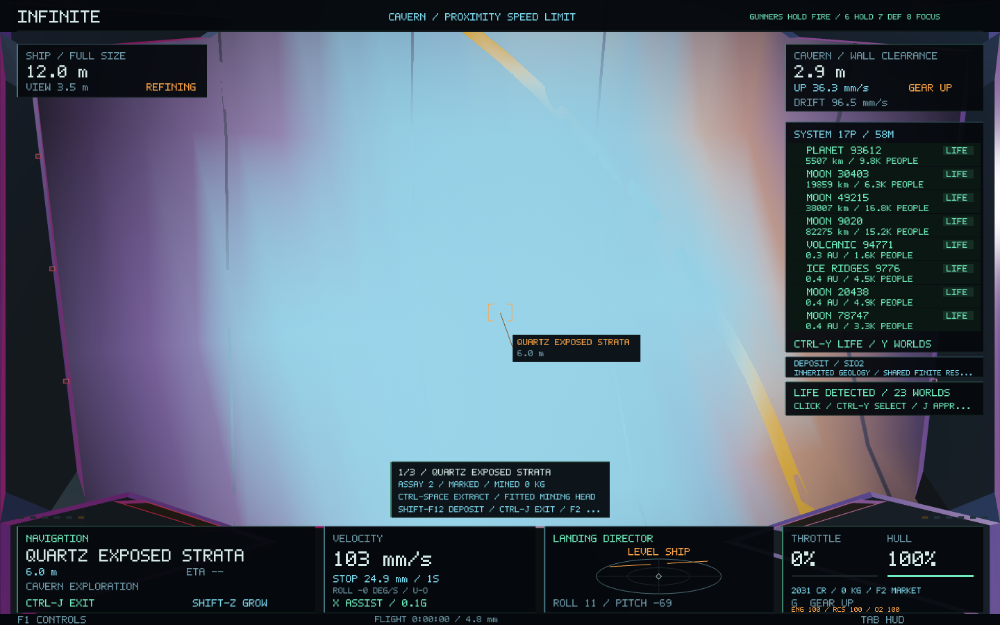
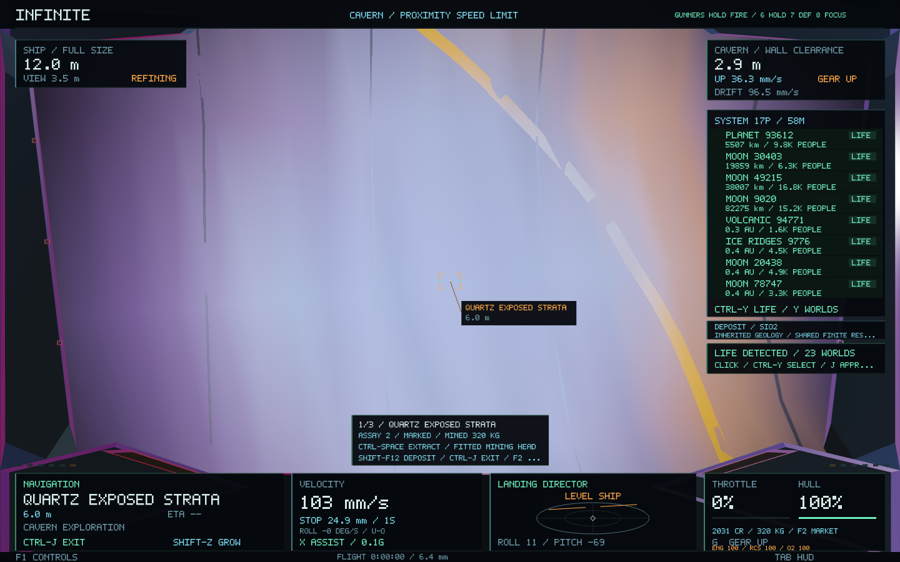
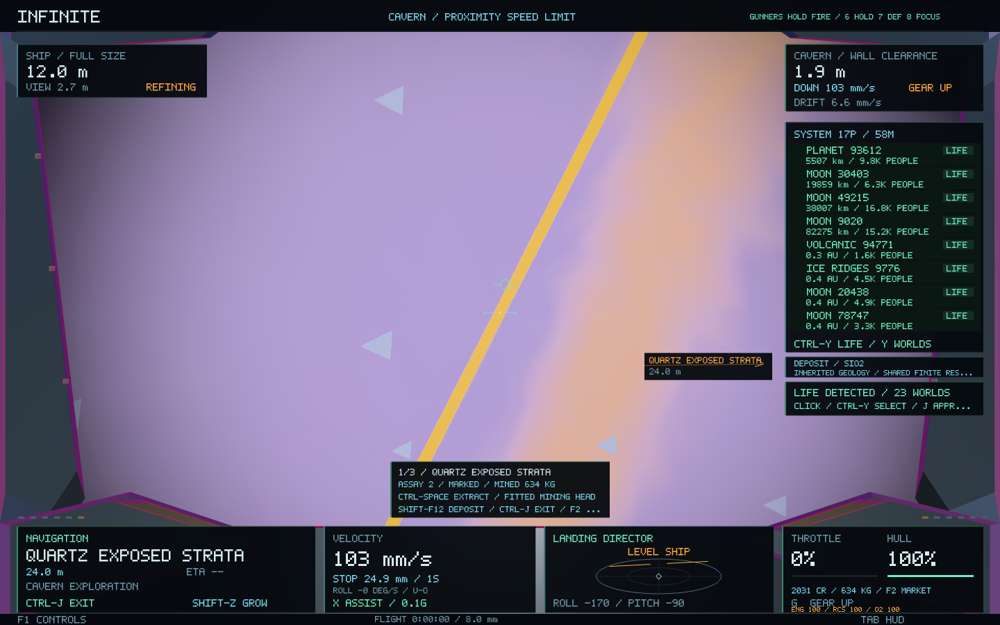
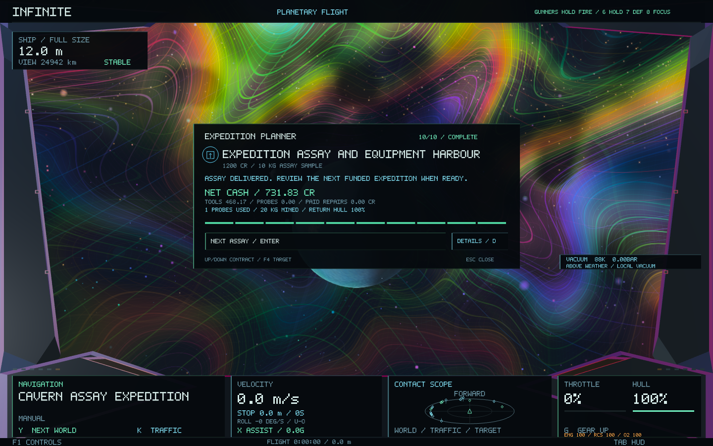

# Mining consequences and expedition outcomes — 0.61.0

Mining now changes what the player sees at the extraction site. Paid cavern-assay delivery opens a compact result card with recorded spending, net cash, return hull condition and a suitable next offer.

## Visible extraction

Ore-bearing coverage recedes with the saved regional reserve. Local cutting exposes worked faces and grooves, while deterministic cuttings accumulate on the cavern floor. Another excavation in the same depleted region sees the same reduced reserve; a fresh hole does not refill it. Surface outcrops and marked seams also lose their untouched finish as their resource is extracted.

| Before extraction | After working the same deposit |
| --- | --- |
|  |  |

Live cutting emits material-specific particles: iron sparks, ice flakes/frost, layered graphite chips and silicate fragments. Emission follows the existing valid utility-beam contact. Rock and intervening ships still block the cutter; dust retains opaque-depth testing. Persistent floor cuttings follow local mined kilograms and retain their material across restarting.

The presentation preserves host rock shapes, crystal facets, collision surfaces and atomic lattices. Worn colours and ore coverage update the existing work-light stream only when its light or saved depletion changes. Cuttings and particle populations are bounded; there is no new terrain rebuild, resource source or texture dependency.

## Delivery debrief

Claiming a completed cavern-assay job automatically opens its summary. It shows the paid reward, net tool spending, probe purchases, paid repairs, probes used, kilograms recovered and hull condition on return. **Enter / Next assay** reviews the next offer; it does not accept it or move the ship. **Esc** returns to flight and **D** keeps the full planner available.

The result uses **cash accounting**: the reward paid minus actual recorded tool, reload and repair transactions after acceptance. Tool trade-ins reduce net equipment spending. A launcher's included probe stays in its refit charge; subsequent reload purchases appear under probes, with the used count shown separately. Existing stock is not assigned a new market price. Extra cargo remains in the hold, and unrelated trading income is outside this contract's result. Remaining hull damage is shown separately from repairs already paid.

Expense attribution follows the selected accepted cavern expedition, or the sole unambiguous active one. Hiding the HUD tracker does not stop accounting. Rejected/replayed orders do not add costs or pay a reward twice. Closed results remain saved. Older jobs without a recorded cost history are identified as such.

Follow-up offers use existing solid worlds and retain their predecessor's identity link. Rewards still come from the issuer's escrow on acceptance; no cash is created by generating the next offer. Original survey offers and universe seeds remain unchanged.

## Verification

- **62 core regressions passed**, including continuity, navigation, ship handling, crew, conservation, shared depletion and restart. [Full run](mining-outcomes-0.61/regressions.log)
- Focused tests cover visible wear, unchanged host geometry, shared/capped reserves, persistent cuttings, material particles, surface versus lattice treatment, real expenses, rejected orders, idempotent receipts, follow-up offers and legacy migration. [Consequences](mining-outcomes-0.61/focused-tests.log), [planner lifecycle](mining-outcomes-0.61/planner-tests.log)
- The background-worker test pays for a scoped repair and verifies that its exact expense survives SQLite restart. [Worker check](mining-outcomes-0.61/worker-check.log)
- **20 native probe/mining views** include untouched, worked and depleted deposits, floor cuttings and active material emission. **18 native planner views** include paid delivery, costs, next-offer selection and portrait layouts. Navigation/world identity and text bounds are checked. [Mining](mining-outcomes-0.61/mining-native.log), [planner](mining-outcomes-0.61/planner-native.log), [image checks](mining-outcomes-0.61/image-checks.txt)
- The signed **0.61.0 / build 75** app passes isolated normal startup. [Startup](mining-outcomes-0.61/startup.log)

Exploration saves write version 6 and read versions 1–6. Probe, wallet and world generation formats retain their versions. New accounting metadata and follow-up links migrate transactionally; old discoveries and depleted reserves remain intact. Native fixtures stage real ledger operations against isolated economies and replay recorded states for presentation comparisons.
