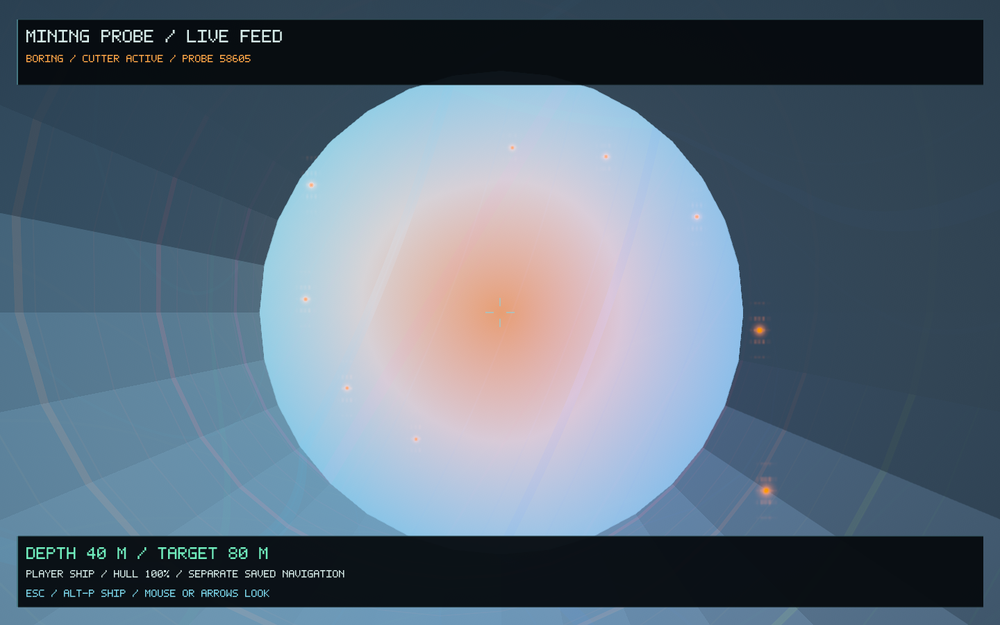
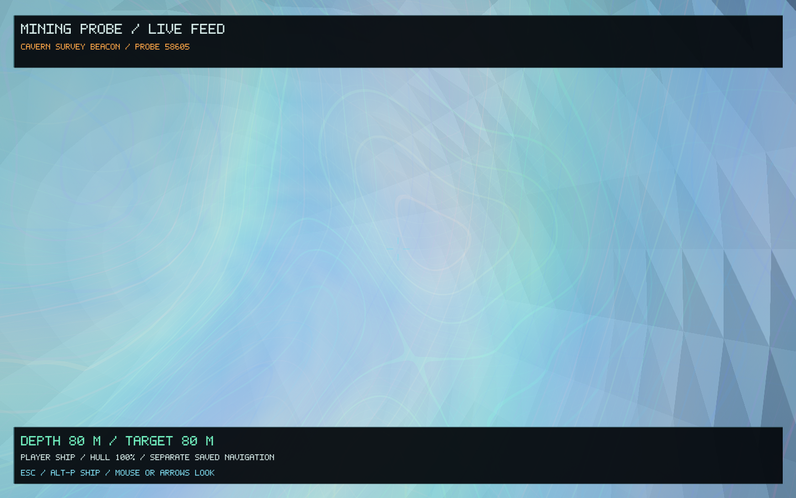

# Mining probes — 0.58.0

Mining probes turn an existing ship weapon bay into a disposable drilling and excavation tool. They fly to exposed solid ground, cut a narrow shaft, arm a buried charge and blast an underground chamber. The protected camera remains as a survey beacon. The entrance, chamber, equipment and ammunition survive restarting.

## Fit and launch

1. Connect to a functioning equipment port and open **F2 → Survey** using **F5** to cycle pages.
2. Use **Left / Right** to choose the nose, port or starboard bay. Select **Fit mining probe** and press **Enter**. An empty bay can be fitted directly; an installed laser is traded in as part of the same transaction. One probe is included. A mining head occupying that bay must be sold first.
3. Reload through the next service row. Each purchase loads up to three rounds, to a maximum of six per bay. Parts, port capacity, available labour and both parties' funds constrain the transaction. Selling the launcher returns its hardware and unused rounds; deployed caverns remain.
4. Fly at full size, with the shrinking/cruise field off. Select a nearby solid planet or moon and face exposed terrain. **Shift-P** cycles equipped launch bays; **Ctrl-P** fires the selected bay. A nose launcher uses the captain; an extra bay needs a ready operator. If you take control of a launcher through the existing **F10** station swap, **Space** also fires it.

The flight path is intersected with the world's actual terrain. Gas worlds, open water, shallow grazing shots, misses and overlapping excavations are rejected before ammunition is spent. Maximum range is 1,500 km. Only one probe can be active at once; up to 64 excavations are retained.

## Watch and explore

The feed opens when launch is confirmed. **Mouse / arrows** look around. **Esc** or **Alt-P** returns to the ship; **Alt-P** reopens the latest probe in the current system. The feed shows approach, cutter operation, depth, fuse, blast and the remaining beacon. The camera is separate from the real ship's coordinates, flight state and saved position. The ship brakes on opening the feed; existing crew relief flight, damage and economic activity still run.

Depth is 40–80 m, with drilling speed constrained by the host mineral's density. The initial cutter radius is 1.3 m. A 1.5 s fuse precedes the blast, which creates an irregular chamber of 12–18 m radius and widens the shaft to 4.5 m radius. Keep the ship away from the charge: nearby hulls take blast damage, including the existing tiny-ship vulnerability.

After detonation, **Ctrl-J** approaches the entrance from outside. Fly through the marked opening slowly and manually; the shaft admits the full-size hull with care. The cavern HUD shows wall clearance and limits close-proximity speed. Automatic landing and automatic exit are suppressed underground; use gear and a slow manual descent, then steer out through the shaft. Existing shrinking remains available for a closer inspection, with its existing fragility.

This excavates terrain and adds collision surfaces. Ore collection continues to use the existing mining/prospecting tools; the probe does not grant free cargo or replace the generators for loose rocks, structures, minerals or atomic lattices.

## Preservation and implementation

Universe addresses, object identities, procedural seeds and canonical terrain meshes remain unchanged. Excavations are bounded, saved player modifications layered over the existing terrain. Worker tasks produce private clipped terrain copies and deterministic shaft/chamber geometry; the existing cancellation, cache budget and GPU upload paths remain in use. The cavern work light uses the current Hyperion material renderer, with mineral patterns scaled to metres rather than applying an unfiltered whole-planet pattern to a wall.

Launch planning, ammunition use and the saved trajectory commit together in the existing asynchronous SQLite economy worker. A read-only time sample drives the camera and drilling phases without writing every frame. Exploration save version 4 retains versions 1–3, including the seam-expedition state. A ship restored inside a cavern waits for its saved excavation snapshot before physical updates resume.

## Verification

- **61 core suites passed**, including **117 direct mining-probe checks**. Tests cover empty-bay and turret refits, finite rounds, trade accounting, launch rejection, phase progression, exact camera position across display scales, real terrain subtraction, unchanged original mesh fingerprints, physical entry/wall collision, cache cancellation and persistence.
- The real economy/SQLite restart test restores the equipped launcher, consumed ammunition, deployed flight and subsequent cavern.
- **Nine native Metal stages passed:** equipment service, approach, boring, fuse, explosion, surviving camera, real terrain opening, full-size ship inside the cavern and a 600 × 1,000 portrait feed. The remote stages assert that ship navigation and state do not change with the camera.
- Native test: 518 rendered frames, median 17.78 ms, 95th percentile 35.35 ms; geometry cache 13,317,736 bytes and peak process memory 144,736,256 bytes. These are observations of the scripted validation, not a general performance benchmark.
- The signed 0.58.0 / 66 macOS app matches all 28 code/data sections of the tested executable. Signature verification and a normal 120-frame startup using an isolated save passed.

Evidence: [core test log](mining-probes-0.58/core-tests.log), [native log](mining-probes-0.58/native.log), [capture hashes](mining-probes-0.58/capture-hashes.json), [verification record](mining-probes-0.58/verification.json).

| Drilling through the actual shaft | Chamber after detonation |
| --- | --- |
|  |  |

[Watch the native first-person probe recording](mining-probes-0.58/mining-probe-pov.mp4). It shows surface approach, boring, arming, detonation and the surviving camera beacon: 639 frames, 21.3 seconds at 1,280 × 720 / 30 fps. The encoded frame count and full decode passed verification. All frames are captured from the game; there is no generated footage or added audio. Its isolated demonstration save leaves the player's existing save untouched.

To reproduce the optional recording with an installed FFmpeg:

```sh
python3 tools/record_probe_video.py build/infinity /tmp/mining-probe-pov.mp4
```
