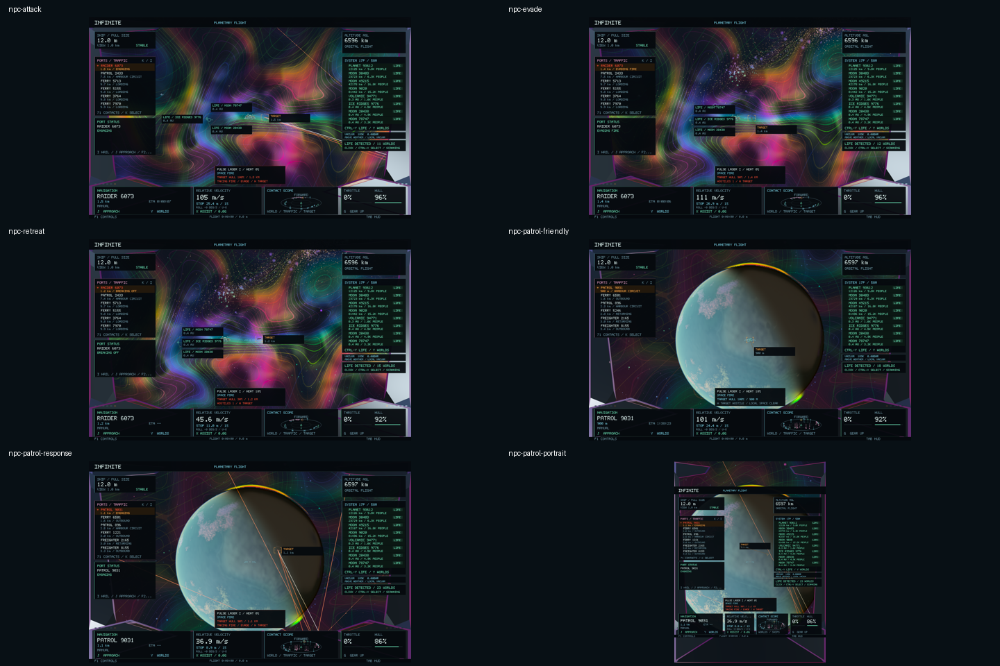
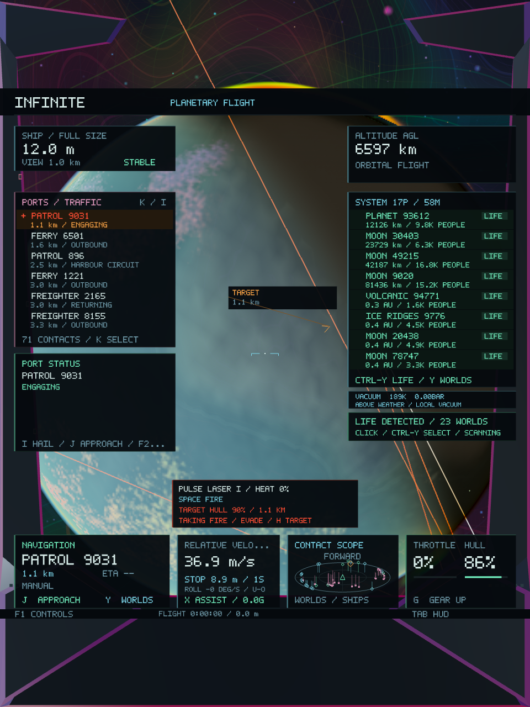

# NPC combat — Infinite 0.45

Hostile raiders now patrol the outer lanes near existing orbital harbours. They detect a full-size ship within 12 km, accelerate into a roughly 1.1 km engagement orbit, strafe, and fire within 2.4 km when aligned. Aimed weapons and incoming hits trigger short evasive manoeuvres. At 30% hull or less, they turn away and retreat without firing. When contact is lost, surviving ships return toward their original route.

**H** selects the nearest visible, unobscured hostile. **Hold Space** fires the fitted laser. The combat card shows target hull/range, hostile count and incoming-damage warnings. Enemy pulses are red/orange and use the existing depth-tested colourful rendering pipeline. Incoming hits use the existing cockpit damage-motion hook. **F7** still toggles cockpit motion.

Existing patrols remain friendly until the player attacks them or a civilian within 8 km. Civilian freighters, ferries and survey craft evade and flee when damaged; nearby patrols respond to their distress. The alert lasts 60 seconds after the latest observed hit. This is local retaliation, without a new faction reputation or bounty economy.

## Damage, protection and escape

Raider lasers deal 4 hull points per hit at a 0.9 second interval; patrol lasers deal 6 at 1.1 seconds. Both have finite heat, cooling, aim/turn limits, line of sight and range. The nearest solid actor, planet surface, terrain or retained opaque geometry can absorb a shot. Firing does not guarantee a hit. NPCs currently target the player; intervening ships can block their shots but do not receive NPC-versus-NPC damage.

Harbours protect a region extending 4.5 km beyond their hull; surface ports protect 1.8 km. Raiders disengage in these zones. Patrols can still retaliate there if provoked. All NPC fire stops while the player is landed. Cruise fields break target lock, and ships below 1% physical size are too small to track. Sensor range contracts with shrinking. Rendering magnification never changes these physical sizes or ranges. NPC combat suspends while the game window is unfocused.

Incoming damage reduces the existing saved hull value; existing port repair services restore it using real stocks and crews. A depleted hull inhibits player weapons and NPC acquisition. There is no new respawn flow. NPC wrecks use the existing persistent damage overlay; damaged economic freighters retain their goods/escrow accounting from 0.44.

## Integration and resource bounds

`CombatActors` adds one independently seeded Raider in reserved activity slot 600 for each existing planet. It follows a deterministic lane around the existing harbour; it does not consume or reorder the generator random stream. All earlier traffic IDs and schedules remain unchanged.

`NpcCombat` consumes read-only canonical activity descriptions, player state and weapon damage. It stores SI steering offsets, drift and attitude in each actor's home frame. The renderer, target approach and weapon queries apply that same overlay before the authoritative wreck overlay. Combat does not modify scientific generators, spatial addresses, seeds, planet geometry or the restored ship controls.

The director updates at most 128 nearby flying actors from at most 512 extracted bodies. The state map is capped at 4,096 entries, settled patrol states are removed, and at most 24 short-lived NPC pulses are rendered. Frame conversions are cached per nearby planet; no new shader, asset dependency or runtime library is introduced. Raider geometry reuses the existing patrol mesh batches.

NPC state has its own seed-validated, bounded `INFINITE_NPC_COMBAT 1` save. Canonical traffic and flight saves retain their formats. Weapon and selected-contact loaders accept the new reserved activity ID. Tests and native captures use isolated save folders.

## Validation

**44 core tests passed**, covering weapons, economic services/recovery/freight accounting, cities, ship handling, landing, persistence and galaxy-to-atomic continuity. The final AI, weapon and cockpit checks also pass, including **1,586 NPC assertions**. The added berth regression requires unprovoked civilians to retain their exact canonical position and velocity. [Core suite](npc-combat-0.45/core-tests.log), [final focused checks](npc-combat-0.45/focused-tests.log), [NPC details](npc-combat-0.45/npc-details.log).

**Both native NPC gameplay/image tests pass across six captures.** The real raider acquires and hits the player, evades a player hit, then breaks off at 30% hull with an actual escape velocity. A previously friendly patrol retaliates after being shot. Saved IDs, damage, steering state and physical camera invariance are checked. Wide and portrait HUDs were visually reviewed. The player finishes with 86% hull from actual incoming hits. [Scenario log](npc-combat-0.45/native-combat.log), [native test results](npc-combat-0.45/native-tests.log).

**Both existing native economy tests also pass across 33 captures**, including weapon purchase/upgrade/sale, firing and disabling a craft, repairs, recovery jobs, delivery outcomes and freight manifests. All four native tests pass against the same final executable. [Economy scenario](npc-combat-0.45/native-economy.log), [detailed native results](npc-combat-0.45/native-details.log).

The [preservation manifest](npc-combat-0.45/preservation.json) verifies **184 protected files unchanged** against `ec708a0`: universe/terrain/city/atomic generators, spatial coordinates, world meshes and every shader remain intact. Separate exact comparisons confirm all existing activity generation code and flight dynamics are unchanged; only the new activity-ID loader and additive hull-damage entry point differ.

The native combat fixture records **476 frames**, **68.39 ms median / 121.66 ms p95** raw frame time and **139,149,312 bytes peak RSS** on this shared machine. These include loading, resizing, readbacks and concurrent economy validation; they are diagnostic measurements, not a matched before/after benchmark. The unit fixture asserts the director stays below 2 MiB during its scenarios. [Measurements and hashes](npc-combat-0.45/validation.json), [frame data](npc-combat-0.45/native-combat-frames.csv).

**Infinite 0.45.0 / build 50** is packaged and ad-hoc signed. All **28 code/data sections** match the final build; the native combat copy has the same full executable SHA-256. [Final build](npc-combat-0.45/final-build.log), [package verification](npc-combat-0.45/package.json), [signature](npc-combat-0.45/signing.log).

