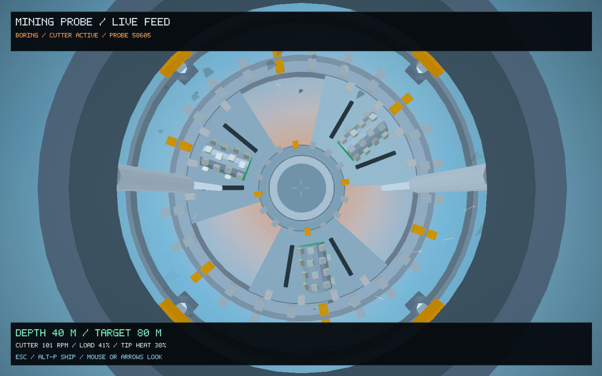
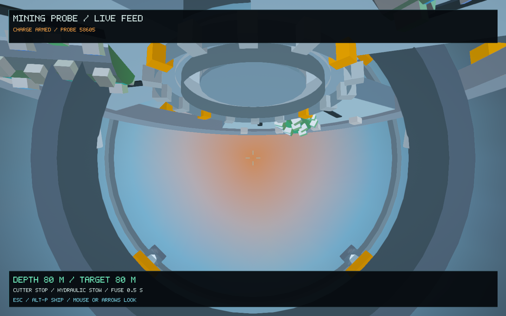

# Cutter and drive assembly — 0.58.2

The probe now carries a substantial cutting head with thick scalloped steel sectors, open cuttings channels, perimeter gauge teeth, service slots and bolted faces. Three toothed drums rotate against the main head, while a separate drive collar turns behind the hub. The guard, work lamps and amber service markings distinguish the stationary housing from moving components.

The head spins up smoothly at contact. Its slower, material-dependent rotation makes the teeth and rollers easier to follow in the camera feed. Small feed strokes, load-dependent vibration and warming cutting tips accompany boring. Cuttings leave the rotating channels with a short tangential drift and travel back inside the shaft; contact sparks follow the same rotation. The tip glow cools after the cutter stops. The heat percentage is a relative visual tool readout, not a new damage or resource system.

During arming, the cutter coasts down and its complete head pivots edge-on and slides back above the camera. It retains its actual dimensions throughout this motion. Two telescoping hydraulic rams remain attached to the moving carrier. The camera keeps a forward view through the existing charge countdown, blast and cavern reveal.

Existing **Ctrl-P**, **Alt-P / Esc**, camera-look and **Ctrl-J** controls remain the same. The refit market, ammunition, saved trajectory, actual boring rate, shaft and chamber geometry, collision, finite ore, universe addresses, seeds and player ship state retain their existing behavior. No save migration is needed.

## Rendering and validation

The manufactured assembly is built once and cached on the GPU. Repeated rollers, hydraulic barrels and rods use shared meshes with separate transforms. Large fixed-finish plates use authored face shading through the existing colour shader; the small rollers retain moving specular highlights. Lamps and cutting-tip glow use the existing Hyperion HDR/bloom/display pipeline. There are no new textures, shader binaries, framebuffers or dependencies.

The probe presentation tests cover rigid full-size retraction, shaft-wall clearance across the full rotor revolution and stow interval, lens clearance, attached hydraulic rods, smooth start/stop behavior, cooling, bounded and deterministic ejecta, cache size and unchanged saved excavation/mesh fingerprints. Existing probe tests retain refit accounting, physical drilling/caverns, camera independence and restart checks.

The native sequence covers the equipment port, flight, drilling, fuse, explosion, surviving camera, real entrance, full-size cavern entry and a portrait view. [Verification record](probe-cutter-0.58.2/verification.json) · [Native log](probe-cutter-0.58.2/native.log) · [Presentation tests](probe-cutter-0.58.2/presentation-tests.log) · [Excavation tests](probe-cutter-0.58.2/probe-tests.log).

Both probe suites passed: 117 existing excavation/refit/camera checks and 550 presentation/mechanism checks. All nine native stages passed. Consecutive runs of the signed 0.58.1 reference and upgraded build measured median frame times of 26.35 and 26.91 ms respectively, with the geometry cache unchanged at 13,317,736 bytes. Their 95th percentiles were 50.43 and 50.63 ms. These capture-fixture observations include asynchronous scene settling and are not a general performance benchmark.

The signed 0.58.2 / 68 app matches all 28 code/data sections of the tested executable and passed a normal 120-frame startup with a separate temporary save. The updated video contains 639 native frames, 21.3 seconds at 1,280 × 720 / 30 fps; frame-count and full-decode checks passed.

| Cutting head and rollers | Hinged head and hydraulic stow |
| --- | --- |
|  |  |

[Watch the updated probe camera recording](probe-cutter-0.58.2/mining-probe-pov.mp4). It uses an isolated demonstration save and follows the existing deterministic probe trajectory.
