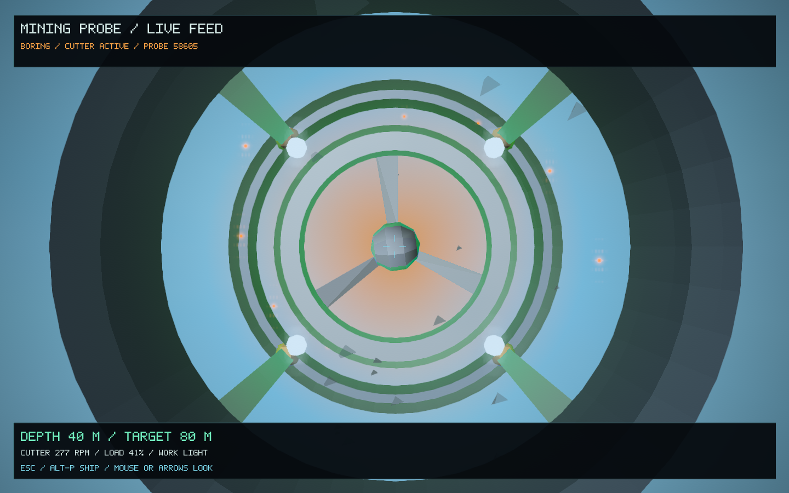
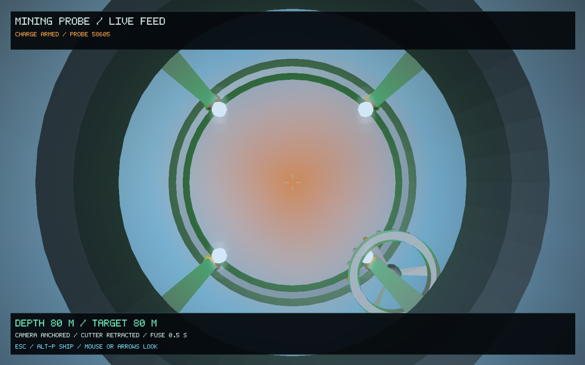
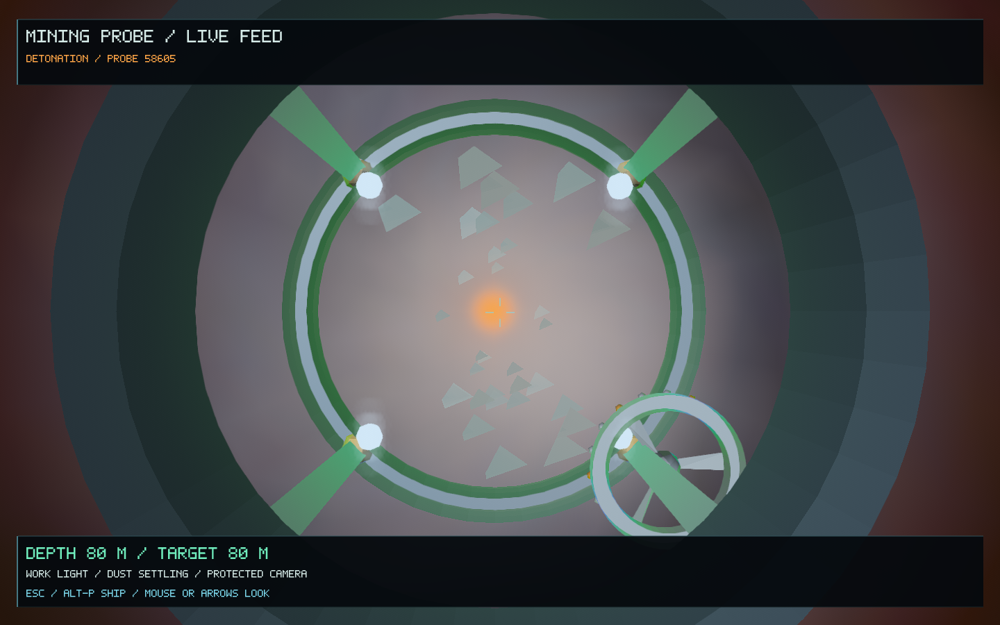
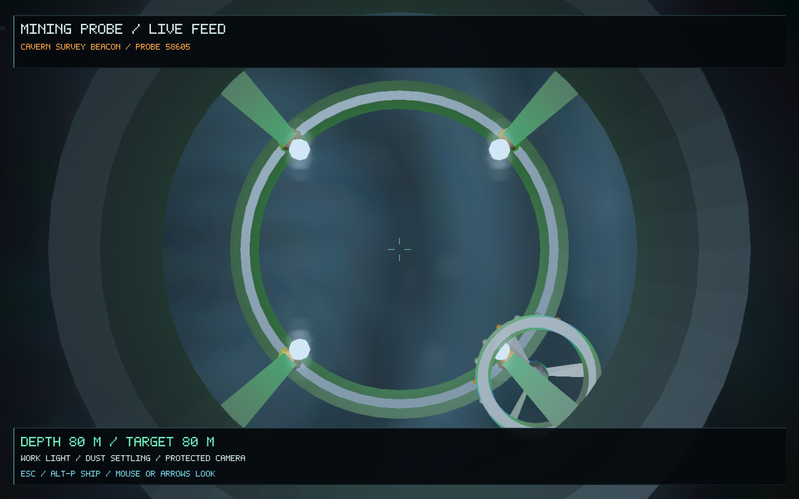

# Drill camera, work lights and detonation — 0.58.1

The mining-probe feed now looks out through a physical protective housing and work-light array. Its three-spoke cutter rotates while boring, with speed and camera vibration constrained by the host mineral's density. During the existing fuse interval, the cutter coasts to a stop and folds into the housing's side, staying inside the original shaft width. The camera steadies and the feed shows the remaining fuse time. The actual ship's hull status remains visible.

Underground surfaces receive a directional work light with distance falloff in metres, lower ambient illumination and a small amount of daylight near the entrance. The fuse adds a warm pulse near the charge. Detonation produces a short local flash and transient rock fragments, followed by soft, depth-tested dust that disperses to reveal the chamber. Drilling produces smaller cuttings and sparks; the sparks stop with the cutter.

Controls remain **Ctrl-P** to launch and **Alt-P / Esc** to switch between camera and ship. Existing camera look controls remain available. Equipment transactions, ammunition, trajectory, boring speed, physical shaft/chamber geometry, collision, blast damage, mineral reserves and saves are unchanged.

## Rendering and preservation

`ProbePresentation` samples the saved trajectory and inherited material without changing either. Its effects use a fixed maximum of 128 transient motes per excavation and expire after nine seconds. Camera motion is angular only; it cannot move the saved player ship or change the probe's physical path. Effect sampling is deterministic and does not depend on the order of rendered frames.

The housing and cutter use small cached GPU meshes and the existing Hyperion geometry material. The cavern retains its cached geometry and static GPU indices; a bounded vertex colour stream supplies the local work light through the existing cross-platform colour shader, followed by the normal HDR/bloom/display passes. The light samples run only for the already bounded nearby cave meshes. No new shader compiler, texture, dependency, framebuffer, procedural generator or save format is introduced.

## Checks and footage

All **62 core suites passed**, including the existing 117 excavation/refit/camera checks and the new machinery, light falloff, fuse timing, bounded particles and presentation-isolation tests. The new tests also verify that presentation sampling leaves the saved excavation and its canonical mesh fingerprint unchanged.

The nine native Metal capture stages additionally require actual drill hardware in the remote view, locally lit cavern vertices, drilling/blast dust and a blast flash that has ended by the settling stage. They retain the ship-state, physical opening, cavern entry and portrait-view checks from 0.58.

The final native fixture rendered 592 frames: median 18.85 ms, 95th percentile 31.90 ms, a 13,317,736-byte geometry cache and 141,459,456-byte peak process memory. These are observations of this capture run, rather than a general performance benchmark. The signed 0.58.1 / 67 app matches all 28 code/data sections of the tested executable and passed a normal 120-frame startup using a separate temporary save.

[Watch the updated first-person recording](probe-presentation-0.58.1/mining-probe-pov.mp4). The clip uses the same world, bore and timeline as the [0.58 reference](mining-probes-0.58/mining-probe-pov.mp4), with an isolated demonstration save.
It contains 639 native frames at 1,280 × 720 / 30 fps, lasting 21.3 seconds. Frame count, full video decode and the native recording's independent ship-state assertions all passed.

Evidence: [core checks](probe-presentation-0.58.1/core-tests.log), [native captures](probe-presentation-0.58.1/native.log), [verification record](probe-presentation-0.58.1/verification.json).

| Rotating cutter and work lights | Retraction and fuse countdown |
| --- | --- |
|  |  |

| Underground blast | Settling dust and surviving camera |
| --- | --- |
|  |  |
