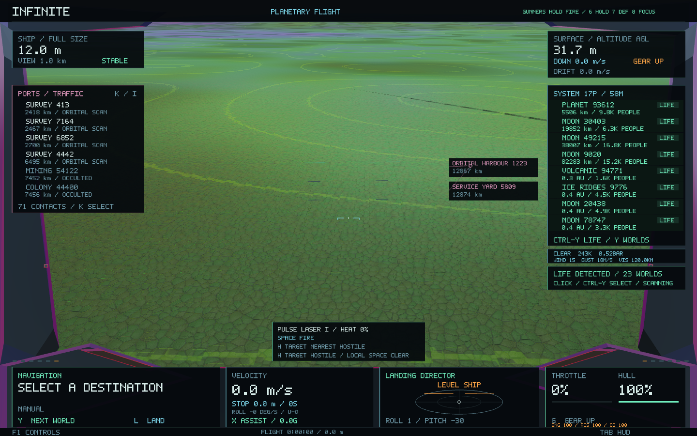
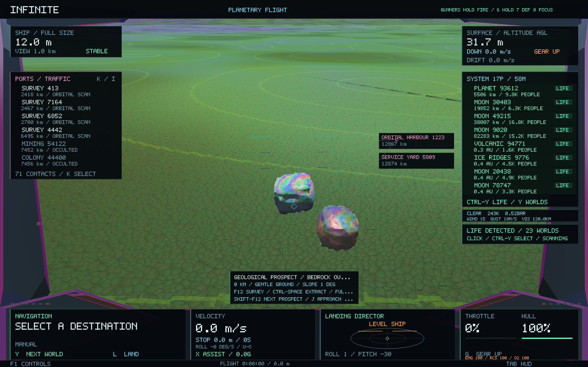
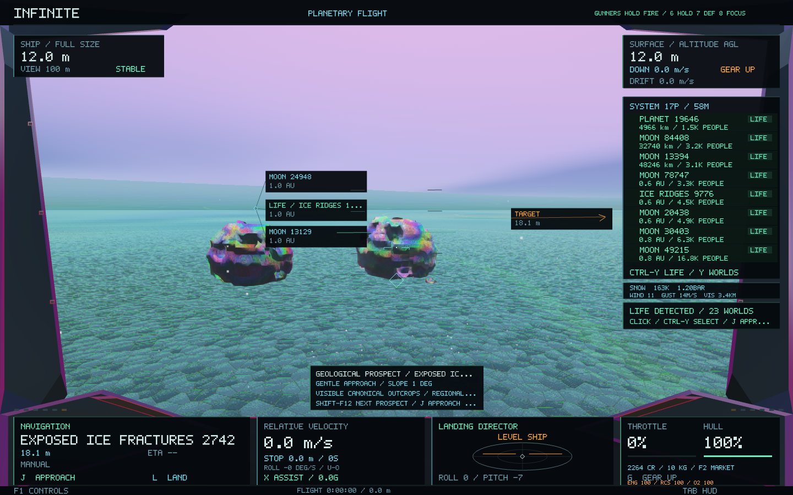

# Geological prospecting — 0.56

Solid planets and moons now offer visible resource-bearing formations, regional resource differences, and approach clearings for surveying and mining. The surface's mineral colour, recoverable stock and outcrop generation draw on the same geological exposure model.

## Find and work a site

- Select or approach a solid world, then tap **Shift-F12** to select a nearby prospect. Further presses cycle the district's sites. The scanner may need a moment to prepare a district on first approach.
- **J** approaches the site's clearing using the established surface-navigation route. The target is a physical point beside the formation, rather than the centre of a large terrain tile. **L** can land on suitable ground; hovering also works.
- At full size, below **40 m** above the ground and slower than **3 m/s**, hold **F12** to survey. Then **Ctrl-Space** operates a fitted mining head. **F11** shows the remaining ice, ore, silicate and carbon in kilograms.
- Ordinary mining still needs a mining head fitted through **F2 → Survey**. A colony expedition's loaned sampler remains specific to its core site; it does not replace general mining equipment.

Cyan markers indicate gentler ground; amber markers identify rougher alternatives. The cockpit reports the site's name and slope. Weather, gravity, ships, hull condition, equipment staffing and hold capacity retain their existing effects.

## What generation now produces

The new regional field distinguishes fractured mineral veins, impact ejecta, bedrock exposures, carbonaceous seams and exposed cold-world ice fractures. Concentration weights use the existing plate convergence, extension, shear, impacts, volcanism, erosion, sediment and climate. They amplify existing constituents; they do not introduce an element missing from the inherited composition. This is a qualitative concentration model, not a fluid or ore-formation simulation.

A district has at most twelve named sites. Each site evaluates several actual terrain locations, rejects open-water locations and prefers gentler terrain. Its approach clearing is selected separately, outside the formation. The gentler-ground classification requires less than twelve degrees of slope and less than two metres of height variation across the sampled ship footing. Rougher sites can still be sampled by hovering.

Three additional outcrop addresses follow the original twenty-four rocks in each mountain's catalogue. These new formations use the existing rock SDF, fractures, cavities, grain clipping and atomic generators. Their physical radii can reach several metres, subject to their parent's spatial scale. Their material composition inherits the local geological concentration. They are ordinary hierarchical objects with deterministic addresses and seeds, so approaching or shrinking into them refines the same structure.

The original rock catalogue remains the prefix, and original rock sizes and identities remain unchanged. Existing planets, moons, city layouts, orbits, terrain heights and navigation coordinates remain intact. A separate presentation colour stream includes the continuous exposure field, sampled consistently by planet meshes and streamed patches. Original terrain vertex colours and mesh fingerprints remain exact. New formations use actual geometry and physical scale in the renderer.

New colony expedition offers also examine nearby terrain before choosing their source, improving the chance of a practical core approach. Already saved expedition sources retain their addresses and descriptors.

## Finite reserves and existing saves

Each canonical level-seven surface district has one recoverable stock shared across all its outcrops and finer scales. Newly worked districts derive their composition and accessible material volume from the geological field, with a bounded recoverable mass of 100–5000 kg. This is the accessible reserve, not the total mass of the landscape or an entire boulder.

The reserve is frozen when extraction first begins, including when a colony core is recovered. `INFINITE_EXPLORATION 2` saves that capacity alongside extraction. Version-one records migrate with their original capacities, so exhausted old deposits remain exhausted. Resurveying, zooming, changing outcrops or restarting cannot refill them. The cockpit directs prospecting toward a neighbouring district when the current one is exhausted.

The new ledger remains in the existing atomic SQLite transaction with the wallet and economies. Wallet, ship, navigation and expedition save formats are unchanged.

## Generation and rendering costs

Regional catalogues use the existing bounded worker pool, cancellation and cache budget. At most four regional catalogues are cached. The renderer requests at most twelve nearby outcrop meshes and reuses the existing screen-space geometry LOD and GPU cache. No new rendering dependencies or full-screen effects are introduced.

[Validation and measured results](prospecting-0.56/verification.json) include source identity checks, legacy depletion migration, a physically simulated approach, cancellation and cache eviction, actual survey/extraction, a cold world and the narrow-window journal. The native outcrop checks compare submitted meshes against their canonical generator output.

## Images

These views use the same camera and world coordinates in 0.55 and 0.56:

## Matched-view performance

This short Metal comparison uses the same physical eye, orientation, 1440 × 900 viewport and visual time. Only settled frames are included (15 before, 17 after); it is a single-scene sample rather than a whole-game benchmark.

| Measurement | 0.55 | 0.56 |
|:---|---:|---:|
| Median CPU frame | 14.90 ms | 15.11 ms |
| Median wall frame | 19.80 ms | 23.16 ms |
| CPU cache | 10.18 MiB | 10.67 MiB |
| Peak process memory | 125.73 MiB | 128.27 MiB |

The updated view draws four additional physical outcrop objects. Its CPU median increased by about 0.21 ms, wall-frame median by 3.37 ms, and peak memory by 2.53 MiB. The renderer reports an additional 92,440 bytes of persistent geometry on the GPU. Terrain itself uses the existing transient buffers; that number is not total graphics memory. [Raw comparison](prospecting-0.56/comparison.json).
