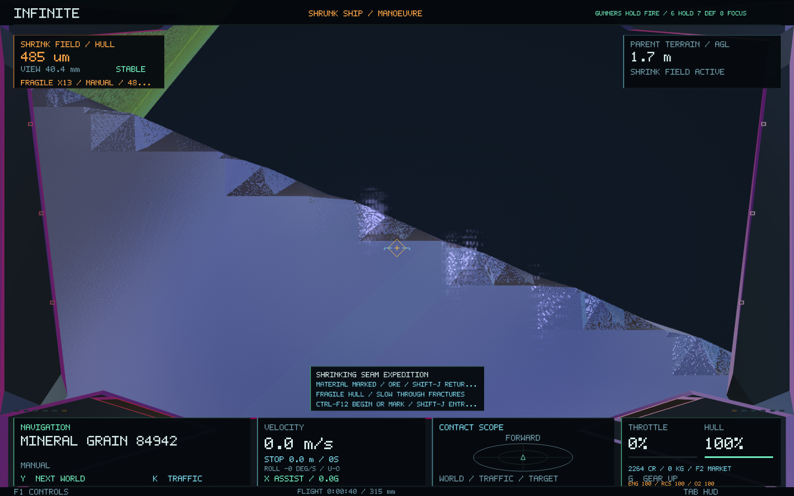
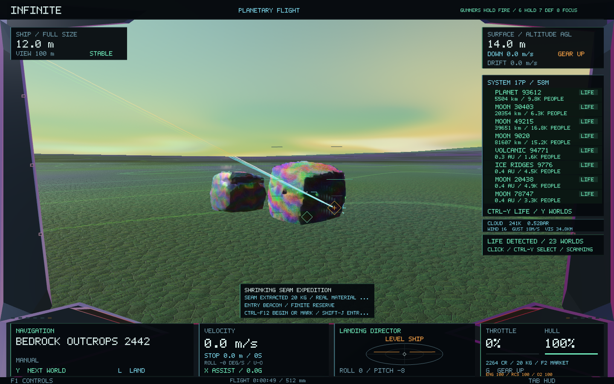
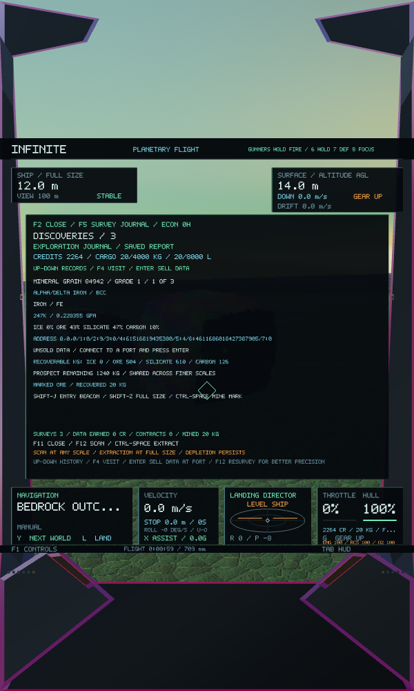

# Shrinking seam expeditions — 0.57.0

The ship can now turn a close physical inspection into a selective mining operation on the same deposit. This extends the existing prospecting system; no generator, seed, coordinate hierarchy, geometry or material identity changes.

## Fly the expedition

1. Fit a mining head at a connected port through **F2 → Survey**. Empty bulk cargo before shrinking. Extra weapon mounts still need a crew member or the captain operating that station.
2. **Shift-F12** selects a visible geological prospect. **J** approaches its clearing. Stop near the outcrop, below 100 m altitude, and hold **F12** to survey the surface.
3. Press **Ctrl-F12** at full size to begin. The computer saves an entry beacon above that actual clearing and selects the canonical source rock.
4. Press **Z** to shrink. **J** brings you toward the rock, stopping outside it. Fly the final distance yourself, approaching its exposed face or navigating an existing fracture or cavity. Use **Ctrl** for precision and **B** to brake. The ship must be physically small and nearly stationary for a close inspection.
5. Hold **F12** near the rock, or explore further into its actual mineral structures and scan those. The computer identifies a recoverable constituent from the observed composition and the district's remaining reserves. A camera zoom alone cannot qualify.
6. Press **Ctrl-F12** while tiny to mark the last completed close inspection. The amber cross-and-diamond identifies the marked material; the cyan square identifies the entry beacon. Source, material, inspection and entry remain saved. Completing another close inspection selects that material instead and asks you to confirm its replacement mark.
7. **Shift-J** points back to the entry beacon. Inside rock, it brakes and provides guidance for manually retracing open passages. Once outside microscopic material, it can fly to the clearing. Regrowth still checks actual terrain, rock, mineral and atomic clearance. **Shift-Z** requests full size; it waits wherever growth is obstructed.
8. At full size, near the original outcrop and below 40 m altitude, select its saved mark and hold **Ctrl-Space** with the mining head staffed. The tool aims at the actual marked material. It extracts only the identified resource, at **20 kg per cycle per mining-head grade**, compared with the ordinary mixed 10 kg cycle. The journal and cockpit show recovered kilograms; real cargo can be sold at ports.

Cargo capacity, tool heat, crew readiness and intervening ships still constrain extraction. The same canonical level-7 district supplies all its rocks and microscopic descendants. A mark does not create a new reserve. Exhausting the marked constituent leaves the district's other resources available to ordinary mining. Starting another expedition retains previous marks, with at most 128 sources recorded. To revisit one, select its material through the existing journal; **J** at full size approaches the saved outcrop clearing.

## Fragile tiny ships

Damage vulnerability is `clamp(sizeRatio^-0.25, 1, 25)`: the normal 12 m hull is unchanged, a 12 mm hull takes about 5.6 times the damage, and the smallest hulls take 25 times. Both weapon damage and collision damage use physical size, independently of camera scale. The safe inward contact-speed threshold also falls as vulnerability rises. Quiet hovering and sufficiently slow contact cause no new passive damage. The cockpit displays the current multiplier. Shrinking is useful for concealment but does not protect a tiny hull from an actual hit.

## Persistence and boundaries

Exploration saves advance to version 3 and continue reading versions 1 and 2. Existing depletion and frozen capacities remain intact. Entry beacons and material marks are validated against the same generated solid world on load. Work is committed through the existing asynchronous economy worker with its normal queue backpressure and SQLite transaction, including cargo and depletion together. Mesh generation and database writes stay off the rendering thread.

The baseline was commit `e13370c` (0.56.0). The original prospecting, exploration, expedition, handling and shrinking tests passed before changes. New checks cover physical size and range requirements, close mineral lineage, stale and mismatched observations, marked beam position, finite selective extraction, cargo limits, replay, save migration, restart and increased tiny-hull damage. Native validation renders the surface, tiny rock, mineral, material mark, full-size extraction and a narrow portrait journal.

## Verified build

- All **60 core suites** passed, including **47 direct seam-expedition checks** and asynchronous SQLite restart checks.
- All **six native stages and image checks** passed. The same source rock was retained throughout; inspected meshes matched their canonical generated fingerprints. The completed expedition transferred **20 kg** into cargo.
- A normal **120-frame startup and save** passed using the signed application and an isolated data folder. Existing player saves were not opened or changed by validation.
- Packaged **Infinity.app 0.57.0 / 65** passed signature verification. All **28 code/data sections** matched the tested executable.
- The final build completed after freeing regenerable test binaries and old raw test captures when the disk filled. Other projects and their generated files were left alone.

[Machine-readable results](seam-0.57/verification.json), [core checks](seam-0.57/core-tests.log), [native sequence](seam-0.57/native.log), [startup](seam-0.57/startup.log).

The visible-scene check permits background requests to remain deferred by the cache budget; it requires stable visible geometry, no active mesh jobs, no LOD transitions or deferred uploads, and an exact fingerprint match for each inspected mesh.

