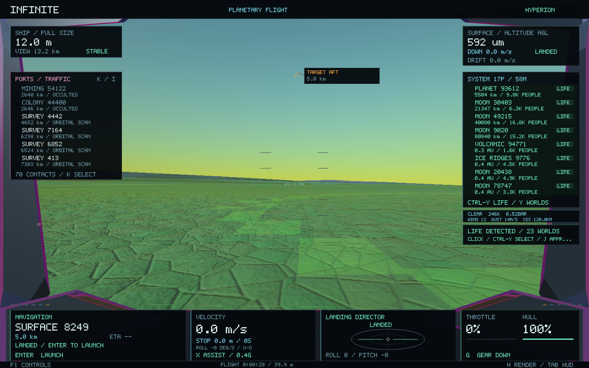
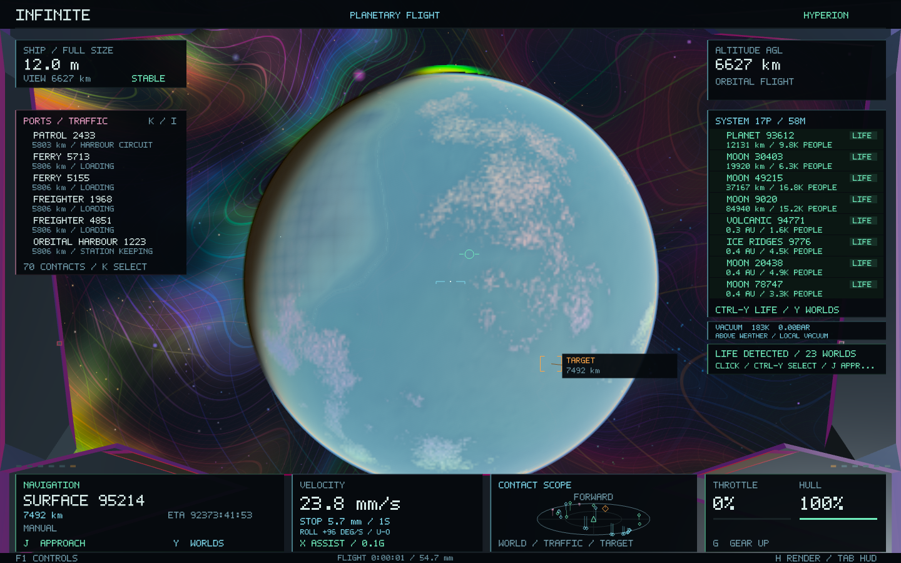
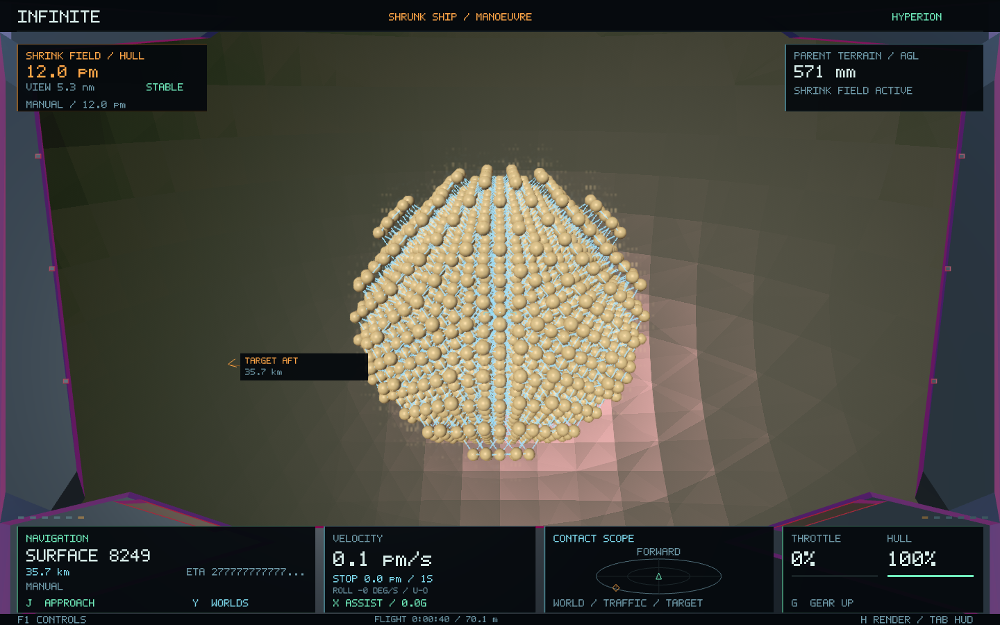

# Ship physics 0.37

Infinite now uses a fixed physical hull and finite actuators for ordinary flight. Turning changes attitude; redirecting travel takes thrust and time. Flight assist remains available, roll remains unrestricted, and the existing destination–approach–landing–launch loop remains operational. Long-range cruise and shrinking retain their explicit fictional fields.

The universe is unchanged. No generators, seeds, addresses, terrain, cities, planetary or stellar descriptors, orbital arrangements, atomic structures or renderer passes were edited. [The preservation manifest](ship-physics-0.37/preservation.json) verifies nineteen generation, geometry, navigation and rendering sources against `checkpoint/infinite-0.36-before-flight-physics` (`7a35cf7`). Existing population, stellar catalogue and surface-site snapshots also pass.

## Research and scope

[NASA's mechanics guide](https://science.nasa.gov/learn/basics-of-space-flight/chapter3-2/) supports force-driven acceleration and inertial coasting. [NASA's spacecraft control survey, section 5.2.4](https://www.nasa.gov/smallsat-institute/sst-soa/guidance-navigation-and-control/) explains thrusters' translational and rotational authority and their interaction. [NASA's rendezvous testing overview](https://www.nasa.gov/reference/jsc-rendezvous-prox-ops-docking-subsystems/) describes relative dynamics and six-degree-of-freedom control testing.

Those principles inform this implementation. The numerical hull, engine and controller settings below are game design choices, not specifications for an existing spacecraft. This remains a playable science-fiction ship: strong manoeuvring jets, unlimited propellant, no heating or crew injury simulation, and no relativistic dynamics.

## Ordinary flight

`ShipDynamics` supplies independently testable SI forces, torques, gravity and drag. `Pilot` consumes them above the existing navigation and generation interfaces.

| Property, full-size hull | Value |
| --- | ---: |
| Length / assumed width / height | 12 / 4 / 3 m |
| Mass | 12,000 kg |
| Principal moments of inertia | 153,000 / 160,000 / 25,000 kg m² |
| Main thrust | 624 kN |
| Reverse / lateral / lift thrust | 384 / 528 / 576 kN |
| Main-engine boost multiplier | Up to 2.4 |
| Pitch / yaw / roll torque limits | 994.5 / 1,040 / 237.5 kN m |

Force no longer increases with ship speed or viewing scale. Translation follows force divided by mass. Attitude integrates angular momentum, inertia and applied torque using a quaternion midpoint method. Assist requests torque to reach a commanded angular rate; it does not overwrite the attained spin. Inertial flight retains linear momentum in vacuum and angular momentum without torque.

Translation and rotation share a bounded manoeuvring actuator envelope. The forward main engine has a separate limit. Gravity compensation takes priority; other commands use the remaining authority. Translation retains the existing 120 ms spool, and assisted attitude valves use 40 ms response. This models aggregate actuator authority rather than individual nozzle plumbing or minimum impulse bits.

Assisted throttle selects a velocity target. The controller can only approach that target with available thrust. Inertial throttle directly commands engine force. There is no conventional velocity clamp or speed-dependent force multiplier. The proximity speed target also considers a finite braking envelope. Ordinary brakes cannot immediately erase kilometres per second of drift.

## Gravity and atmosphere

`FlightEnvironment` reads existing addressed bodies through the asynchronous region catalogue. The current star, ancestor planet and a moon's primary are available immediately; complete system catalogues arrive through existing workers. Up to three visited systems are retained. There are no new generation jobs on the flight thread and no global simulation step.

Stars use their existing physical mass. Planets and moons use existing radius and bulk-density queries; the historical solid-planet `massSolar` placeholder is not treated as a solar mass. Gravity sums inverse-square contributions and uses a bounded uniform-density interior. It is independent of terrain queries and landing eligibility, so it remains active beyond 3R and on gas giants. Retained sources survive precision-frame transitions. This is a bounded local gravity model; loading or dropping a distant system can change a very small distant contribution.

Solid-world density, temperature, pressure and wind come from the existing deterministic climate and weather sampler at ship flight time. Drag uses projected hull area and air-relative velocity. Its implicit quadratic update cannot reverse that velocity or add kinetic energy relative to the air. Wind can accelerate a stationary hull. Gas giants use a read-only hydrostatic envelope and broad zonal wind model; they acquire no solid landing surface.

The existing celestial positions stay static. This update adds forces on the ship; it does not introduce evolving planet orbits, an N-body universe, fuel depletion, aerodynamic lift or atmospheric entry heating.

## Approach and instruments

Moving contacts provide target velocity as well as position. Guidance captures a fixed approach axis in the target reference frame, retains its stand-off point, slows for lateral corridor error, and uses available braking acceleration to limit closing speed. The final hold matches target velocity instead of trying to stop in the universe frame. Manual control still cancels approach.

The existing velocity card now shows target-relative speed during rendezvous, estimated braking distance and burn time, roll rate and conventional proper g-load. Green prograde and amber retrograde cues use the same relative motion. `FIELD DRIVE` identifies fictional drive use; `THRUST LIMIT` warns when local gravity exceeds the hull's maximum conventional thrust acceleration. Existing cockpit bounds and controls remain in place.

## Cruise, shrinking and saves

**N** explicitly engages cruise. Its field acceleration is separate from conventional engine force; disengaging allows a labelled field-braking handover. **Z** and the size controls explicitly operate the shrinking field. Merely changing render magnification never changes hull mass, thrust, inertia, velocity or body spin.

For physical hull ratio `s`, the field prescribes mass ∝ `s³`, inertia ∝ `s⁵`, thrust ∝ `s⁴` and torque ∝ `s⁵`. It also rescales gravitational and wind coupling and shields the hull from continuum drag below microscopic sizes. Those environmental and mass exchanges are intentional fiction. Atomic collision geometry remains authoritative. Shrinking first brakes unsafe transit speed; growth still refuses occupied matter. A steadily shrunken inertial ship does not acquire an automatic overspeed brake.

Ship save format 4 adds filtered angular actuators and the drive-braking handover. Versions 1–3 remain readable. Modern version-3 saved flights retain position, velocity, attitude, hull scale and throttle. An assisted legacy overspeed can use a field handover to the normal-flight envelope. The historical main-program migration for versions 1–2 remains intact. Invalid restores are transactional, and a saved actuator combination cannot exceed the shared budget. Finite inertial spin is preserved above the old 100 rad/s save threshold.

## Measurements and validation

Measured on Apple M1, 16 GiB, macOS 26.4.1, Release build. [Before](ship-physics-0.37/before-handling.json) and [after](ship-physics-0.37/after-handling.json) use the same handling probe at 60 Hz.

| Probe | 0.36 | 0.37 |
| --- | ---: | ---: |
| Assisted roll rate | 1.79992 rad/s | 1.79999 rad/s |
| Roll release settling | 0.317 s | 0.267 s |
| Release rotation | 0.184 rad | 0.232 rad |
| Roll reversal | 0.200 s | 0.233 s |
| Assist re-engagement first-frame velocity change | 0.000508 m/s | 0.000508 m/s |
| Residual lateral drift after the 2 s capture probe | 1.766 m/s | 1,182.484 m/s |
| Turn slip angle | 0.640 rad | 0.827 rad |

The drift fixture starts at 1,264.91 m/s lateral speed. The new controller removes about 82.43 m/s over the probe instead of almost erasing the entire drift. That longer braking response and greater turn slip are intentional consequences of finite thrust, not a claim that every response time improves. Earlier handling assertions requiring effectively unlimited capture thrust were replaced with bounded-authority checks.

The new physics suite checks angular momentum for 10,000 torque-free steps, energy drift, torque/inertia response, 2,000 actuator combinations, shrink scaling, vacuum and atmospheric drag, equal engine impulse at different starting velocities, inertial overspeed, gravity continuity at 3R and on gas bodies, render-scale invariance, moving-target rendezvous, and versioned persistence. Rotational relative energy error was **1.51 × 10⁻⁸** over the conservation probe. A three-second ramped throttle burn averaged **26.0084 m/s²**, below the 52 m/s² engine limit, independently of initial velocity. The moving 3 m/s contact settled at **4.293 m** stand-off error with approximately **1.3 × 10⁻⁹ m/s** relative speed.

Validation records:

- [All 35 core tests](ship-physics-0.37/core-tests.log), including unchanged world snapshots, weather, cities, landings, streaming, controls and galaxy-to-atomic continuity.
- [Native piloting and image checks](ship-physics-0.37/native-pilot-tests.log): identical camera and geometry in all three rendering modes; safe touchdown at 0.592 mm AGL with 100% hull; thrust launch to 30.127 m AGL; micro/nano resizing; 1,631 visible atoms; real moons and traffic; both roll directions and release.
- [Native scale and UI checks](ship-physics-0.37/native-scale-ui-tests.log): screen-fit capture checks, seamless flight through nine scales with eight inward/eight outward frame changes, and the galaxy-to-atomic return with matching descriptor/material/site proof digest `18021890525663604607`.
- [Physical dynamics checks](ship-physics-0.37/physics-tests.log), [package verification](ship-physics-0.37/package.json), and [unchanged source hashes](ship-physics-0.37/preservation.json).

The native cockpit workload rendered 2,063 frames: median wall time **26.12 ms**, p95 **151.14 ms**, peak RSS **144.8 MB**, and peak CPU geometry cache **11.94 MB**. This run overlapped CPU regression tests and includes streaming and resizing, so these are workload observations, not a controlled rendering speedup comparison. Shaders, renderer passes and GPU representations are unchanged. The new force-source cache is bounded by three system catalogues.

The built app is **0.37.0 / build 37**, ad-hoc signed and verified. Its twenty-eight Mach-O code/data sections match the tested executable.

Controls: **W/S** throttle; **A/D**, **Q/E** strafe/lift; mouse/arrows helm; **U/O** or **Alt+A/D** roll; **X** assist/inertial; **B** brake; **J** approach; **L/G/Enter** land/gear/launch; **N** cruise; **Z**, **,/.**, **Shift-Z** shrink/resize/regrow. **F1** opens the fitted guide.
