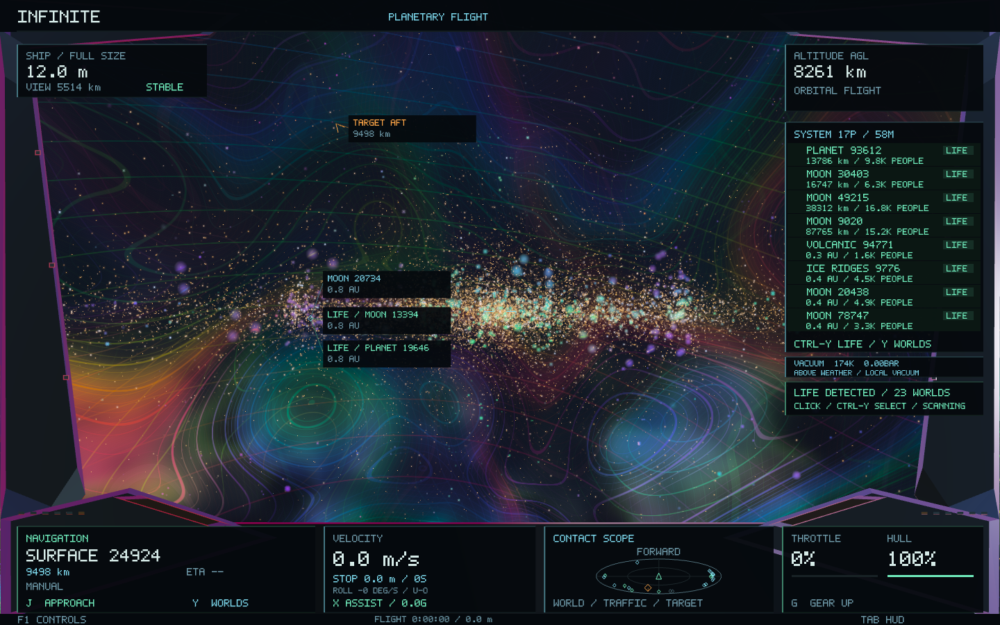
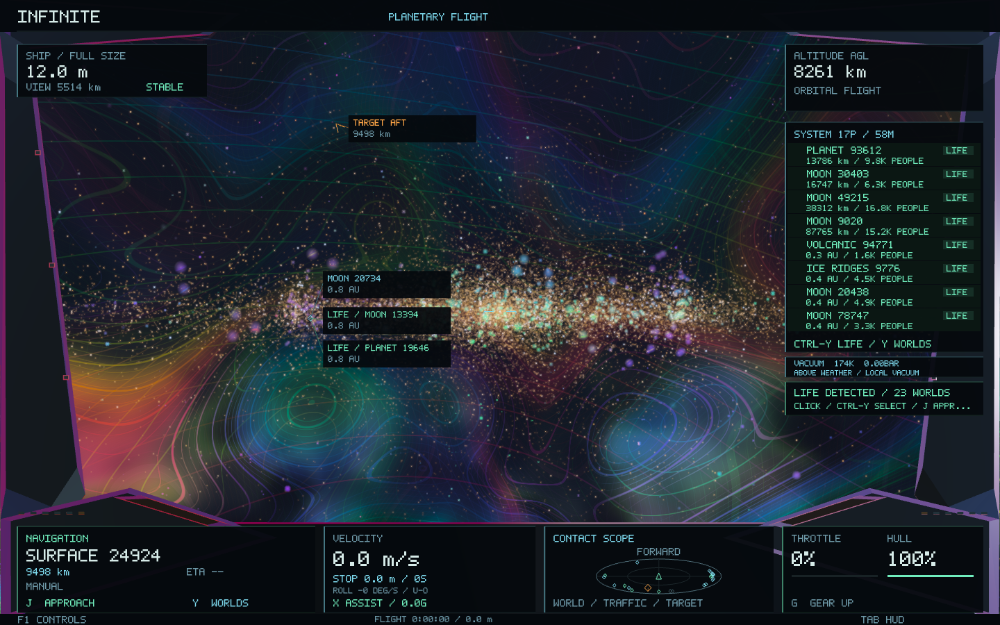

# Background star stability — 0.50.1

The star field was strongly undersampled. The existing glow shader puts a Gaussian core `exp(-48*r*r)` inside a billboard whose radius can be only 1.05 pixels. Its core sigma is about 0.11 pixels, and its bright diffraction spikes are narrower still. Small changes in sampling position can therefore cause large brightness jumps.

This also occurs without steering. The existing cockpit has engine vibration at 6.1, 7.7 and 9.3 Hz, plus load-dependent motion. Those small camera rotations move unresolved stellar cores between framebuffer samples while the physical ship heading remains steady. The distant-star branch itself has no time-dependent twinkle animation.

## Change

Unresolved background emitters receive an optical footprint before rasterization. Their Gaussian envelope becomes `sqrt(radiusPixels² + 6²)`, giving its core a minimum sigma of roughly 0.61 pixels. A compact shared four-triangle sprite occupies half that envelope and fades to black at its edges. A 1.62132496 normalization compensates for this window, followed by the inverse area ratio, preserving mean linear core/halo emission within the tested 0.1% bound. Tiny bright spikes naturally drop out for unresolved sources as their radiance is spread over the footprint. The response varies continuously with projected size; resolved stellar photospheres and coronae retain their existing rendering.

Only the background point-light presentation changes. There is no whole-image blur, temporal history, new texture, new dependency or additional emitter instance. The same shaders and instance layout are used, with one small shared sprite mesh. Gas, foreground materials, nearby stellar photospheres/coronae, cockpit motion, object positions, picking, identities, scientific geometry and generation stay intact. The negative-control API is for native validation and is not a new player rendering mode.

The per-point conversion reuses the current projection matrix, avoiding an extra trigonometric calculation for every emitter. The compact mesh cuts quad area by 75% versus the first filtered prototype. Points retain priority over fainter gas when transient instance capacity is tight. Instance count and memory representation stay bounded; no full-screen buffer is added.

## Validation

The mathematical regression samples the existing core/halo kernel through a full two-dimensional subpixel sweep and through the actual stationary-engine motion. It checks integrated energy, finite bounds and invalid inputs. The native scenario uses the same generated galaxy, physical ship pose and emitter geometry, with two frozen-camera frames and sixteen idle-vibration samples for each presentation. Its probes retain actual star IDs and include the local galactic background and the existing display pipeline.

The CPU reference reduces full-phase brightness variation from **160% to 1.08% CV** at the smallest common star size; the real idle-engine input falls from **136% to 1.14% CV**. These reference measurements isolate the emitter kernel. The native test includes the real background, tone mapping and post-processing: **52 addressed star apertures show a 32% reduction in median brightness variation**, from **8.26% to 5.62% CV**. Both final frozen-camera frame pairs are pixel-identical. The same galaxy geometry fingerprint is retained throughout.

All **50 Infinite CPU checks pass** in the full workspace run, which also included an independently configured game check. After sprite compaction, all **5 focused checks and 4 native checks pass**, including station swapping. The native star run contains 36 captures across 686 frames. The signed **0.50.1 / build 56** app matches all 28 tested code/data sections; 196 protected scientific, flight, crew, optics and shader files match checkpoint `3d92a5b`. The normal saved flight was reopened and visually checked.

Captured-frame diagnostics recorded CPU medians of **23.96 ms before / 24.42 ms after** and GPU medians of **94.39 ms before / 79.11 ms after**. These are shared-host diagnostics with capture readback, concurrent app/build activity and transient disk pressure; they are not a controlled speed claim. Peak RSS was **157,122,560 bytes**. The first wide sprite was replaced to reduce fill and keep stars compact.

A broader existing celestial image test still fails its `ice: visible celestial rendering is missing` assertion. The unchanged, verified 0.50 executable also produces zero changed ice pixels for that comparison, matching the initial filtered build: [baseline comparison](star-stability-0.50.1/ice-baseline-comparison.json). Its native geometry, depth and camera assertions complete on both builds. This pre-existing image expectation was not rewritten as part of the star fix.

[Final results and hashes](star-stability-0.50.1/validation.json), [CPU checks](star-stability-0.50.1/core-tests.log), [focused checks](star-stability-0.50.1/final-focused-tests.log), [native checks](star-stability-0.50.1/final-native-tests.log), [per-star measurements](star-stability-0.50.1/comparison.json), [preservation](star-stability-0.50.1/preservation.json), [signed package](star-stability-0.50.1/package.json).

