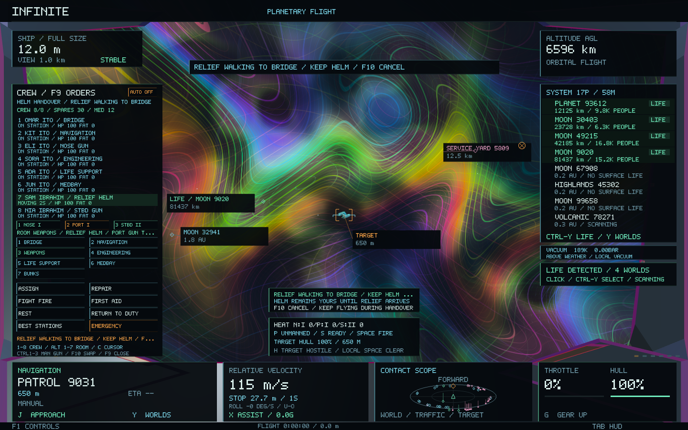
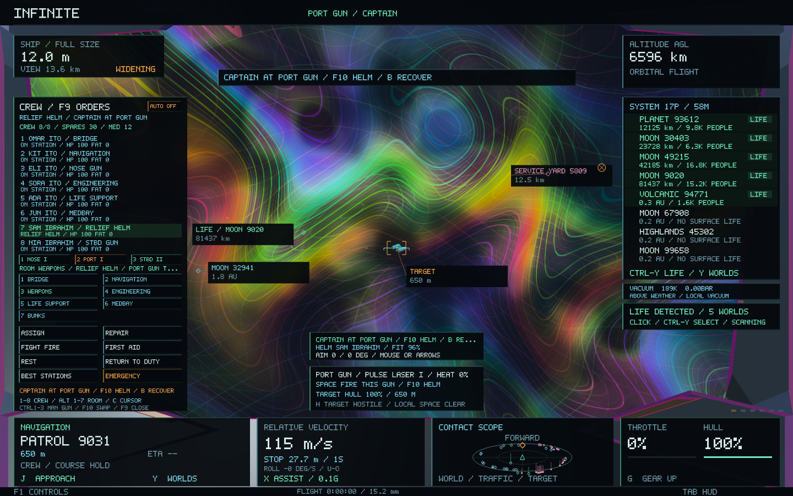
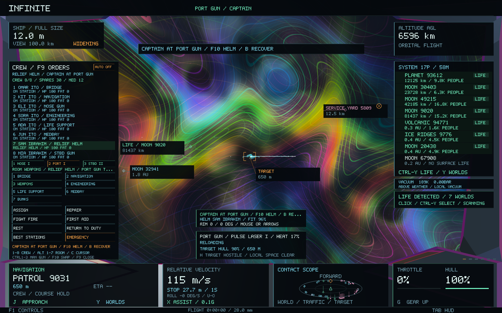
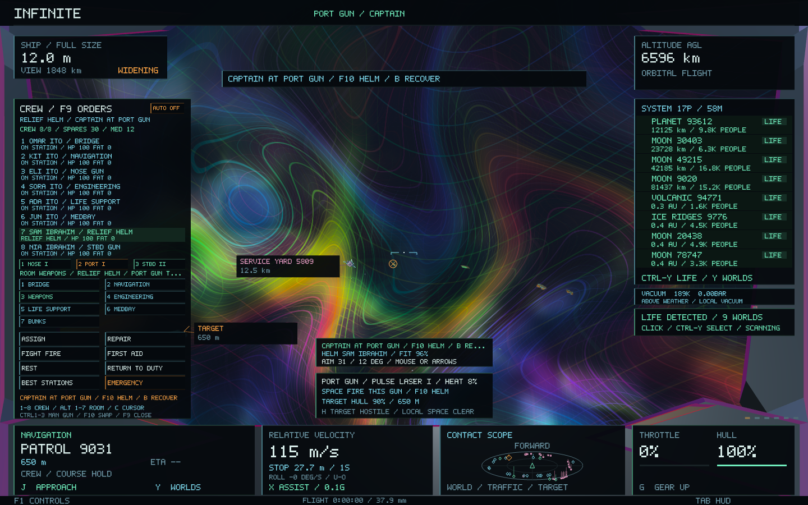
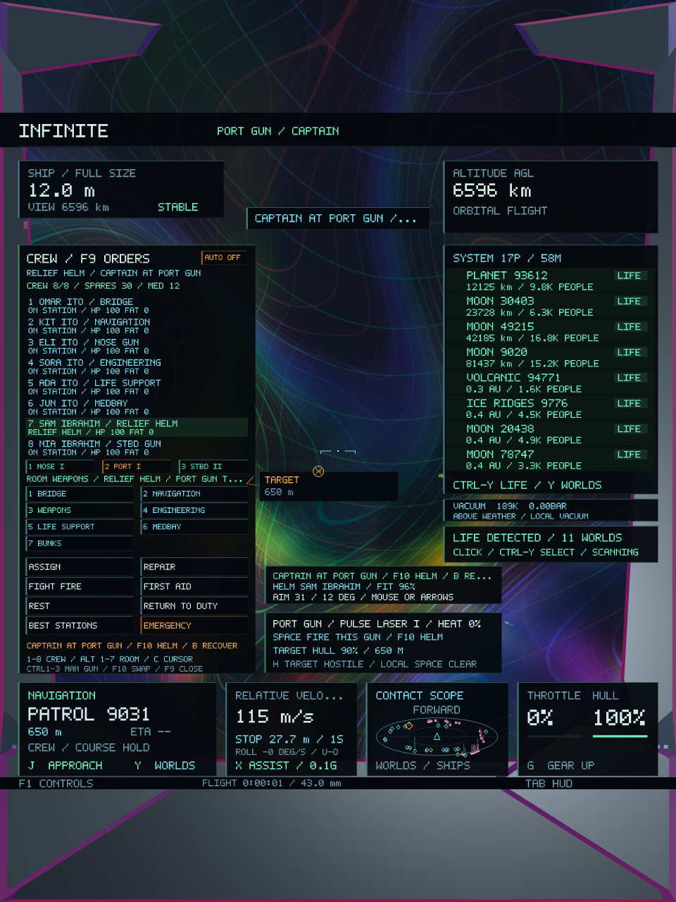

# Captain and gunner station swap — 0.50

The captain can exchange places with an available gunner when the ship has at least two fitted weapons. Gun equipment, ownership, heat and cooldown remain those of the selected mount.

## Controls

- **F10** requests a staffed extra gun, or returns to the captain's helm. With **F9** open, select a gunner first to take their specific console, including the nose gun. Outside F9, ready port/starboard guns take priority.
- During **RELIEF WALKING TO BRIDGE**, normal flight controls remain yours. The gunner follows the existing compartment corridors. Handover completes when they reach the bridge.
- At the gun, **mouse or arrow keys** traverse the weapon: 120 degrees left/right and 70 degrees up/down. **C** retains the existing mouse capture control. The reticle follows this weapon; the ship's physical heading remains independent.
- **Space** fires only the gun you occupy. At the helm, Space retains the existing linked battery firing behaviour.
- **F10** immediately returns the helm; **B** returns and brakes. The relieved person walks back to their assigned gun. They cannot service it from the bridge or while walking.
- Destination selection and **J** approach remain available: the relief pilot continues that approach. Landing, launch, travel/shrinking changes, explorer mode, markets and the full crew deck return control to the helm.

The station card identifies the captain's gun, relief pilot, current fit and traverse. F9 identifies the person at **RELIEF HELM**. Fit reflects the same existing bridge experience ranks, health, fatigue, morale and bridge integrity used by the crew system; it is not a success percentage.

## Crew flying and safety

With no active navigation order, relief holds the physical heading captured at handover and maintains the existing throttle through the ship's assisted flight controller. With an active navigation order, they follow its existing approach and velocity-matching guidance. More capable pilots correct heading faster and execute approaches at a higher permitted speed; novice pilots use slower corrections and more conservative approach speeds. There is no added random wobble, hidden teleport or new force model. The captain's assist preference is restored when crew control ends.

The exchange requires a fit gunner actually present at their console and safe weapons/bridge compartments. Incapacitation, death, orders taking the relief away from the bridge, removal of the gun/person, low oxygen, fire, loss of the hull or a travel/size field automatically returns the captain to the helm. Explicit crew orders are preserved during cancellation. Automatic fatigue rest can also end relief duty.

The existing bridge crew can remain at their station: the selected gunner occupies the captain's helm temporarily. Their permanent gun assignment stays bound to their identity, and they gain bridge experience rather than gunnery experience while flying. Other crew retain their assignments.

## Integration and preservation

`StationControl` owns transient authority and gun traverse. `ShipCrew` owns the relief identity, real corridor movement, readiness and training. `Pilot::updateCrew` feeds the existing controller with a frame-aware course and quality, while ordinary captain flight still uses the original path. Gun range, muzzle spacing and the viewing position inherit physical hull size. The camera, spectral sky, stellar optics, contacts, lighting and HUD consume the independent gun aim as read-only presentation data.

The weapon system traces from the selected muzzle without nose convergence, reusing the existing obstruction checks, shared damage ledger, target identities, thermal/reload state and GPU pulse effects. It does not auto-select targets or start firing for the captain.

No save version changes are needed. Saves retain the gunner's identity, permanent gun duty, location and in-progress corridor leg, and direct them back to the gun on load. Player station authority and traverse are deliberately transient, so reopening a save starts at the captain's helm. Existing wallet, crew and combat saves remain readable.

Universe generators, coordinates, seeds, identities, geometry, all scientific scales and ordinary ship forces remain unchanged. The existing `ShipState`, seven room IDs and corridor graph are preserved.

## Validation

All **49 core tests pass**, including the new station-control suite and existing handling, weapons, crew markets, economics, persistence and galaxy-to-atomic continuity suites. New checks cover eligibility, real walking, ownership, independent aim and traverse limits, single-gun fire, training, return orders, equipment loss, unsafe compartments, saves, frame/scale changes and fitted HUD layouts.

In a matched one-second course correction, the novice pilot retained **27.4 degrees** of heading error and the expert **6.9 degrees**, from the same initial 51.6-degree error. The approach test also verifies different travel speeds while preserving the navigation order. The novice subsequently settles without sustained spin.

All **8 native gameplay/image checks pass across 28 captures**: station swapping, paid extra guns, in-flight crew management and NPC combat. The new eight-frame fixture shows the helm, walking relief, occupied gun, one-shot shared target damage, independent traverse, portrait view, loss of the pilot and return to the gun. Initial screenshot review found a station-card overlap with the life panel in portrait; the card was moved, explicit non-overlap checks were added and all final tests were rerun. The [initial portrait](station-swap-0.50/swap-portrait-before-layout-fix.png) is retained for comparison with the corrected capture below.

The final station fixture recorded **217 frames**, **34.11 ms median / 91.48 ms p95** raw frame time and **149,864,448 bytes peak RSS**. These diagnostics include loading, captures and resizing and are not a matched performance comparison.

**Infinite 0.50.0 / build 55** is packaged and ad-hoc signed. All four native executables match the final build, and all **28 code/data sections** match the signed app. The preservation manifest verifies **188 protected files**, the exact physical `ShipState`, room IDs and corridor graph against checkpoint `701243a`. Validation uses isolated saves.

[Final results and hashes](station-swap-0.50/validation.json), [core tests](station-swap-0.50/core-tests.log), [native tests](station-swap-0.50/native-tests.log), [preservation](station-swap-0.50/preservation.json), [package verification](station-swap-0.50/package.json), [lossless capture hashes](station-swap-0.50/captures.json).

