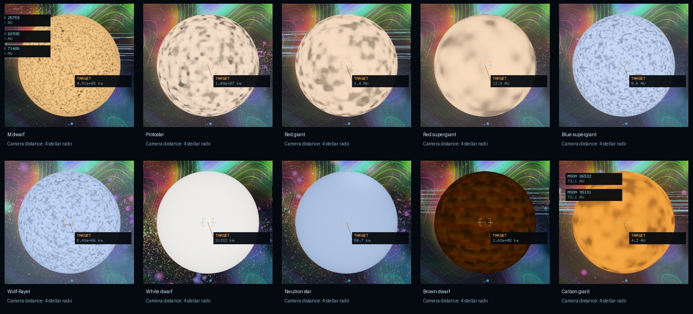

# Stellar diversity — Infinite 0.36

Infinite adds **192 persistent stellar destinations per galaxy**, separate from the established catalogue. New objects appear in galaxy geometry, celestial contacts and the normal approach system. **Shift+N** cycles stellar destinations in the current galaxy; **J** uses the existing navigation drive. Plain **N** continues to toggle long-range cruise.

## Research translated into generation

[NASA’s spectral-class overview](https://science.nasa.gov/exoplanets/stars/) orders main-sequence stars O, B, A, F, G, K and M by temperature. The new population separates spectral class from evolutionary family. Main-sequence mass, radius and luminosity use bounded piecewise scaling relations; temperature follows `L/Lsun = (R/Rsun)^2 (T/5772 K)^4`. Massive-star luminosity is bounded by an electron-scattering Eddington envelope; radius is reconciled with the retained temperature. Rotation periods keep equatorial speeds below centrifugal breakup, so expanded giants rotate slowly. Stars with shorter lifetimes cannot survive in an old population. The lifetime proxy is `10 M^-2.5 + 0.003` Gyr; it is a procedural approximation rather than a stellar-structure calculation.

[NASA’s stellar-family reference](https://science.nasa.gov/universe/stars/types/) motivates separate extended giants, cooling compact remnants and substellar objects. Giants retain a progenitor mass and a post-main-sequence age. White dwarfs use a bounded [Kalirai initial–final mass relation](https://arxiv.org/abs/0706.3894), a Nauenberg-style cold-degenerate radius relation and an age-dependent cooling temperature. Neutron stars occupy a separate 11–13.5 km radius branch with 1.2–2 solar masses; their radii are never enlarged to match an ordinary star.

| Family | Generation and presentation |
| --- | --- |
| [O–M main sequence](stellar-diversity-0.36/star-0.png) | Surviving hydrogen-burning population; hot blue-white through cool orange-red; fine convection and mass-dependent spots |
| [Protostar](stellar-diversity-0.36/star-1.png) | Young, inflated, cool, mottled surface; confined to star-forming galaxies; no mature planetary catalogue |
| [Red giant](stellar-diversity-0.36/star-2.png) | Expanded envelope, lower temperature and broad convection; conservative surviving-planet inner boundary |
| [Red supergiant](stellar-diversity-0.36/star-3.png) | 350–950 solar radii, large convection structures and enhanced wind |
| [Blue supergiant](stellar-diversity-0.36/star-4.png) | Hot, luminous, extended photosphere and stronger wind |
| [Wolf–Rayet](stellar-diversity-0.36/star-5.png) | Hot, stripped massive-star branch, reduced current mass and strong optical wind halo |
| [White dwarf](stellar-diversity-0.36/star-6.png) | Earth-scale remnant, progenitor mass loss, cooling age and clean photosphere; conservative surviving outer planets |
| [Neutron star](stellar-diversity-0.36/star-7.png) | Physical compact radius, cooling and stored spin; stable magnetic-cap treatment; no generic mature planets |
| [Brown dwarf](stellar-diversity-0.36/star-8.png) | Substellar mass, age-dependent cooling, near-Jovian radius and L/T/Y temperature labels; dim banded/mottled atmosphere |
| [Carbon giant](stellar-diversity-0.36/star-9.png) | Cool late giant, mass loss, coarse convection and warm atmospheric colour bias |

[ESO’s resolved giant-star observations](https://www.eso.org/public/unitedkingdom/news/eso1741/) motivate much larger convection structures on giants than on main-sequence stars. [NASA/ESA’s Wolf–Rayet reference](https://science.nasa.gov/missions/hubble/hubble-view-wolf-rayet-stars-intense-and-short-lived/) motivates a distinct hot, strong-wind branch. [Carbon-star evolution research](https://doi.org/10.1051/0004-6361/202039613) motivates a separate cool late-giant channel; this version does not simulate carbon dredge-up or a physical dust shell.

[NASA’s SPHEREx brown-dwarf observations](https://www.nasa.gov/missions/spherex/nasas-spherex-telescope-sees-menagerie-of-brown-dwarfs/) support cooling objects with varied cloudy atmospheres. Brown dwarfs do not undergo sustained hydrogen burning. Their L/T/Y labels use approximate temperature boundaries, not synthetic spectra. The cockpit uses enhanced exposure so the coolest objects remain visible; their displayed colour is not a prediction of naked-eye visibility.

Young massive stars and protostars occupy the existing young arm distribution in gas-rich galaxies. Old, gas-poor galaxies replace these birth channels with remnants and constrain surviving main-sequence masses. Spatial position, age, metallicity-dependent inherited chemistry, physical stellar properties and galaxy particles all refer to the same addressed object.

The additive catalogue deliberately stratifies rare classes to make them discoverable. It does not reproduce measured occurrence rates. Black holes, supernova events, accretion discs, stellar hydrodynamics and real-time stellar evolution are outside this change. Existing binary companions retain their previous implementation. Neutron-star spin does not produce a flashing light or a new hazard mechanic.

## Preservation and planetary inheritance

The local checkpoint is `checkpoint/infinite-0.35-before-stellar-diversity`, at `1b8004b`. The baseline executable and all 32 baseline core checks were preserved before editing. A new **2,258-record frozen snapshot** records existing stars, planets, moons and representative galaxy/planet geometry across three universe seeds.

Existing seeds, addresses, positions, masses, orbits and generation recipes remain unchanged. A separate System-ID namespace (`1 << 62`) supplies the additions. Existing galaxy particles retain their order; new stellar particles follow the established stars and gas. Historical galaxy-geometry checks exclude exactly these additional emitters and compare all original geometry. Old system and planetary fingerprints remain exact.

New planetary systems inherit the actual host mass for Keplerian orbits and luminosity for irradiation. Expanded giant envelopes around brown dwarfs scale their mass budget with host mass. New condensed planets receive physical mass descriptors, and temperatures respect the cosmic background floor. Evolved hosts enforce a conservative photospheric/survivor inner boundary; white-dwarf descendants retain a depleted volatile reservoir. Protostars, very young main-sequence stars, massive short-lived phases and neutron stars do not receive the generic mature planetary catalogue. These are conservative population rules, not a dynamical survival simulation.

The original coordinate hierarchy, terrain/geology, cities, weather, navigation, ship handling and atomic refinement remain available. New mature systems refine through the same planet-to-lattice generators.

## Rendering boundary

`StellarEvolution` owns immutable physical descriptors. `Presentation` and `StellarOptics` expose read-only type parameters, radiance, angular radius and stellar-local orientation. The Hyperion layer consumes these through its existing photosphere, corona, bloom and compositing passes. No new render target, texture, runtime dependency or generation thread is introduced.

Convection and bands use stellar-local normals and derivative-filtered noise. Physical rotation changes material coordinates; fast neutron-star spin is retained as metadata without flashing the image. The analytic stellar disc fills unresolved/precision gaps and avoids adding a second photosphere over a resolved mesh. A narrowly scoped culling exception permits a new compact stellar mesh to remain visible when its enclosing system exceeds the ordinary cell-size guard. It retains the original mesh scale and physical radius. Original, Hyperion and Hybrid modes share geometry and camera position.

## Validation and measured cost

All **73 checks passed** in the complete regression run: 34 core checks and 39 native graphics/image checks, run in serial GPU batches to limit temporary capture storage. The complete galaxy-to-atomic-lattice round trip, planet stability, weather, cities, landing, ship handling/roll, UI bounds, shadows and three-mode checks pass. After the final giant-rotation bound, all 34 core checks and both stellar-gallery checks pass again. The final snapshot writer also passes a write/check round trip and all three frozen-catalogue checks. [Combined results](stellar-diversity-0.36/release-tests.log), [final core checks](stellar-diversity-0.36/final-core-tests.log), [final stellar checks](stellar-diversity-0.36/final-stellar-tests.log), [extra preservation checks](stellar-diversity-0.36/snapshot-tool-tests.log).

The new process test passes **57,099 assertions** across 2,304 added objects. It checks every stellar family and all OBAFGKM/LTY labels, parent ages, evolutionary survival, luminosity/radius/temperature consistency, massive-star luminosity limits, remnant sizes/cooling, planetary inheritance and budgets, atomic refinement, addressed galaxy LOD emitters, parallel replay and destination selection without moving the ship. [Counts and results](stellar-diversity-0.36/stellar-core.log), [preservation hashes](stellar-diversity-0.36/preservation.json).

The **28-scene native gallery** uses actual generated addresses. It verifies mesh/descriptor identity and physical camera position across modes, including close views of white dwarfs and neutron stars. Rebased compact-star photospheres differ by approximately **0.016/255 RMS** in the checked region. Disabling analytic stellar optics changes a resolved supergiant by only **1.516/255 RMS**, confirming that the renderer avoids adding a second photosphere. [Native proof](stellar-diversity-0.36/native.log), [pixel measurements](stellar-diversity-0.36/comparison.json).

Each view is four stellar radii from its host. Their similar apparent sizes do **not** imply equal physical sizes: the neutron-star fixture has a radius of about 12.7 km, while the red-supergiant fixture spans hundreds of millions of kilometres. All three compiled shader backends—Metal, SPIR-V and GLSL—have verified manifests; native rendering was tested on Metal.

The existing 0.35 executable and 0.36 executable also complete the same 12 m flight loop at 1440 × 900 and visual time 12. [Original scene before](stellar-diversity-0.36/before-orbit-hyperion.png), [after](stellar-diversity-0.36/after-orbit-hyperion.png). Full-loop peak RSS is 160.11 MiB before and 144.50 MiB after. One long native piloting run exceeded the previous 100-second validation deadline after reaching atomic scale; the harness now allows a longer bounded run, with the same assertions. [Flight-loop timings](stellar-diversity-0.36/performance.json).

For a longer steady sample, six additional native runs alternate the versions in B,A,A,B,B,A order from reset copies of one orbital save. Each runs 300 frames with fixed visual time, a verified 1280 × 720 backbuffer and traffic disabled only in that benchmark save. Frames 121–280 supply 160 measured frames per run. The table uses the median of three run medians per version. [All runs, hashes and method](stellar-diversity-0.36/orbit-performance.json).

| Steady orbital measurement | 0.35 | 0.36 |
| --- | ---: | ---: |
| Median frame interval | 19.70 ms | 19.76 ms |
| CPU frame statistic | 7.75 ms | 7.96 ms |
| Render submission | 10.16 ms | 11.17 ms |
| Effect target storage | 15,356,160 B | 15,356,160 B |
| Material texture storage | 1,660,244 B | 1,660,244 B |
| Weather GPU fields | 87,384 B | 87,384 B |
| CPU region cache | 7,309,048 B | 7,072,008 B |

These are measurements on a shared Apple M1 desktop, not isolated GPU timings. The scene, viewport and starting save are controlled; external host load is not. The new types reuse existing material textures and effect targets. Generation continues through the existing asynchronous, cancellable and bounded region cache.

The signed **0.36.0 / build 36** app verifies successfully, with all 28 code/data sections matching the built executable. [Package verification](stellar-diversity-0.36/package.json).

The app resumed the saved flight successfully: a 12 m ship, 17 primaries and 58 moons, with the existing flight-restored status and Hyperion mode visible in the cockpit.
