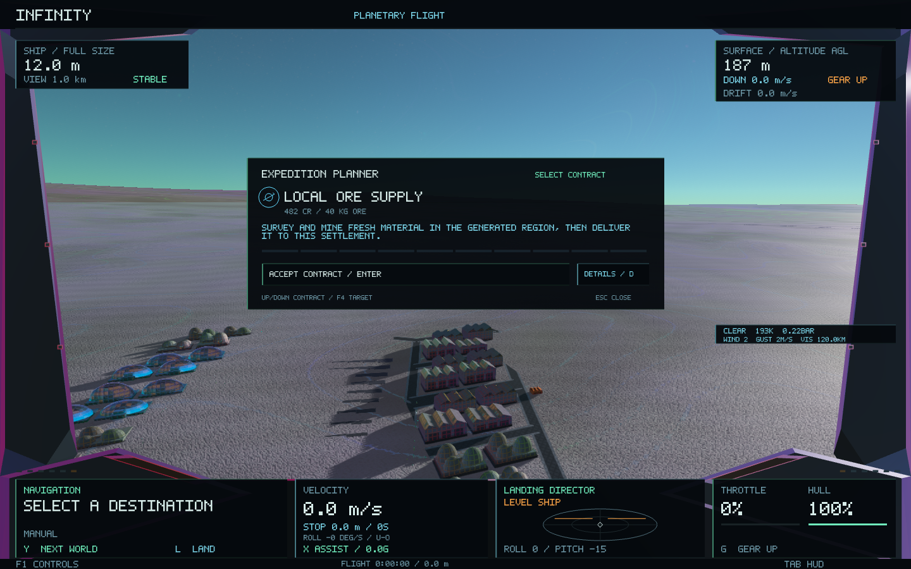
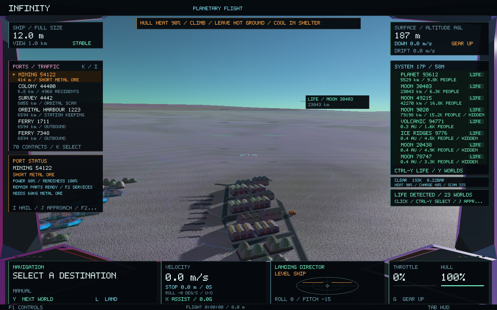

# Environmental hazards and local supply expeditions

Surface conditions now affect the player ship as well as landing advice. The
same generated terrain, climate, weather and economic ledger drive the effects.
Planet and settlement identities, geometry, seeds and layouts are unchanged.

## Exposure

* Hot ground gradually raises hull heat. Heat above 80% damages the hull;
  cooling continues after leaving the hot region. Heat warnings begin at 25%.
* Thunderstorms build electrical charge. A warning precedes a bounded discharge,
  hull damage and a cockpit jolt. Leaving the storm dissipates charge.
* Dust reduces survey progress and cutter efficiency. Severe electrical weather
  holds exposed surveys and the surface cutter. The completed excavation remains
  available for sheltered geological inspection and cutting.
* Shrinking accelerates exposure and retains the existing size-dependent damage
  multiplier. There is an initial escape window even for a tiny ship. Slow close
  assays in a sheltered cavern remain possible; its existing icefall hazard still
  applies.

The weather strip shows heat, charge and scan signal while any needs attention.
The existing collision-aware warning system gives actions without adding a new
permanent HUD panel. **L** checks landing conditions; **Shift-L** accepts the
environmental risk and does not disable exposure damage. **Enter** lifts off.

Docked ships and excavated interiors stop taking new outdoor exposure. Loads
cool or discharge naturally rather than resetting on a mode change. Physical
altitude controls exposure; render magnification does not. The ship save reader
accepts versions 1–8; version 8 preserves exposure alongside guided warp and
debris landing state. Legacy formats are retained for ships without exposure.

## Work driven by the local ledger

Each nearby settlement can show up to six rover duties drawn from actual freight
loading/inbound records, supplied production recipes or a damaged plant's
available maintenance kit. Idle sites do not invent cargo jobs. Production duties
also require demand for their output and, for extraction, remaining reserves.
Their IDs derive from existing freight/site/street identities.

The vehicles follow retained terrain-sampled road strips near their depots. They
represent local handling work; stock transfer, freight travel and production stay
in the existing economic simulation. Vehicles do not independently create or
consume goods. Outdoor work freezes during severe weather or heat. Separate
bounded clocks allow freight handling to continue while a recipe awaits input,
and hold machinery at its existing phase until production resumes.

These are shared instanced meshes under the existing 6,000-instance scene cap.
The clock cache remains bounded to 128 settlements. No per-vehicle physics,
additional terrain or synchronous world generation was added to rendering.

## Completing a local supply expedition

1. Open **F3**, or **F2 → Survey**, in an inhabited system. A settlement can offer
   **LOCAL SUPPLY** when a demanded recipe lacks a locally obtainable raw input.
   The request names its actual material, mass and funded reward. These offers
   take priority in the planner when no other job is selected or accepted.
2. Accept the offer. The issuer reserves payment. Prepare a probe launcher,
   ammunition, a separate mining head, operators and enough cargo space.
3. Use the planner's **F4** route to the procedurally selected resource region.
   Check the local forecast and choose gentle exposed ground. A region is a
   prospecting area, not an invented discovered deposit.
4. **Ctrl-P** launches the drill; **Alt-P** opens its camera. Enter the completed
   excavation, select the requested material and hold **F12** for an overview.
5. Shrink below 12 mm, stop near the face and hold **F12** for a fresh close assay.
   **Ctrl-F12** marks it. Return to the clear chamber and **Shift-Z** restores size.
6. At full size, hold **Ctrl-Space** with a clear cutter line until the requested
   mass is aboard. The excavation shares the existing finite surface reserve.
7. Exit, follow **F4** back to the issuer, land or dock, then deliver through the
   planner. It transfers the cargo into the settlement's real stock and pays once.
   **F2 → Outcomes** observes subsequent production.

Old cargo or a discovery alone cannot satisfy the job: the accepted mission must
have fresh extraction in its generated region, a fresh close assay and a marked
matching material. Other jobs' reserved freight is unavailable for handover.
The planner displays the actual mass instead of the ordinary 10 kg assay sample.
The exploration save format adds version 9 while retaining versions 1–8.

A delivery can restore the missing input; weather, power, health, warehouse
capacity or another missing ingredient can still prevent work. The debrief and
outcome observer report that rather than promising an automatic restart.

## Validation

The surface mission regression runs real drill, scan, mark, extraction and delivery
commands on a generated planet and settlement, with a controlled economic shortage.
It checks finite material and money accounting, real refinery output, duplicate
claim rejection, historical-extraction rejection, save/load, rover work and weather
holds, and retained planet/city fingerprints. Exposure tests check warning time,
size vulnerability, cooling, discharge, timestep stability and malformed saves.
Native rendering checks and final test results are recorded with the implementation.

Results:

* [All 77 headless tests passed](surface-expeditions/headless-77.log).
* [All 71 non-desert headless tests passed again](surface-expeditions/final-checks-71.log)
  after the final cooling/discharge and scan-hold wording changes.
* [Native Metal planner regression](surface-expeditions/native-planner.log): 18
  layouts, real assay delivery, no text overlaps and unchanged ship/world state.
* [Native Metal supply/HUD check](surface-expeditions/native-surface-mission.log):
  the same terrain digest, `5149391451716758143`, across the planner and flight
  captures. These use a generated settlement with a controlled shortage and
  controlled exposure readouts; the cold landscape is not a natural heat event.

