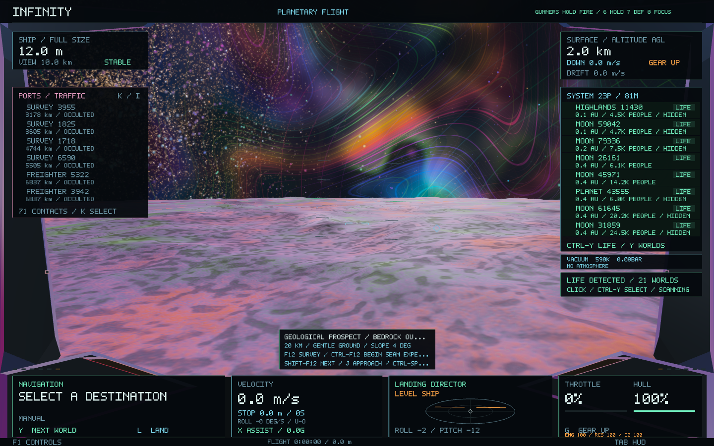
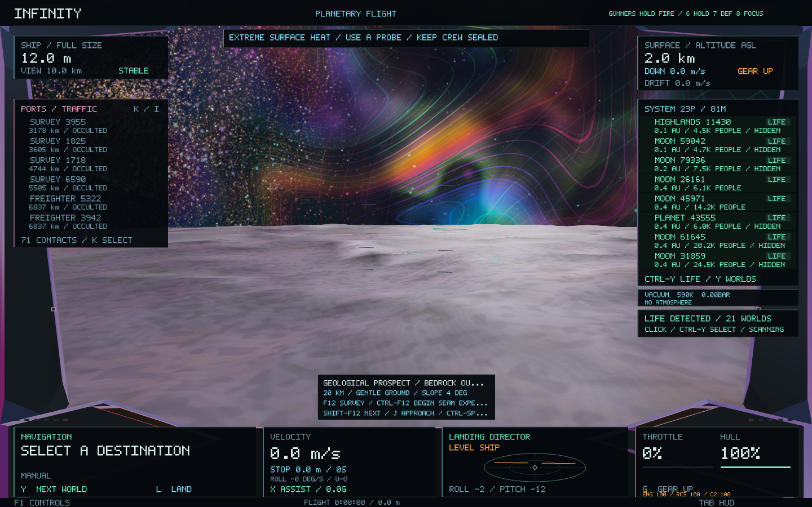
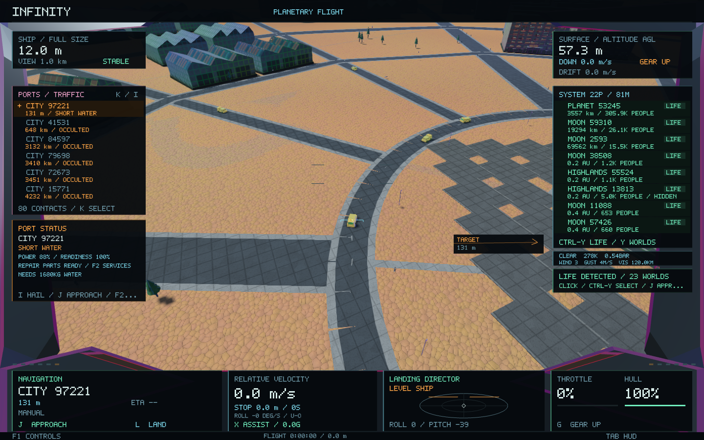

# Terrain materials, working settlements and surface hazards

The terrain height field, tessellation, normals, planet addresses, geological histories, mining deposits and city layouts retain their existing generation recipes. This change adds read-only material and activity descriptions above those systems.

## Terrain presentation

`TerrainMaterial` derives exposed bedrock, sediment, frozen coating, roughness and metallic response from the planet's inherited mineral, composition, climate and weathering. Slopes expose rock; gentler ground retains sediment. Bedding uses the actual authored elevation and inherited material spacing, with derivative filtering when bands become smaller than a pixel. Regional colour modulation is deliberately quieter than the old dense multicoloured field. Hyperion's spectral mineral seams, lighting, wet coatings and glacial response remain part of the material.

The renderer supplies four additional vectors per material. It reuses the existing periodic noise, triplanar close-material texture and mip chain, floating-origin material frames, terrain meshes and single sun-shadow target. It creates no additional terrain or water geometry and no new material textures. Metal, SPIR-V and GLSL shaders are rebuilt from the pinned bgfx compiler; native image checks use Metal.

## Working settlements

Cargo rovers follow the existing terrain-sampled streets. Cranes and pump equipment belong to retained industrial and utility buildings. Roof equipment stays within the buildings' existing conservative collision bounds. The equipment uses four shared mesh families with three levels of detail, hardware instancing, frustum and pixel-size culling, and the existing 6,000-instance budget. Each sampled settlement adds at most 28 work actors.

The live economy snapshot controls power, readiness, outages, production bottlenecks, loading and incoming deliveries. Missing or catching-up snapshots do not invent active production. Weather closes outside work and residents shelter. Equipment stops during outages, input shortages or unsafe weather and resumes from its held animation phase. A bounded presentation-clock cache keeps stops from teleporting vehicles. These visual actors do not create goods, spend money, accept contracts or replace the canonical freight ships.

The selected settlement's hail includes its actual work status. Existing trade and maintenance systems provide the ways to supply or repair a struggling port. Nearby equipment shares the existing sun-shadow map with bounded four-Hz caster updates.

## Surface hazards and player choice

The existing weather and geology supply crosswinds, poor visibility, electrical storms, steep loose ground, fractured ice and extreme heat. Warnings include an action such as waiting, finding gentler ground or using a probe. They use the existing collision-aware cockpit popup allocator, with priority for immediate terrain danger.

L requests assisted landing with an environmental check. An approach encountering a newly unsafe final descent holds and brakes rather than continuing automatically. Shift-L accepts environmental risk explicitly. This override does not bypass solid-surface, geographic reachability or the original geometric slope limits. Enter still launches from a landed ship.

Wind and collision consequences use the existing flight physics. Heat is an exposure warning and landing-assistance check; this update does not introduce a ship thermal-damage simulation. Enclosed caverns retain their own hazards, and microscopic flight does not receive unrelated outdoor warnings.

## Validation

Tests cover mineral and ice response, deterministic equipment identities and motion, street following, stopped and resumed animation, roof bounds, missing/stale economy data, outages, weather holds, gas-world exclusion, geometry/city fingerprints, explicit landing-risk acceptance and cockpit overlap at five aspect ratios. Matched native captures compare the same generated worlds and cameras before and after the material change.

All 76 headless tests passed. Native Metal checks passed seven settlement/weather views, six matched terrain views and fifteen real-weather visibility views. The separate work check showed moving rovers and machinery, then a stopped site under an outage, with the same terrain digest throughout. Its outage is a controlled copy of a real initial economy snapshot; it is never saved back to the game. That city remained naturally dry, so weather holds are covered by the deterministic tests and weather rendering is checked on the other naturally generated worlds.

Representative 1440×900 capture sweeps measured the following. These are individual native runs, subject to background load, rather than a controlled benchmark. The existing cache and material-texture budgets are retained.

| Sweep | Before median / p95 | After median / p95 | Before / after peak RSS |
| --- | --- | --- | --- |
| Settlements and weather | 25.74 / 41.49 ms | 25.62 / 41.15 ms | 148.1 / 150.6 MiB |
| Plains and highlands | 23.86 / 36.54 ms | 20.53 / 30.79 ms | 147.7 / 148.3 MiB |

The matched highland scene retained terrain digest `8423431922347431947` and geometry fingerprint `13581507250006745020`. Raw validation summaries are in [surface-operations](surface-operations/).

Before:

After, with a real surface-heat warning:

Existing streets carrying local work traffic:

Naturally generated dust reducing visibility:

