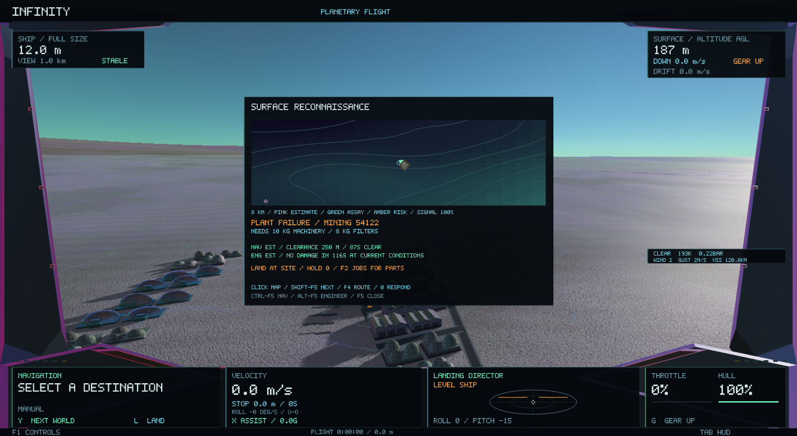
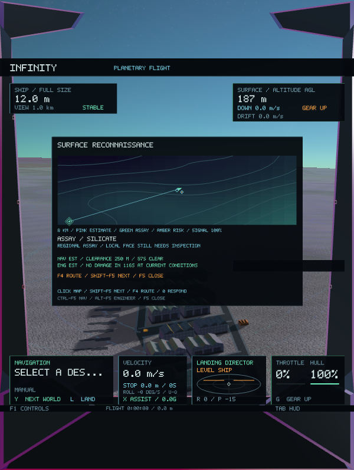
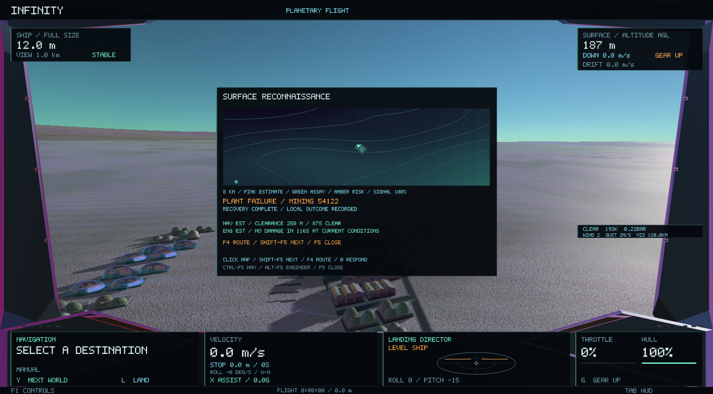

# Surface reconnaissance, crew assistance and field incidents

**F5** opens a compact scanner over the current first-person cockpit. The map
shows an 8 km area of the real nearby terrain, weather hazards, broad resource
returns, recorded assays, completed cavern entrances and generated settlements.
The ship marker, picking, approach waypoints, crew assessments and incident
service points all use the same planet-space coordinates.

## Controls

| Control | Action |
| --- | --- |
| F5 | Open or close the scanner |
| Click a map marker / Shift-F5 | Select a return / select the next return |
| F4 | Close the scanner and approach the selected point |
| Ctrl-F5 | Ask the navigator to assess the selected route; toggle the order off |
| Alt-F5 | Ask the engineer to watch exposure; toggle the order off |
| Hold 0 at an incident | Accept the funded recovery job or transfer its required parts |
| B | Brake, including while the scanner is open |
| F9 | Assign ready crew to navigation and engineering |
| F2 → Jobs / Outcomes | Review requirements and the actual result of recovery work |

The console pauses manual helm input while open. The universe and ship continue
moving; the existing velocity and landing instruments remain visible. Close it to
resume normal helm input. Opening another console closes this map. Its crew watch
orders can continue with the map closed. In a crew-controlled weapon station,
Ctrl-F5 retains its existing helm-order meaning unless the scanner is open.

## Information that improves with observation

Resource estimates are broad returns sampled from the existing geological
exposure field. They are not guaranteed individual deposits and do not create
journal entries or cargo. A grade-two-or-better recorded regional assay refines
the existing return to an assayed marker with the same identity. Saved entrances
use the actual bore entry and only appear after the excavation has opened.

Map relief samples the same terrain height function used by the existing world.
Possible landing areas are advisory samples of gentle exposed terrain, checked
against live weather and known building bounds; the pilot still needs visual clearance and the normal
landing checks. Amber map patches indicate sampled hazards.

## Crew assistance

The navigator takes time to assess the selected route. Ready crew, station
condition, fatigue and experience feed the existing station-efficiency model.
An assessment reports estimated terrain clearance and a weather forecast, with
a shorter forecast and a more conservative clearance for less capable crew.
Completing the initial assessment produces a cockpit callout. F4 uses the assessed
clearance for the approach waypoint; the existing flight controller remains in
charge of movement and collision.

The engineer projects the ship's existing heat and charge state at current local
conditions, without changing the state. Skill controls the warning horizon. The
watch can call out impending damage and live cavern ice strain. Removing or
resting the assigned crew member removes that station's assessment capability.
These are estimates, not guarantees about unsampled terrain or changing weather.

## Incidents and recovery

Field markers come from the current system's saved recovery jobs and actual
freight weather holds:

* Plant failures link to funded maintenance jobs at the existing settlement.
* Production stops and urgent supplies link to existing restart and relief jobs.
* Freight weather holds identify real delayed deliveries at their destination.
  A weather delay by itself does not invent a paid repair contract.

Land at the marked site at full size with the drive off. Hold **0** to accept the
job, bring its listed supplies, then hold **0** to transfer them. An engineer
improves the response rate. Field work pauses during hazardous outdoor weather.
The authoritative command checks the job, observation time, position, physical
surface contact, speed, ship state and completed work before using the existing
recovery ledger.

Cargo, payment, escrow and local repair work remain in that ledger. Partial
deliveries remain possible. A repair can continue after the player leaves, and
the same marker shows work in progress and completion. The existing settlement
machinery and lighting reflect the resulting site state. Other shortages or bad
weather can still hold operations.

No new settlements, wrecks, supplies or casualties are spawned just to populate
the display. No universe identities, seeds, generation rules or existing save
formats were changed.

## Runtime boundary and validation

The scanner keeps at most four immutable maps, each containing a 21×21 terrain
grid. Terrain sampling runs on a cancellable worker; an available nearby map can
remain visible while a replacement loads. The main thread composes bounded
weather and marker overlays at four updates per second. The HUD uses the existing
vector renderer and adds no textures or render targets.

The regression covers exact terrain positions, coordinate-reference changes,
estimated-to-assayed identity, saved bore entrances, cache cancellation and
eviction, staffed and unstaffed crew orders, field access checks, a real repair
through completion, accounting and save/load. HUD checks cover six aspect ratios,
including a critical weather alert above the map.

Results:

* [All 78 headless tests passed](surface-reconnaissance/headless-78.log).
* [All 72 non-desert tests passed again](surface-reconnaissance/final-checks-72.log)
  after the contour, HUD layering and exposure-sampling refinements.
* [Final focused checks passed](surface-reconnaissance/release-checks.log),
  including selection continuity while a replacement map is loading.
* [Native Metal checks passed](surface-reconnaissance/native-reconnaissance.log):
  scanner, staffed assessments, recorded assay, portrait layout and a completed
  repair at a generated settlement. These use an isolated, controlled economic
  outage, not the player's save. The terrain geometry digest stayed
  `5149391451716758143` across all three captures; planet and settlement identity
  checks also passed.

