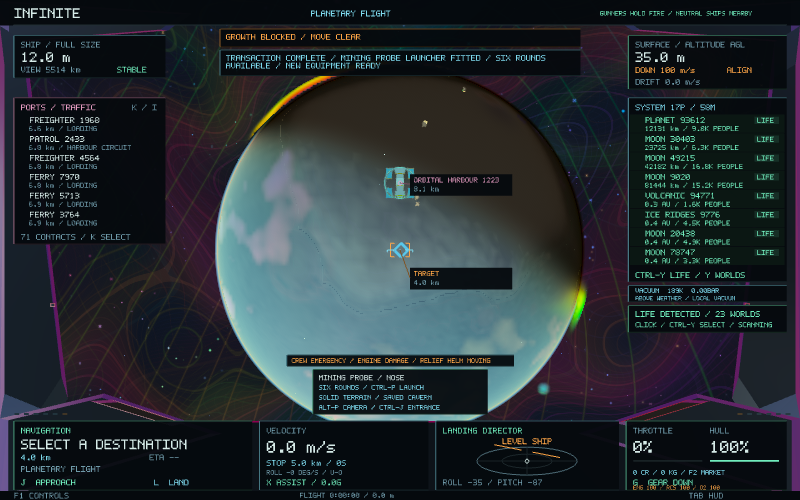
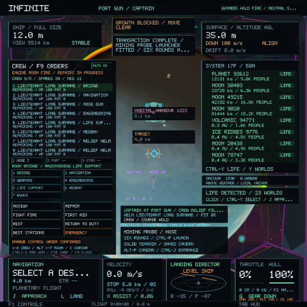
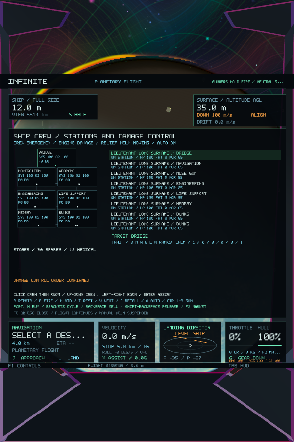
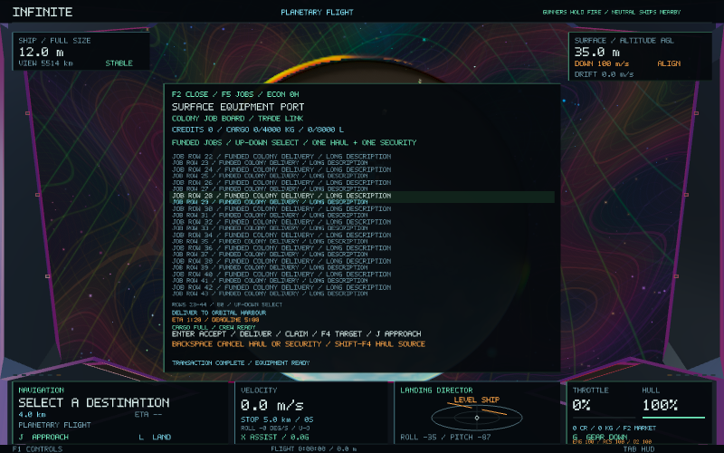
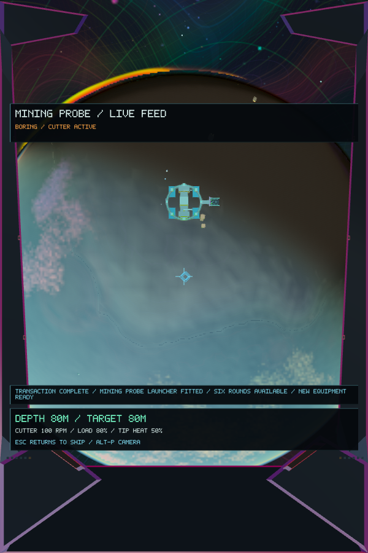

# UI layout and popup fixes — 0.58.4

Warnings and status notifications previously shared space with the weapon and exploration readout. Modal panel backgrounds were submitted before the entire text batch, allowing underlying HUD text to remain visible. Screen-space prospect markers were also submitted after the UI and could cross market and crew text.

Notifications now wrap into bounded cards and search for clear space, with terrain/growth warnings placed first. Every active instrument, existing text run and popup reserves its area. World labels use the same occupied areas. The probe feed has a separate notification strip above its telemetry card, and the header reserves separate space for flight phase and crew fire status.

Opening the crew deck, market, controls guide or in-flight crew console removes covered underlay lettering and strokes before adding panel content. Prospect and excavation markers are masked against UI areas and drawn below the HUD. Open modal screens block underlying world/contact selection; the in-flight crew console blocks the hidden traffic rows while keeping visible celestial rows selectable.

Long job, route and equipment lists display complete groups around the selected offer. Rows stay above the plan and action footer, with a visible row-range indicator when the list spans multiple pages. Selection and transaction rules remain unchanged.

## Verification

- `infinity_popup_tests`: **21,747 checks** across **105 layouts** at five canvas aspect ratios. Cases include simultaneous warnings/long notifications, staffed gun stations, eight-person crew screens, weather, crowded life/traffic contacts, docking, combat, shrinking, the probe feed and every market page. An 80-line job/equipment fixture verifies that the selected offer stays visible. Checks cover text collisions, canvas bounds, compacted glyph indices and world-marker masking.
- **18 regression tests passed**, covering cockpit layout/motion, docking, ship handling, weapons, crew, station swapping, exploration and economic systems. The six affected cockpit/crew tests passed again after the final marker-layer fix.
- **12 native Metal layouts passed** on the final executable: 800×500, 600×600, 600×900 portrait, 1920×1200, 1440×900, the controls guide, crowded notifications, staffed station/F9, crew deck, long job board and two probe-feed layouts. Runtime checks found **zero text overlaps** and verified real contact selection, blocked panel clicks and unchanged navigation through every resize.
- The packaged **0.58.4 / build 70** app passed signature verification and a separate **120-frame normal startup** using isolated temporary save data.
- `git diff --check` passed. No universe generation, seeds, geometry, saved identities or flight controls changed in this update.

The collision scan runs only in the native UI test. Normal play retains lightweight text bounds for layout and modal masking; it does not run the pairwise diagnostic scan.

Evidence: [native run](ui-popups-0.58.4/native.log), [capture checks](ui-popups-0.58.4/image-checks.txt), [regressions](ui-popups-0.58.4/regressions.log), [final UI regressions](ui-popups-0.58.4/ui-regressions-final.log), [popup checks](ui-popups-0.58.4/popup-checks.txt), [signed startup](ui-popups-0.58.4/startup.log).

## Native captures

These use read-only presentation stress data over a real generated scene. The planet camera stays fixed; displayed warning altitude, equipment and job text are test fixtures.

