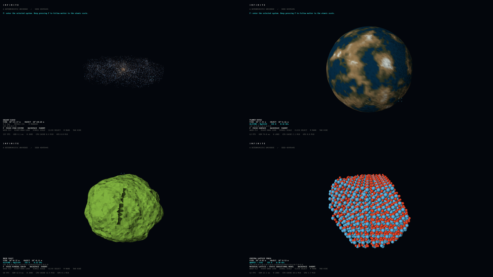

# Validation — foundation and first vertical slice

Date: 27 October 2026. Native macOS arm64 Release build, Apple Clang 21, CMake 4.3.1, SDL 3.2.8 and the pinned bgfx Metal backend. Other platforms have not been executed.

Core: **250 checks pass**. CTest: **3/3 tests pass**, including SQLite writer/reader processes. Tests cover address/seed identity, generation order, threading, scalar terrain boundaries, extreme local coordinates, material inheritance, all four lattice motifs, valid finite mesh buffers, LOD invariance, cancellation, cache regeneration and sparse persistence.

Native packaged app: **15 settled tour stops**, descending through eight scales and returning through the same addresses. **5,396 instanced atoms** in the default quartz specimen. Screenshot headers confirm a **1920 × 1080** backbuffer. The test uses a Retina window so the full target resolution fits this desktop.

Frame measurements include navigation, generation activity, uploads, selection overlay and periodic lossless screenshot capture. Ten startup frames are excluded below. CPU submission time is measured before bgfx frame/presentation waiting; GPU time comes from bgfx timestamp statistics and may refer to an earlier frame. All wall-frame outliers are retained.

| Scope | Samples | Median wall ms | P95 wall ms | Max wall ms | Median CPU submit ms | Median GPU ms |
|---|---:|---:|---:|---:|---:|---:|
| Whole tour | 1264 | 16.672 | 17.362 | 135.440 | 2.948 | 1.559 |
| GALAXY | 171 | 16.674 | 17.115 | 82.695 | 8.781 | 1.665 |
| STAR SYSTEM | 183 | 16.672 | 17.613 | 81.110 | 1.571 | 1.526 |
| PLANET | 166 | 16.699 | 17.189 | 90.284 | 3.181 | 1.537 |
| SURFACE | 147 | 16.664 | 17.446 | 106.943 | 2.928 | 1.531 |
| MOUNTAIN | 165 | 16.666 | 17.209 | 103.295 | 3.833 | 1.569 |
| ROCK | 166 | 16.665 | 17.064 | 102.224 | 5.489 | 1.906 |
| MINERAL GRAIN | 188 | 16.677 | 17.675 | 113.518 | 1.648 | 1.530 |
| CRYSTAL LATTICE | 78 | 16.664 | 18.867 | 135.440 | 1.357 | 4.892 |

Peak process resident memory: **144.6 MiB**. Maximum accounted CPU geometry cache: **19.1 MiB**. Maximum accounted GPU mesh buffers: **10.8 MiB**. Cache accounting excludes render targets, driver allocations and transient buffers; resident-memory measurement is separate.

The median wall time is approximately 60 FPS at 1080p on this Mac. This is one measured guided path, not a guarantee for every seed, view, GPU or future feature. See frame-profile.csv for individual frame measurements and native-tour.log for addresses and process results.

Generation timings are in benchmark.csv; benchmark-memory.txt records the core benchmark peak RSS. Each benchmark detail/sample is regenerated three times; the reported P95 is the slowest of those three, so this is an initial timing sample, not a robust latency distribution.

Actual native captures: [galaxy](captures/galaxy.png), [system](captures/system.png), [planet](captures/planet.png), [surface](captures/surface.png), [mountain](captures/mountain.png), [rock](captures/rock.png), [grain](captures/grain.png), [lattice](captures/lattice.png).

What remains: neighbour-balanced stitched terrain streaming, inter-cell spatial traversal, versioned edit replay, advanced formation/microstructure algorithms, stronger cross-platform reproducibility fixtures and Windows/Linux GPU CI. The next implementation task is the stitched streaming terrain quadtree.
