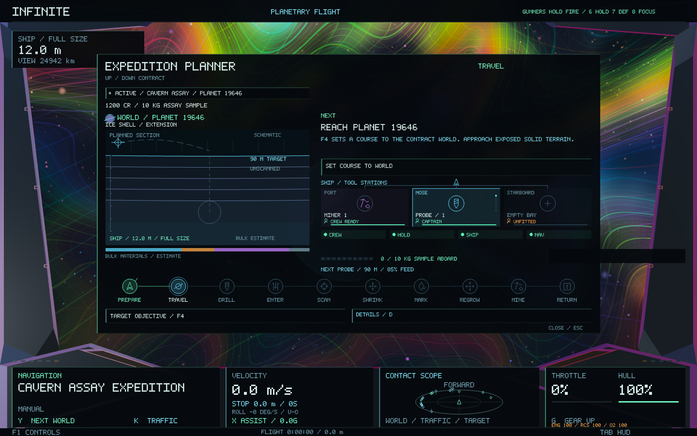
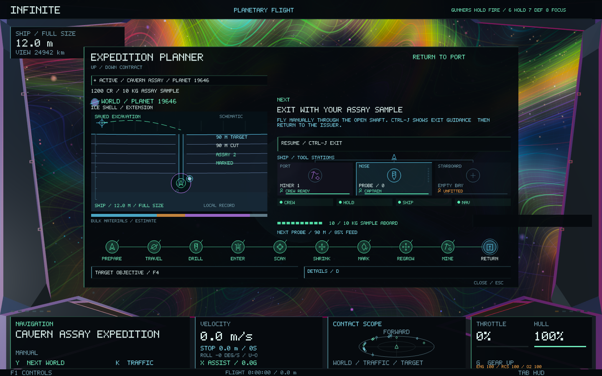
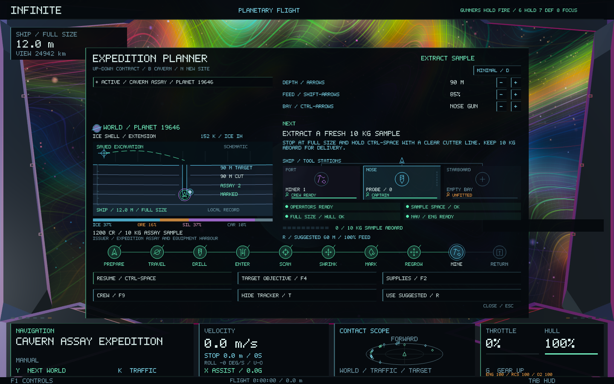

# Minimal visual planner — 0.60.1

**F3** opens a smaller planner with one selected contract, a visual expedition route and one primary next action. **D**, or the **Details** button, reveals the extra controls and readouts. The view preference persists across restarting; existing planner settings load into the minimal view.

The ten mission icons form a connected route. Completed steps turn green and the current step has a bright outline. The next objective and its action stay together above the ship stations.

The ship diagram places the nose bay between port and starboard. Each bay shows its actual fitted tool, ammunition and operator status. Compact crew, hold, ship and navigation indicators replace the long preparation checklist. The sample gauge follows cargo and the existing assay rules; selling the sample empties it.

The section shows planned depth before launch and the saved cutting progress afterward. After blasting, it shows the cavern and deposit positions in the bore's tangent section. Unscanned deposits stay unclassified; surveyed and marked deposits gain their corresponding colour and marker. Physical ship size drives the tiny-ship indicator and fragility label. The circular chamber outline and geological bands provide a schematic view; the existing world geometry and collision surfaces are unchanged.

The details view retains depth, feed and bay controls, suggested settings, composition percentages, issuing port, expanded readiness labels, supplies, crew and tracker actions. **Up / Down** or the mouse wheel selects another contract in either view. **Enter** follows the primary action; **F4** targets the objective; **Esc / F3** closes the planner. The existing drilling and expedition controls remain available.

All diagrams consume read-only world, crew, economy and expedition descriptions. Rendering uses bounded native vector meshes with no textures or new dependencies. Generation, identities, seeds, ship dynamics and navigation are preserved. A loaded assay cavern remains selected when requesting a new drilling site, keeping its manual-exit guidance available.

Validation covers both views at five aspect ratios, normal and probe-camera HUD layers, vector bounds and mesh budgets, equipment/crew state, real cutting depth, physical size, assay/mark/cargo changes and preference migration. The native fixture captures **18 views**, including both portrait layouts, actual sample handover and the compact flight tracker, and checks unchanged navigation and world identity. It stages real ledger commands against an isolated economy.

Evidence: [focused planner checks](visual-planner-0.60.1/focused-tests.log), [regressions](visual-planner-0.60.1/regressions.log), [native layouts](visual-planner-0.60.1/native.log), [image checks](visual-planner-0.60.1/image-checks.txt), [packaged startup](visual-planner-0.60.1/startup.log).
