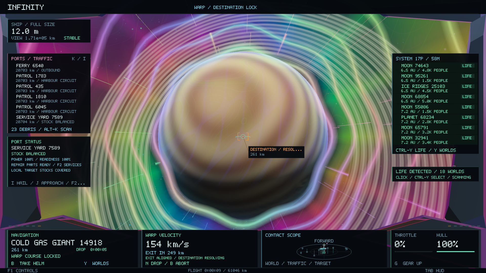
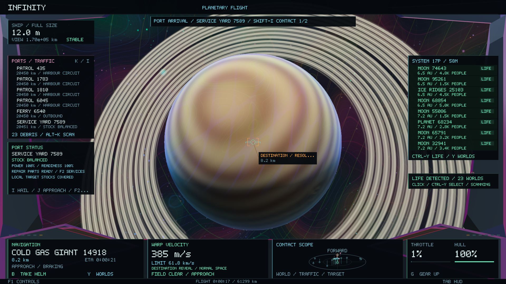

# Warp destination reveal and arrival radio

Guided warp presents the same addressed destination throughout travel, deceleration and normal approach. The renderer requests its existing geometry through the bounded asynchronous cache. The tunnel's vanishing point follows the real body's projected centre in the final approach and its opening grows with the body's angular radius. A guided exit releases the optical field over 2.8 seconds. Manual warp retains its shorter release. The camera, physical route and procedural objects are not replaced by a separate arrival scene.

Guided field response is bounded to 0.4 seconds. The previous 1.5-second response was underdamped with the route's proportional velocity controller and could overshoot a gas-giant stand-off. During handoff the field follows the normal approach velocity and releases after matching it, rather than releasing as soon as speed falls below the much larger local cruise ceiling. Manual flight dynamics and the route's physical destination remain independent of these optical effects.

The flight console reports remaining distance to the controller's existing drop boundary, estimated time until drop and alignment/clearance status. The estimate integrates the capped proportional braking leg and follows the measured fractional closing rate when clearance reduces the speed envelope. It is labelled approximate and withheld during initial acceleration, opening or substantial misalignment. A green exit status means the destination is aligned, engines are operational and the local solid surface is more than a kilometre away. It is not a guarantee against other ships or hazards.

Only an automatic guided drop increments the transient arrival event. Manual drops, braking, cancelled routes and save restoration do not fabricate arrivals. The arrival director waits for field clearance and the optical reveal, then reads the destination's live economy and canonical contacts. It waits briefly for the background economy and scene workers when necessary.

Calls can describe an actual surviving crew member aboard a disabled freighter, a real port shortage, a hostile within sensor range, a landable orbital fragment, an active survey ship, a patrol or inbound freight serving the destination. Weather-delayed freight reports its actual hold. There are no additional spawns, invented cargo, automatic contract acceptance or arrival rewards. Existing NPC combat, rescue, trading and mining systems handle the selected contact.

Shift-I selects the current contact, then cycles the bounded list on subsequent presses. Selection uses the normal traffic targeting action and cancels the current autopilot. J approaches; I hails the live contact. Arrival radio uses the existing collision-aware popup allocator and yields to active notifications and modal panels. Calls expire after one minute or when another warp starts, the ship shrinks or the ship lands.

Deterministic ordering uses a separate read-only arrival stream derived from destination seed and activity identity. Distress, hostile contacts and shortages take priority. No universe seed, generation recipe, coordinates or identities are written. At most eight calls are retained per arrival.

Validation covers countdown integration, reveal progression from planets to galaxy scale, angular aperture, deterministic ordering, contact deduplication, resolved rescues, stale economy snapshots, field/reveal gating, one-shot arrivals, expiry, selection and HUD collision checks across five aspect ratios. Operating-scale tests cover physical guided travel, save/resume, frame changes, automatic exit and abort behaviour.

All 75 headless tests passed after the final guided-braking change. The dedicated warp/arrival test contains 95 checks.

Native Metal checks rendered 2,281 frames at 1920×1080 across a solid-world approach and a ringed gas-giant approach. Both retained their original descriptor fingerprints and full hull health, cleared the drive field and received live economy calls. The gas-giant route dropped at 11.9 km from its existing stand-off and continued approaching it. At twelve seconds into that flight, the estimated drop time was 3.05 seconds; actual drop occurred at 15.07 seconds. A headless regression continues the gas-world handoff for another twenty seconds and rejects any flight past the approach point.

