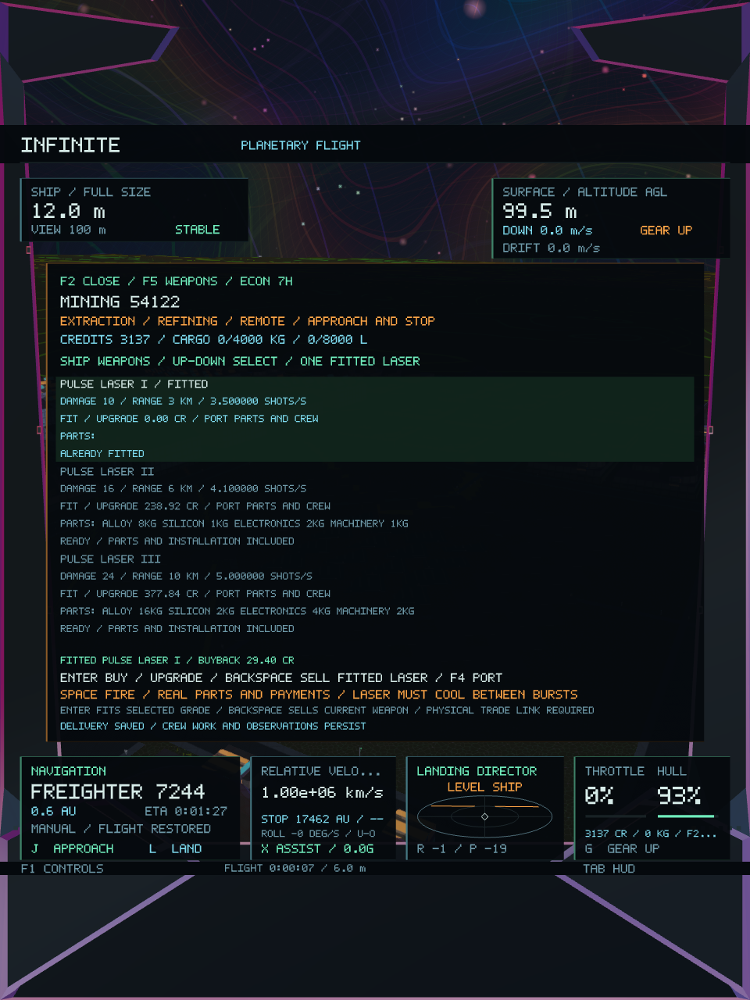
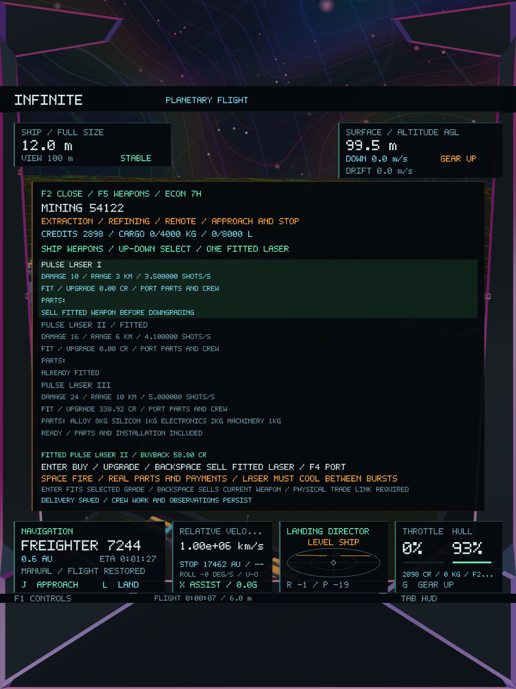
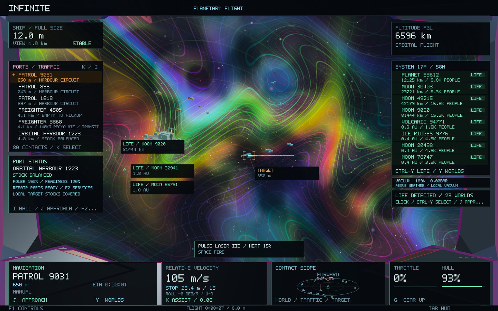
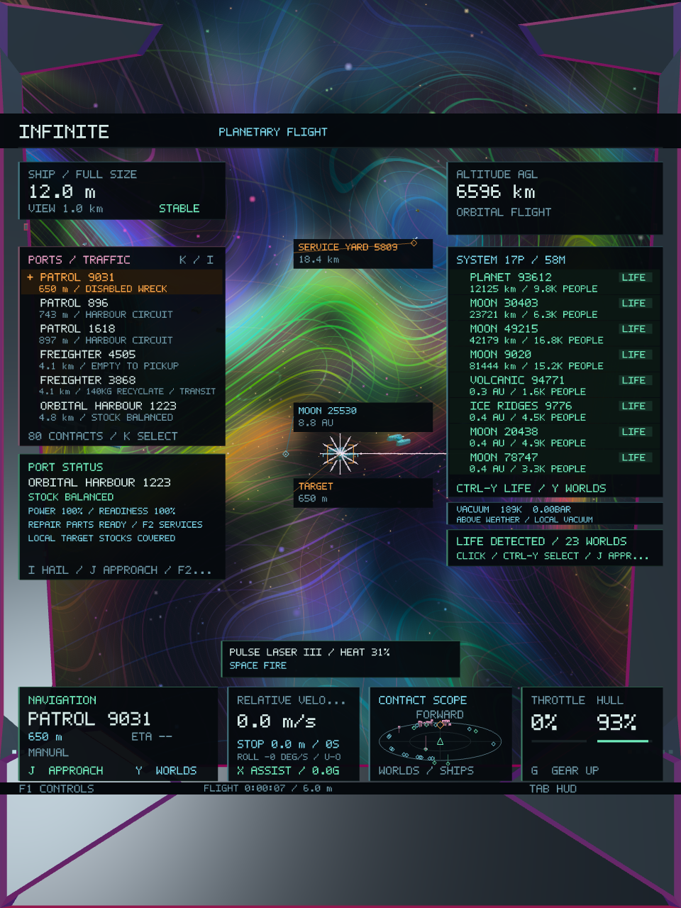

# Ship weapons and equipment trade — Infinite 0.44

The player starts with a **Pulse Laser I**. **Hold Space** to fire along the ship's forward axis. Shots have finite range, rate of fire and heat; sustained fire overheats the laser, which must cool before firing resumes. Firing uses the existing cockpit recoil hook and adds bounded beam/impact geometry to the existing colourful rendering pipeline. Steering, roll and thrust response are unchanged.

Firing is inhibited while landed, in a market, during an active cruise/braking field, during a hull-size transition or with a depleted player hull. A steady shrunken ship can fire: muzzle offset and range scale with the physical hull, independently of render magnification. The authoritative saved weapon mount must load before firing is enabled.

| Grade | Damage | Full-size range | Shot interval | Heat per shot | Cooling per second |
| --- | ---: | ---: | ---: | ---: | ---: |
| Pulse Laser I | 10 | 3 km | 0.28 s | 17 | 28 |
| Pulse Laser II | 16 | 6 km | 0.24 s | 16 | 32 |
| Pulse Laser III | 24 | 10 km | 0.20 s | 15 | 36 |

## Buying, selling and upgrading

**F2 → F5 → Weapons** opens the armourer at an existing port. **Up/Down** selects a grade. **Enter** buys or upgrades the mounted laser; **Backspace** sells the fitted weapon. **F4** targets the port and **J** uses the existing approach. Surface trade still requires landing and stopping; orbital trade uses the existing berth access rules.

Each grade represents installed alloy, silicon, electronics and machinery. An upgrade uses only the additional hardware required by the higher grade, plus an installation fee paid to existing crews. The port must have unreserved parts, an available crew and sufficient money for buybacks. Selling returns the installed hardware to port inventory at its quoted sell prices. The quoted spread and labour prevent a purchase/resale loop from minting credits. Weapons occupy a single fitted mount, while the cargo hold and sealed freight remain intact. There is no ammunition commodity or change to the existing goods/recipe indices.

The cockpit displays the fitted laser, heat and firing status. The shop lists performance, cost, required parts, availability and buyback value. Wallet version 4 reads versions 1–3 and grants their existing ships the same starter laser once; a sold mount remains empty after subsequent reloads.

## Hits and disabled craft

The nearest intersected actor receives damage; terrain, planet surfaces and retained solid geometry can absorb shots first. Large atomic meshes use compact instances for hit queries. Coordinate transforms are shared per actor home frame, and the renderer supplies only nearby candidate craft.

At zero hull, a craft becomes a disabled wreck with its identity, orientation and home-frame position retained. Presentation darkens the existing craft mesh and suppresses its engine motion. No universe generator, world geometry, seed or spatial address is rewritten.

The economic worker also records disabled freighters. Before pickup, it releases reserved goods and refunds remaining buyer escrow. Cargo already loaded remains aboard and counted in the ledger; it does not silently arrive at the destination or disappear. Disabled ships receive no new dispatches and do not count as expected inbound supply. Ledger version 6 reads versions 1–5. Combat damage, heat and cooldown have a separate validated, bounded save; the wallet remains authoritative for the fitted grade.

## Validation

**43 core tests pass**, including **183 weapon checks** for cooldown/heat, nearest-hit ordering, opaque geometry, nanoscale rays, compact atomic instances, damage persistence, transactions, replay, upgrade/buyback, migration, reservation release and retained wreck cargo. A real worker fixture tests weapon ownership and disabled-vessel persistence across cache eviction and SQLite restart. Existing economy, handling, city preservation and galaxy-to-atomic continuity checks pass. The final weapon/cockpit checks were rerun after presentation fixes. [Core tests](weapons-0.44/core-tests.log), [detailed checks](weapons-0.44/core-details.log), [focused checks](weapons-0.44/focused-tests.log).

**Both native gameplay/image checks pass across 33 captures.** The controlled scenario upgrades the starter laser, sells it, buys grade III, fires at the existing Patrol 9031 and disables it with five actual shots. It checks unchanged navigation state, combat save round-trip and distinct shop images before/after the upgrade. Wide and portrait images were visually reviewed. Beam vertices subtract the double-precision camera origin before GPU conversion, and the weapon card is hidden while the market is open. Existing economic, recovery and landing-service scenarios also remain in the native run. [Native tests](weapons-0.44/native-tests.log), [scenario log](weapons-0.44/native-economy.log), [image checks](weapons-0.44/native-details.log).

The [preservation manifest](weapons-0.44/preservation.json) confirms **186 protected files unchanged** against `023f598`, including generators, coordinate logic, world/city meshes, ship dynamics and every shader. Damage is a mutable activity overlay; it does not change procedural output. No runtime dependency or shader binary is added.

The representative hauling-worker fixture grows from **535,797 to 537,845 bytes**, an increase of **2,048 bytes**. The existing cache stays below its **4 MiB** test budget. Candidate craft, visible pulse effects and retained combat records are bounded; expanded atomic triangles use existing compact instances for large-mesh hit queries. The final native scenario records **1,919 frames**, **100.15 ms median / 221.83 ms p95** raw frame time and **153,632,768 bytes peak RSS** on a shared machine. These include loading, resizing, captures and gameplay; they are diagnostic measurements rather than a matched speedup comparison. [Measurements/hashes](weapons-0.44/validation.json), [frames](weapons-0.44/native-frames.csv).

The native runner losslessly compresses completed test frames to avoid accumulating large raw captures. It leaves incomplete GPU writes untouched, verifies decompression byte-for-byte and runs the same pixel checks on decoded images. This affects test storage only. [Compression check](weapons-0.44/capture-compression.log).

**Infinite 0.44.0 / build 49** is packaged, ad-hoc signed and verified. All **28 code/data sections** match the build, and the final native copy has the same full executable SHA-256. Tests use isolated saves. [Full build](weapons-0.44/final-build.log), [final visual/capture build](weapons-0.44/capture-build.log), [package](weapons-0.44/package.json), [signature](weapons-0.44/signing.log).

