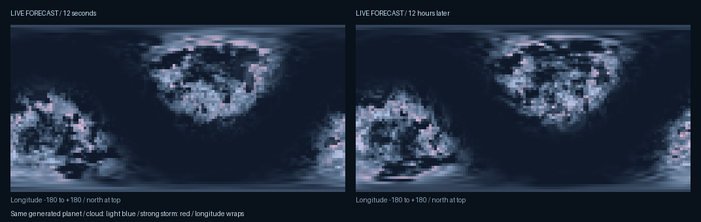

# Planetary weather — Infinite 0.34

Live weather now has latitude-driven circulation, wind-advected fronts, evolving cyclones with spiral rain bands and clearer eyes, moist convection, cold precipitation and wind-driven dust. The existing planet radius, rotation, gravity, temperature, pressure, volatile inventory and inherited seed constrain those processes. This is a deterministic weather model with physically motivated rules, rather than a fluid or chemistry solver.

The verified 0.33 baseline is `4a8448c`, retained at `checkpoint/infinite-0.33-before-weather-upgrade`. Universe addresses, object seeds, terrain, orbital structures, histories, cities and ship dynamics are preserved. Climate and settlement planning remain recipe 1. The old weather function is retained unchanged as `samplePlanningClimate` for city siting and districts; only live weather uses recipe 2. [Preservation evidence](weather-0.34/preservation.json).

## What is visible

- Clouds form lower, moisture-dependent banks with storm-dependent depth, making them approachable from the surface. The same live forecast supplies orbital clouds and local precipitation.
- Rain uses wind-slanted, camera-facing ribbons. Snow and dust use soft flakes with deterministic motion. Particles remain attached to physical world cells across camera movement and render-unit changes.
- Active precipitation adds depth-clipped, height-dependent visibility loss. Rain, snow and dust receive different tints; the effect stops at opaque geometry and fades with altitude. Rain also changes the existing ground material coating near the ship. Haze strength fades smoothly at shower boundaries and its tint blends across freezing.
- Warm, moist storm cells receive short, inherited-seed discharge pulses inside their cloud volume. Illumination is localized to dense storm regions.
- The existing cockpit weather card shows state, temperature, pressure, mean wind, gusts and visibility in two lines within its previous bounds. Hazard colour makes strong weather easier to spot.

The visual reference remains the actual Hyperion game. `src/flight/shaders.hpp::cloudFragment` supplies its density erosion and localized discharge approach; `worldFragment` supplies its distance-haze treatment. Infinite retains its own geometry, atmosphere rays, materials, weather atlas and rendering backend. There are no invented lightning bolts, new weather geometry layers or new dependencies. Original retains its drawing path while displaying the same updated live forecast; Hyperion and Hybrid receive the enhanced optical presentation.

The weather atlas remains 128 × 64 RGBA8 with mipmaps, 43,692 bytes per field. Dust uses the previously unused alpha channel. Generation prepares circulation once per atlas on the existing bounded asynchronous cache: at most two jobs and four CPU entries. The GPU retains two fields (87,384 bytes). No new render target or temporal history is allocated. Reused particle buffers are capped at 384 particles. Clear views use the existing composite; precipitation selects the optional visibility shader.

The map samples the same planet at 12 seconds and 12 hours later. It visualizes the generated field directly; it is not an artistic sky texture. [Raw samples](weather-0.34/fields.csv).

## Matched captures

Each pair compares disabled and enabled effects within one **0.34 executable**, rather than screenshots of two generation versions. Each fixture searches actual generated solid planets and freezes their weather time and physical camera. Clouds remain enabled in the near-surface pairs, isolating the added local presentation. The orbital pair separately isolates the volume clouds.

| Actual scene | Control | Weather visible |
| --- | --- | --- |
| Surface rain | [Effects disabled](weather-0.34/rain-off.png) | [Rain and visibility](weather-0.34/rain-on.png) |
| Cold-world snowfall | [Effects disabled](weather-0.34/snow-off.png) | [Snow](weather-0.34/snow-on.png) |
| Dry-world dust | [Effects disabled](weather-0.34/dust-off.png) | [Dust](weather-0.34/dust-on.png) |
| Storm from orbit | [Discharge disabled](weather-0.34/storm-off.png) | [Localized discharge](weather-0.34/storm-on.png) |
| Cloudy planet from orbit | [Volumes disabled](weather-0.34/cloud-orbit-off.png) | [Cloud banks](weather-0.34/cloud-orbit-on.png) |

## Validation

All **65 checks pass across the complete run and targeted rerun**: 30 core checks and 35 native/image checks. The complete run passed 57; cloud, polar and inhabited-surface tours reached their previous 100-second utility limit, and the cockpit test checked stars before its asynchronous galaxy sample was ready. All eight affected checks passed after the bounded timing/readiness fixes. The twelve-check targeted rerun also revalidated live weather and its image controls. After the final haze-fade adjustment, both native weather checks passed again ([release weather run](weather-0.34/release-weather-tests.log)). [Complete run](weather-0.34/tests.log), [targeted rerun](weather-0.34/final-tests.log).

The final visibility checks find 1,198,544 changed pixels for rain, 1,282,437 for snow and 1,296,000 for dust. Orbital discharge changes 522 pixels in actual storm cells. Airless effects-enabled and disabled images are identical. Render-unit changes produce RMS differences below 1.50 code values out of 255. [Image measurements](weather-0.34/comparison.json), [camera and geometry proof](weather-0.34/native.log).

The suite also covers unchanged city sites, procedural populations, planets and moons, terrain, cloud and polar optics, ship handling and roll, landing, cockpit fitting, streaming and galaxy-to-atomic continuity.

The dedicated weather process test checks repeatability, temporal and spatial continuity, latitude circulation, tangent winds, moisture constraints, snow, dust, bounded gusts, cloud heights, altitude fade and discharge duty cycle. Native weather captures exercise rain, snow, dust, storm and airless controls, then repeat them after changing render units. They verify unchanged physical cameras, planet descriptors and submitted terrain geometry. The airless control must be pixel-identical with weather effects enabled and disabled.

Cloud validation now selects an actual water-cloud climate; its previous ultracold fixture correctly has negligible water cloud under the improved condensation rule. Pilot validation waits for the asynchronously generated addressed galaxy sample before asserting stellar visibility. Longer native capture tours use bounded time limits rather than assuming the same host load on every run.

## Performance

The clear-weather composite binary is **identical to 0.33 on all three compiled backends**; the added visibility calculations are selected only for active local precipitation. [Binary comparison](weather-0.34/clear-composite.json).

A seven-repeat CPU benchmark queried 8,192 global directions on the same generated planet, measuring median times:

| Operation | Median |
| --- | ---: |
| Retained version-1 weather queries | 12.95 ms |
| New live weather queries, circulation prepared once | 20.84 ms |
| New atlas generation, including mipmaps | 63.39 ms |
| Field storage, including mipmaps | 43,692 B |

The richer model adds 7.89 ms per 8,192-query set in this run. Atlas generation stays off the rendering thread and snapshots are eight seconds apart. This is a model-cost comparison, not a claim of improved frame rate. Other games were running on the shared host during validation, so desktop frame timings include contention. [Measurements](weather-0.34/generation.json).

On the final Metal capture run, the median frame intervals in 24 settled frames before each capture were:

| Scene | Effects disabled | Effects enabled |
| --- | ---: | ---: |
| Rain | 13.50 ms | 15.71 ms |
| Snow | 11.14 ms | 10.83 ms |
| Dust | 26.13 ms | 17.89 ms |
| Orbital storm | 16.98 ms | 18.70 ms |
| Identical airless control | 8.88 ms | 8.72 ms |

The airless images are identical, yet their frame times vary by 0.16 ms. This demonstrates host-load variation; these samples do not isolate GPU effect cost or establish a general speedup. All views retain 29,988,608 bytes of effect targets and 87,384 bytes of weather GPU fields. [Frame measurements and executable hash](weather-0.34/performance.json), [full trace](weather-0.34/frames.csv).

## Physical reference and limits

The circulation and cyclone rules are informed by [NOAA’s Coriolis explanation](https://www.nesdis.noaa.gov/about/k-12-education/atmosphere/what-the-coriolis-effect), [NOAA’s cyclone structure reference](https://www.noaa.gov/jetstream/tropical/tropical-cyclone-introduction/tropical-cyclone-structure), and [NWS storm ingredients](https://www.weather.gov/safety/lightning-thunderstorm-development). The particular equations and thresholds are game-model approximations. A coarse global atlas and four prepared cyclones provide bounded cost; this does not simulate resolved atmospheric fluid motion, persistent surface water or weather on gas giants. Metal is runtime-tested; GLSL and SPIR-V require runtime testing on their platforms.

The signed macOS app is packaged as **0.34.0, build 34**. Its executable code and data sections match the tested build; code-signature metadata differs as expected. [Package verification](weather-0.34/package.json).
